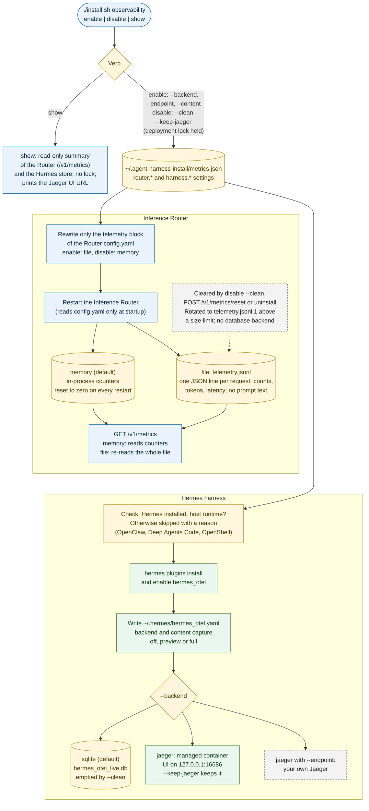

<!--
  Copyright (C) 2026 Intel Corporation
  SPDX-License-Identifier: Apache-2.0
-->

# Agent Harness Installer

An installer that deploys an agent harness onto Intel hardware and wires it
to a local, OpenAI-compatible inference endpoint.

The installer deploys one of three open-source agent projects, each
published independently:

| Agent | Verified package |
| --- | --- |
| `openclaw` | npm `openclaw` — github.com/openclaw/openclaw |
| `deepagents-code` | `dcode` (Deep Agents Code) — github.com/langchain-ai/deepagents |
| `hermes` | Nous Research's official installer — github.com/NousResearch/hermes-agent (pinned installer script from the repo, not npm) |

The inference backend is **configurable**, but every request goes through the
**Inference Router** (IR): agents are wired to the Router's endpoint, never
directly to a model server. By default the Router sits in front of a local
**OpenVINO Model Server** (OVMS) serving an OpenAI-compatible
`/v3/chat/completions` endpoint on Intel Core Ultra iGPU and Arc (CRI)
GPUs; the Router itself is the published `intel/inference-router` image.
Setting `HARNESS_LLM_ROUTER_ENDPOINT` instead points the Router at any
existing OpenAI-compatible endpoint you already operate (e.g., Ollama, vLLM,
an internal gateway), with `HARNESS_LLM_ROUTER_API_KEY` as an optional bearer
token. OVMS is not started in that case, and this installer never starts,
stops, or health-checks that endpoint (`status` reports it as "routed
externally"). Host mode has no fresh-install default model: name it with
`--model` or the model environment variables. The installer can reuse a
previously exported model; otherwise it prompts on a terminal and fails
non-interactively without a selection.

## Agentic AI Security

Explore [Agentic AI Security](./docs/user-guide/agentic-ai-security.md) for security
controls for agent deployments, starting with
[Agent Sandboxing using OpenShell](./docs/user-guide/agentic-ai-security/agent-sandboxing.md).

The `--runtime` option is **optional**. Interactive installation offers a choice
of `host` or `openshell`; pressing Enter selects `host`. Non-interactive
installation also defaults to host mode unless a runtime is explicitly selected
with `--runtime` or `HARNESS_RUNTIME`.

Select `--runtime openshell` to deploy OpenClaw, Hermes or Deep Agents Code in
a sandbox. The installer supplies default sandbox policies and agent/provider
configuration as a functional starting point. Fresh managed OpenShell deployments
default to `OpenVINO/Qwen3.5-9B-int8-ov` when no explicit or reusable model
selection exists, with model-tuning defaults for OpenClaw and Hermes. These
sandbox defaults do not change host-mode model selection. See the
[sandbox setup and policy boundaries](./docs/user-guide/agentic-ai-security/agent-sandboxing.md#getting-started)
for prerequisites and limitations.

## Observability

`./install.sh observability enable|disable|show` manages telemetry for the
Inference Router and Hermes harness. `enable` takes the collection and storage
options (`--backend`, `--endpoint`, `--content`); `disable` can delete collected
data (`--clean`) or keep the managed Jaeger (`--keep-jaeger`); `show` prints a
CLI summary, with Jaeger providing the full trace view. The Router persists
request counters and latencies to a JSONL file and serves them on `/v1/metrics`.
Hermes records per-turn traces through the `hermes-otel` plugin in a local
SQLite store and optionally exports them to a managed or external Jaeger.
Harness telemetry is Hermes-only and unavailable in OpenShell sandboxes.
Settings are kept in `~/.agent-harness-install/metrics.json`, so Router config
regeneration preserves them. See [Observability](./docs/user-guide/get-started.md#observability)
for details.



## Documentation

- [Get Started](./docs/user-guide/get-started.md): install flow, usage and
  [model sources](./docs/user-guide/get-started.md#model-sources) (Hugging Face,
  Ollama, remote URL and the other Model Download hubs).
- [Run Without a Checkout](./docs/user-guide/get-started/run-without-a-checkout.md):
  the standalone `curl | bash` bootstrap path.
- [Uninstall](./docs/user-guide/get-started/uninstall.md).
- [Known Limitations](./docs/user-guide/known-limitations.md).

## Layout

```text
startup.sh                    prerequisite setup: installs/verifies curl/git, Docker, Node.js/npm, Python -- run automatically by install.sh, or standalone
install.sh                   thin bootstrap (delegates to scripts/install.sh, or self-clones)
uninstall.sh                  removes the Inference Router, OVMS, the installed agent, and state dir (models too, unless --keep-models)
scripts/install.sh            payload: install flow + status/onboard/models/mcp/skill subcommands
scripts/lib/colors.sh         logging/spinner helpers
scripts/lib/state.sh          state dir, symlink-safe path assertions, atomic writes
scripts/lib/sudo.sh           non-interactive-safe sudo authorization
scripts/lib/verify.sh         HTTPS-only, checksum-verified downloads of third-party scripts
scripts/lib/shim.sh           CLI shim + PATH profile management
scripts/lib/gpu-intel.sh      Intel GPU + compute-runtime readiness detection (no install)
scripts/lib/docker-setup.sh   Docker install/group setup, Docker daemon proxy config + GPU device args
scripts/lib/nodejs.sh         Node.js-via-nvm bootstrap
scripts/lib/python-setup.sh   Python (venv + PyYAML) bootstrap
scripts/lib/openvino.sh       OpenVINO Model Server (OpenAI-compatible inference)
scripts/lib/inference-router.sh  Inference Router (always run in front of OVMS or an external endpoint; agents are wired to it, not to the model server directly)
scripts/lib/agents.sh         Agent Harness Installer's agent catalog: openclaw / deepagents-code (dcode) / hermes
scripts/lib/harness-mcp.sh    registers an arbitrary MCP endpoint URL with an agent (Hermes and OpenClaw built in; others via HARNESS_MCP_REGISTER_CMD)
scripts/lib/metrics.sh       observability commands for Router and Hermes telemetry
docs/user-guide/              usage documentation (see Documentation above)
test/metrics-test.sh          observability behavior tests (Docker/Hermes stubbed)
test/metrics-cli-test.sh      observability CLI entry-point tests
test/smoke-test.sh            end-to-end smoke test suite (phased; see --list)
test/full-flow-test.sh        full install -> real chat completion -> uninstall run, per agent
```

## Design notes

This installer is deliberately lightweight and single-purpose: a
bootstrap/payload split, nvm-based Node.js bootstrapping, and a real,
verified agent catalog (openclaw, hermes, dcode), built specifically for
Intel Core Ultra iGPU / Arc (CRI) hardware (CPU fallback otherwise). No
fixed appliance concept, no CDI (Intel render nodes pass through directly
via `--device`). Downloaded third-party scripts are fetched over HTTPS only and
verified against a SHA-256 (`scripts/lib/verify.sh`). The Hermes and dcode
installers are fetched from pinned upstream commits with built-in digests;
where the vendor publishes none (Docker's convenience script) the installer
refuses to run the download unless you pin a digest or explicitly opt out.
Source builds (the Inference Router, opt-in) and the Model Download script are pinned
to full commit SHAs. The standalone-fetch
bootstrap requires an explicit `HARNESS_INSTALL_REF` (a tag or commit) —
see [Running Without a Checkout](./docs/user-guide/get-started/run-without-a-checkout.md).
Uninstall is a plain bash script.

## Extending

- `scripts/lib/gpu-intel.sh` only detects GPU/compute-runtime readiness; it
  assumes drivers are already provisioned (e.g., via Edge Pack:
  github.com/open-edge-platform/edge-pack) rather than installing them.
