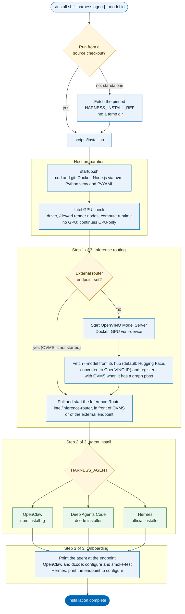
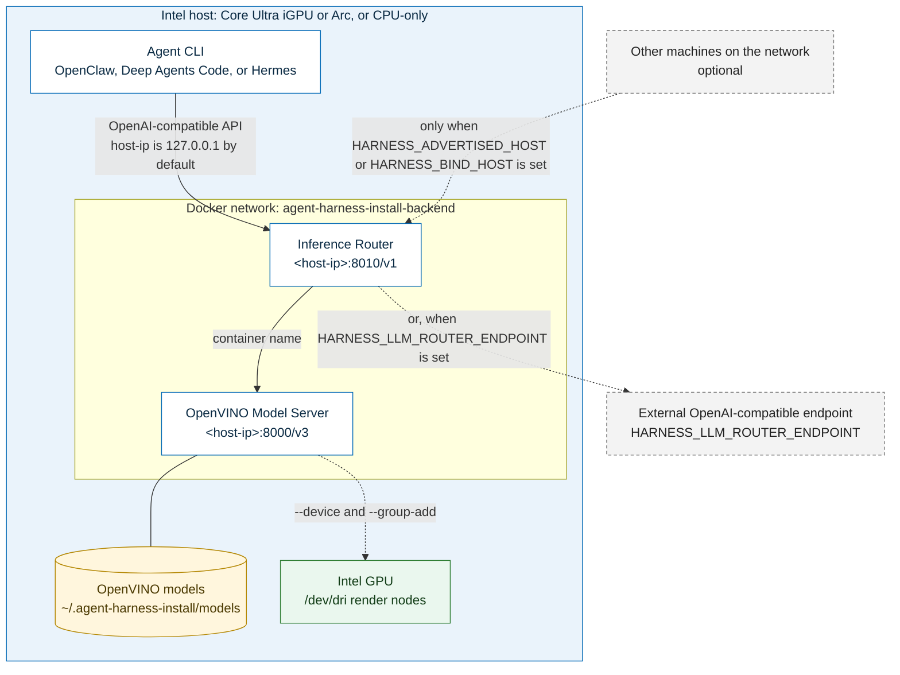

<!--
  Copyright (C) 2026 Intel Corporation
  SPDX-License-Identifier: Apache-2.0
-->

# agent-harness-install

An installer that deploys an agent harness onto Intel hardware and wires it
to a local, OpenAI-compatible inference endpoint.

The installer deploys one of three open-source agent projects, each
published independently:

| Agent | Verified package |
|---|---|
| `openclaw` | npm `openclaw` — github.com/openclaw/openclaw |
| `deepagents-code` | `dcode` (Deep Agents Code) — github.com/langchain-ai/deepagents |
| `hermes` | Nous Research's official installer — github.com/NousResearch/hermes-agent (pinned installer script from the repo, not npm) |

The inference backend is **configurable**, but every request goes through the
**Inference Router** (IR): agents are wired to the Router's endpoint, never
directly to a model server. By default the Router sits in front of a local
**OpenVINO Model Server** (OVMS) serving an OpenAI-compatible
`/v3/chat/completions` endpoint on Intel Core Ultra iGPU and Arc (CRI)
GPUs; the Router itself is the published `intel/inference-router` image.
Setting `HARNESS_LLM_ROUTER_ENDPOINT` instead points the Router at any
existing OpenAI-compatible endpoint you already operate (e.g. Ollama, vLLM,
an internal gateway), with `HARNESS_LLM_ROUTER_API_KEY` as an optional bearer
token. OVMS is not started in that case, and this installer never starts,
stops, or health-checks that endpoint (`status` reports it as "routed
externally"). A model must always be named with `--model` (the installer
prompts for it on a terminal and fails otherwise).

## OpenShell runtime (experimental)

OpenClaw and Hermes can run in separate OpenShell sandboxes instead of being
installed on the host. Host mode remains the default. OpenShell mode currently
targets Linux, Docker and OpenShell **0.1.5**; a different installed OpenShell
version is rejected rather than upgraded or downgraded automatically.

First provision shared inference without installing a host agent:

```bash
./install.sh inference --model <model-id> --non-interactive
```

If IR already serves the required model, skip that step. Installing a sandbox
does not change the shared IR configuration or switch its models:

```bash
./install.sh --runtime openshell --harness openclaw --model <model-id> --non-interactive
./install.sh --runtime openshell --harness hermes --model <model-id> --non-interactive
./install.sh status --runtime openshell --harness openclaw
./install.sh connect --runtime openshell --harness openclaw
./install.sh connect --runtime openshell --harness hermes
```

Profiles are independent under `~/.agent-harness-install/openshell/<agent>/`.
Existing host agent configuration is not imported or modified. The sandbox
agent accesses `http://host.openshell.internal:8010/v1` through a dedicated
provider profile. IR and OVMS remain published on host loopback, and IR reaches
OVMS over its private backend network. External inference is configured on the
shared IR with `HARNESS_LLM_ROUTER_ENDPOINT`, not directly in the sandbox.

The OpenShell gateway owns sandbox lifecycle and policy delivery. The OpenClaw
gateway runs **inside** its sandbox, binds to sandbox loopback and uses a
generated authentication token. Hermes runs as an interactive CLI; messaging
integrations are not enabled. `connect` uses OpenShell's authenticated execution
path and does not publish an agent UI on the LAN.

`HARNESS_OPENSHELL_GATEWAY` selects the gateway when creating a new profile
(default: `openshell`); lifecycle commands use the recorded gateway. On a fresh
machine the checksum-pinned upstream installer provisions the CLI and local
gateway. Existing gateways must already be configured and authenticated.

Sandbox images install the same pinned agent packages/installers as host mode,
run as a non-root user and do not mount host agent homes, model directories or
the Docker socket. Runtime egress is limited to the attached inference provider;
MCP, package downloads, messaging, and other egress need explicit additional
policy. Landlock uses OpenShell's `best_effort` compatibility setting; this is
not a claim that every host supports the same filesystem isolation guarantees.

To remove only the selected sandbox:

```bash
./uninstall.sh --runtime openshell --harness openclaw --yes
```

Back up sandbox data first. OpenShell's sandbox deletion semantics apply to its
home/workspace. Shared inference, host agents and the OpenShell CLI/gateway are
not removed. Completed ownership records are retained as `removed-profile.json` for audit.
Host uninstall refuses to remove shared state while active OpenShell profiles exist.

Onboarding checks inference connectivity, **not** agentic correctness. Tool-use
acceptance requires independently verifying generated files/content. The
0.5B quickstart model is not a validated multi-step tool-use baseline.

Offline regression tests: `bash test/openshell-test.sh`. Agent-image build and
real sandbox tests require Docker, the pinned gateway and a running shared IR.
See [OpenShell quality gates](test/README.md) for automated test cases, TAP
reports, opt-in lifecycle tests and CI runner setup.

## How it works

### Install flow

`./install.sh` is the only command you run. It prepares the host, brings up
the inference backend, installs the chosen agent, and wires the two together.



Third-party downloads (the Hermes and dcode installers, Docker's convenience
script) are fetched over HTTPS and verified against a SHA-256 before they run.
The Hermes and dcode installers come from pinned upstream commits with their
digests built in, so no flags are needed; the Docker convenience script still
needs a digest or an explicit opt-out.

### Runtime architecture

Once installed, the agent talks to a single OpenAI-compatible endpoint. The
Inference Router sits in front of OVMS (or of an external endpoint), and the
local containers run on a dedicated Docker network. Published ports bind to
127.0.0.1 by default; set `HARNESS_ADVERTISED_HOST` (a specific address) or
`HARNESS_BIND_HOST=0.0.0.0` (all interfaces) to reach them from other machines.
Neither service authenticates inbound requests, and Docker-published ports
bypass `ufw`, so restrict access with the `DOCKER-USER` iptables chain or bind
to a specific interface address.



## Documentation

- [Get Started](docs/user-guide/get-started.md): install flow, usage and
  [model sources](docs/user-guide/get-started.md#model-sources) (Hugging Face,
  Ollama, remote URL and the other Model Download hubs).
- [Running Without a Checkout](docs/user-guide/running-without-a-checkout.md):
  the standalone `curl | bash` bootstrap path.
- [Uninstall](docs/user-guide/uninstall.md).
- [Known Limitations](docs/user-guide/known-limitations.md).

## Layout

```
startup.sh                    prerequisite setup: installs/verifies curl/git, Docker, Node.js/npm, Python -- run automatically by install.sh, or standalone
install.sh                   thin bootstrap (delegates to scripts/install.sh, or self-clones)
uninstall.sh                  removes the Inference Router, OVMS, the installed agent, and state dir
scripts/install.sh            payload: install flow + status/onboard/models/mcp/skill subcommands
scripts/lib/colors.sh         logging/spinner helpers
scripts/lib/state.sh          state dir, symlink-safe path assertions, atomic writes
scripts/lib/sudo.sh           non-interactive-safe sudo authorization
scripts/lib/verify.sh         HTTPS-only, checksum-verified downloads of third-party scripts
scripts/lib/shim.sh           CLI shim + PATH profile management
scripts/lib/gpu-intel.sh      Intel GPU + compute-runtime readiness detection (no install)
scripts/lib/docker-setup.sh   Docker install/group setup, Docker daemon proxy config + GPU device args
scripts/lib/nodejs.sh         Node.js-via-nvm bootstrap
scripts/lib/python-setup.sh   Python (venv + PyYAML) bootstrap
scripts/lib/openvino.sh       OpenVINO Model Server (OpenAI-compatible inference)
scripts/lib/inference-router.sh  Inference Router (always run in front of OVMS or an external endpoint; agents are wired to it, not to the model server directly)
scripts/lib/agents.sh         agent-harness-install's agent catalog: openclaw / deepagents-code (dcode) / hermes
scripts/lib/harness-mcp.sh    registers an arbitrary MCP endpoint URL with an agent (Hermes and OpenClaw built in; others via HARNESS_MCP_REGISTER_CMD)
docs/user-guide/              usage documentation (see Documentation above)
test/smoke-test.sh            end-to-end smoke test suite (phased; see --list)
test/full-flow-test.sh        full install -> real chat completion -> uninstall run, per agent
```

## Design notes

This installer is deliberately lightweight and single-purpose: a
bootstrap/payload split, nvm-based Node.js bootstrapping, and a real,
verified agent catalog (openclaw, hermes, dcode), built specifically for
Intel Core Ultra iGPU / Arc (CRI) hardware (CPU fallback otherwise). No
fixed appliance concept, no CDI (Intel render nodes pass through directly
via `--device`). Downloaded third-party scripts are fetched over HTTPS only and
verified against a SHA-256 (`scripts/lib/verify.sh`). The Hermes and dcode
installers are fetched from pinned upstream commits with built-in digests;
where the vendor publishes none (Docker's convenience script) the installer
refuses to run the download unless you pin a digest or explicitly opt out.
Source builds (the Inference Router, opt-in) and the Model Download script are pinned
to full commit SHAs. The standalone-fetch
bootstrap requires an explicit `HARNESS_INSTALL_REF` (a tag or commit) —
see [Running Without a Checkout](docs/user-guide/running-without-a-checkout.md).
Uninstall is a plain bash script.

## Extending

- `scripts/lib/gpu-intel.sh` only detects GPU/compute-runtime readiness; it
  assumes drivers are already provisioned (e.g. via Edge Pack:
  github.com/open-edge-platform/edge-pack) rather than installing them.
