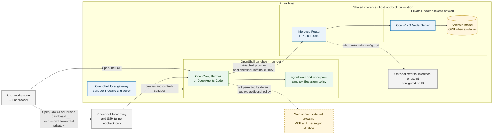

<!--
  Copyright (C) 2026 Intel Corporation
  SPDX-License-Identifier: Apache-2.0
-->

# Agent Sandboxing

## Introduction

Sandboxing separates an agent's tool execution from the host environment and
limits the files and network endpoints available to it. Agent Harness Install
provides this capability through OpenShell for OpenClaw, Hermes and Deep Agents
Code. This integration targets OpenShell 0.1.5 on Linux with Docker; host mode remains
the default.

The `--runtime` option is not mandatory. Interactive installation offers
`host` or `openshell`, with Enter selecting `host`. Non-interactive installation
uses host mode unless `--runtime openshell` or `HARNESS_RUNTIME=openshell` is
set. The commands below select OpenShell explicitly for reproducible setup.

This is one layer of [Agentic AI Security](README.md), not prompt protection or
PII masking. A sandbox can still perform unwanted actions within its permitted
workspace and allowed services. Review tool effects, protect credentials and
grant only the access needed for a task.

## Architecture and security boundaries



Each agent has an independently owned profile under
`~/.agent-harness-install/openshell/<agent>/`. All installed sandboxes use shared
inference.
Existing host agent configuration is not imported or modified during sandbox
installation. External inference is configured on shared IR using
`HARNESS_LLM_ROUTER_ENDPOINT`, not directly in the sandbox; in that case IR
routes to the external backend instead of managed OVMS.

Host mode already publishes IR/OVMS on loopback by default and connects them
through a private Docker backend network. OpenShell reuses that architecture
and additionally enforces loopback-only publication, validating actual service
bindings and the managed backend network before attaching a sandbox. Host-mode
LAN-publication options remain available; they are not supported in OpenShell
mode.

Sandbox images install the same pinned agent packages/installers as host mode,
run as a non-root user and do not mount host agent homes, model directories or
the Docker socket. Runtime egress is limited to the attached inference provider.
Web search, external browsing, MCP, package downloads, updates and messaging
need explicit additional policy and any required tool dependencies/credentials.
Working LLM inference does not establish external web-tool connectivity.
The host `mcp`/`skill` helpers reject OpenShell mode rather than modifying the
wrong agent.

OpenShell applies Landlock with `best_effort` compatibility; enforcement may
vary with the host kernel. Desktop/computer-use workflows are not enabled.

## Prerequisites

- Linux with Docker and sufficient memory/disk for the chosen model and images.
- OpenShell **0.1.5**. A different installed version is rejected rather than
  upgraded or downgraded automatically.
- Automatic OpenShell CLI/gateway provisioning requires Debian/Ubuntu and a
  working systemd user service. On other Linux distributions, install and
  configure OpenShell 0.1.5 manually before running the installer.
- Host Node.js is required for installer configuration/profile handling.
  The installer runs its normal host prerequisite setup.
- Network access for initial package/image/model downloads, or suitable caches.
  Runtime sandbox egress restrictions do not describe the image-build environment.

`HARNESS_OPENSHELL_GATEWAY` selects the gateway when creating a new profile
(default: `openshell`); lifecycle commands use the recorded gateway. On a fresh
machine the checksum-pinned upstream installer provisions the CLI and local
gateway. Existing gateways must already be configured and authenticated.

See [Get Started](../user-guide/get-started.md) for general installer
prerequisites. Run the commands below from the Agent Harness Install component
directory.

## Getting started

### Default sandbox setup

The installer supplies sandbox policies, inference-provider configuration and
agent-specific model configuration as a functional starting point. No initial
policy authoring is required, but the prerequisites above still apply.

- **Filesystem policy:** OpenClaw uses the [base agent policy](../../openshell/policy.yaml).
  Hermes and Deep Agents Code use the [interactive policy](../../openshell/interactive-policy.yaml),
  which also permits sandbox-local pseudo-terminal devices for their terminal
  interfaces. The policies allow writes to the sandbox home, `/sandbox`, `/tmp`
  and `/dev/null`; they do not mount the host home or Docker socket.
- **Inference access:** A separate attached provider policy permits access to
  the shared Inference Router. This is not general internet access: web search,
  external browsing, MCP and messaging require additional policy, dependencies
  and credentials as appropriate.
- **Model and configuration:** Fresh managed OpenShell deployments default to
  `OpenVINO/Qwen3.5-9B-int8-ov` with the default `openvino` model hub only when
  no explicit or reusable selection exists. Saved selections and explicit model,
  hub and exporter choices take precedence. OpenClaw and Hermes receive the supported
  [Qwen tuning defaults](#qwen-local-model-defaults); Deep Agents Code receives
  provider/model configuration, not those same tuning settings.

These defaults apply to sandbox deployments. Host-mode model selection is
unchanged, and an external inference backend does not receive the fresh managed
model fallback. Default policies remain subject to the security limitations
described above; a working inference connection is not a guarantee of tool-use
correctness.

### Install a sandboxed agent

On a fresh host, one command provisions installer-owned OVMS and IR, downloads
**OpenVINO/Qwen3.5-9B-int8-ov**, and installs OpenClaw in its sandbox:

```bash
./install.sh --runtime openshell --harness openclaw --non-interactive
```

For Hermes, use:

```bash
./install.sh --runtime openshell --harness hermes --non-interactive
```

For Deep Agents Code, use:

```bash
./install.sh --runtime openshell --harness deepagents-code --non-interactive
```

Run one command to install one agent, or multiple commands to create separate sandboxes
against the same shared model. The default is the **9B** model in the Qwen3.5
family, not a 3.5B model. Explicit `--model`, exporter and hub choices remain
supported; host-mode model selection is unchanged.

The default model's preconverted OpenVINO weights are downloaded using the
existing `hf-snapshot` exporter. Its repository has no OVMS graph, so the pinned
serving image generates `graph.pbtxt` using `--configure --task text_generation`
before registration. Once the serving image is available, this metadata-only
container step needs no network/GPU access and does not reconvert weights.
No external OVMS container or local model-directory import is used.

With managed local inference, IR/OVMS are validated for the exact model,
readiness, private network and loopback publication. With an external backend,
the local IR's loopback publication and advertised model are checked instead;
the installer does not manage that external backend.
An installed sandbox's OpenShell workspace is recorded with its ownership
profile and reused for later lifecycle and cleanup commands. Set
`OPENSHELL_WORKSPACE` before the first install to select a non-default
workspace. The Inference Router port is also recorded by the sandbox provider;
changing `HARNESS_IR_PORT` for an existing sandbox is rejected rather than
leaving its network policy pointed at a stale endpoint; a port change requires
a complete OpenShell teardown and reinstall.

To prepare or explicitly reconfigure shared inference separately:

```bash
./install.sh inference --runtime openshell --non-interactive
# Or choose another model explicitly:
./install.sh inference --runtime openshell --model <model-id> --non-interactive
```

Separate inference provisioning is optional, not a prerequisite for a fresh
managed sandbox install.

### Inspect and connect

```bash
./install.sh status --runtime openshell --harness openclaw
./install.sh connect --runtime openshell --harness openclaw
```

For Hermes:

```bash
./install.sh status --runtime openshell --harness hermes
./install.sh connect --runtime openshell --harness hermes
```

For Deep Agents Code:

```bash
./install.sh status --runtime openshell --harness deepagents-code
./install.sh connect --runtime openshell --harness deepagents-code
```

The OpenShell gateway owns sandbox lifecycle and policy delivery. The OpenClaw
gateway runs **inside** its sandbox, binds to sandbox loopback and uses a
generated authentication token. Hermes and Deep Agents Code run as interactive
terminal chat interfaces; messaging integrations are not enabled. Dcode's
interactive interface is a terminal UI, not a hosted browser UI. From a local
machine, open an SSH session with a PTY (for example, `ssh -t user@<host>`),
then run the Dcode `connect` command above. It forces a PTY for the sandbox
session so the chat interface can receive input and render interactively. Deep
Agents Code is configured with the shared OpenAI-compatible inference endpoint
and the selected local model as its default, so no model selection is needed.
The connector skips Dcode's first-run setup; Tavily web search remains
unconfigured unless the user supplies an API key later. `connect` supplies the non-secret
`HARNESS_DCODE_API_KEY=not-needed` placeholder only to the Dcode process; it is
not stored in the sandbox environment. `connect` uses OpenShell's authenticated
execution path and does not publish an agent UI on the LAN.
The connector disables Dcode's optional Wasmtime-backed JavaScript
interpreter, avoiding a nested execution runtime; the OpenShell sandbox remains
the execution boundary for agent work.

### Browser access

Agent UIs must remain private: use OpenShell forwarding bound to host loopback
and an SSH tunnel to your laptop rather than LAN publication.

Hermes browser chat is available on demand through its built-in dashboard:
run `hermes dashboard --host 127.0.0.1 --port 9119 --skip-build --no-open`
inside the owned sandbox using `openshell sandbox exec`. Forward sandbox port
9119 with `openshell forward service`, then SSH-tunnel the host loopback port
to your laptop. The dashboard is not started by the installer and stops with
its process/sandbox; keep its launcher running during testing. No messaging
gateway is required for browser chat. Do not expose the loopback-only dashboard
on a LAN without configuring Hermes authentication.
This browser UI is separate from external web-search/browser tools: those tools
still need explicit egress policy and any required service configuration.

For example, read the sandbox `name` and `gateway` from
`~/.agent-harness-install/openshell/hermes/profile.json`. Substitute them below.
Run the dashboard on the installation host in one terminal:

```bash
openshell sandbox exec --name <sandbox-name> --no-tty --no-login-shell \
  -g <gateway-name> -- /home/node/.local/bin/hermes dashboard \
  --host 127.0.0.1 --port 9119 --skip-build --no-open
```

In a second terminal on that host, keep the forward running:

```bash
openshell forward service <sandbox-name> --target-port 9119 \
  --local 127.0.0.1:19119 -g <gateway-name>
```

On your laptop, substitute your SSH account/host and add your SSH identity
option if needed:

```text
ssh -N -T -o ExitOnForwardFailure=yes -o ServerAliveInterval=30 -o ServerAliveCountMax=3 -L 127.0.0.1:19119:127.0.0.1:19119 <user>@<installation-host>
```

Open `http://127.0.0.1:19119/chat?profile=default` on the laptop. The example
uses loopback/tunnel access and does not require an OpenClaw token. A Hermes
"Gateway Status: Off" indication refers to its messaging gateway, not a failed
browser dashboard. Stop all three commands when finished.

Hermes and Deep Agents Code use [an interactive policy](../../openshell/interactive-policy.yaml)
matching the [base agent policy](../../openshell/policy.yaml) except for writable
`/dev/ptmx` and `/dev/pts`. These sandbox-local pseudo-terminal devices are
needed by their terminal interfaces; OpenClaw's policy is unchanged. This does
not grant host filesystem, Docker socket or additional network access. Existing
sandboxes must be recreated with the new policy after backing up needed data.

## Model lifecycle and repeated installs

Repeated installs without `--model` reuse the saved shared model and preserve
sandbox data. The full source ID, hub, exporter, revision and conversion options
are saved in `~/.agent-harness-install/openshell-model-source.json`; the served ID
is also recorded in `openshell-model`. Older installations fall back to their
shared selection, agent profile or OVMS registry before the fresh-install default.

An explicit new `--model` checks the normal exporter cache, downloads/converts
when needed, reconfigures OVMS/IR, and synchronizes all installed sandbox agents.
Changing shared inference can interrupt active turns: finish those turns first.
The installer preserves sandbox identities, gateway tokens, history and workspace.
It writes a durable selection inside each sandbox, restarts it without deletion,
and updates its host profile only after the restart/model check succeeds.
The durable selection takes precedence over the original sandbox creation
environment, so OpenClaw and Hermes keep the new model on later stop/start.

An interrupted switch leaves `openshell-model-pending.json`; rerun the install
without `--model` to resume that exact target before requesting another model.
This is recoverable sequencing, not an atomic all-service transaction: a failed
switch may temporarily leave inference or an agent unavailable. Old downloaded
models remain cached until full uninstall.
Only the selected model remains registered for serving in managed OpenShell
mode, avoiding simultaneous loading of previous large models into GPU memory.
A no-model rerun does not silently replace an existing route; incomplete
deployments require an explicit model selection to repair.

Existing images predating restart-safe startup fail preflight before inference
is modified. They require a separately planned image migration after backing
up needed data; the installer does not automate image upgrades, agent replacement
or backup/restore and never deletes/recreates a legacy sandbox to change its model.

### Qwen local-model defaults

New OpenShell images generate a responsiveness-oriented baseline for the exact
served model `Qwen3.5-9B-int8-ov`:

| Setting | OpenClaw | Hermes |
|---|---|---|
| Context budget | `contextWindow: 65536` | `model.context_length: 65536` |
| Reply cap | Catalog and model params `maxTokens: 512` | Custom-provider `extra_body.max_tokens: 512` |
| Sampling | Model params `temperature: 0.2` | Custom-provider `extra_body.temperature: 0.2` |
| Thinking | `thinkingDefault: off` and `chat_template_kwargs.enable_thinking: false` | Model reasoning override `none` and custom-provider `chat_template_kwargs.enable_thinking: false` |
| Prompt/tool size | `localModelLean: true`, bootstrap limits 4000/12000 characters, `tools.profile: coding` | No unsupported OpenClaw prompt/tool settings are copied |

These are operational budgets, not model maximum capabilities or latency
guarantees. The 512-token cap can truncate long answers or tool calls; increase
the model-specific request cap (and OpenClaw catalog cap) when needed. Existing
explicit settings, including catalog values in older configurations, take
precedence; absent keys receive defaults. Startup preserves gateway tokens,
history and workspace data. Hermes uses its bundled Python/YAML runtime and a
dedicated `custom:harness-ovms-qwen` provider through the same IR endpoint.

The sandbox's `.harness-local-defaults.json` tracks only installer-added values.
Restarts preserve user edits. Switching models removes unchanged installer-added
Qwen values before configuring the next model; user overrides remain. Other
models keep existing settings, or the previous generic OpenClaw catalog defaults
(32768 context / 4096 output) when none exist. Host mode is unchanged. Existing
images need rebuilding/migration to include this startup behavior; this is not
a live deployment migration or a chat acceptance gate.

## Validation and troubleshooting

Onboarding checks inference connectivity, **not** agentic correctness. A Ready
sandbox or successful chat smoke test does not validate multi-step tool use.
Tool-use acceptance requires independently verifying generated files/content.
The 0.5B quickstart model is not a validated multi-step tool-use baseline.

| Symptom | Check |
|---|---|
| LLM responds but web search or browsing fails | External tools need explicit egress policy and service configuration; IR only supplies inference routing |
| Hermes dashboard opens but its terminal cannot allocate a PTY | Use the Hermes-specific policy; older sandboxes need backed-up recreation |
| OpenClaw SQLite temporary-storage errors | Current startup exports a private mode-700 `SQLITE_TMPDIR` before any Node process; older images need the updated startup |
| Installation reports a pending model transition | Rerun without `--model` to resume before selecting a different model |

Offline regression tests: `bash test/openshell-test.sh`. Agent-image build and
real sandbox tests require Docker, the pinned gateway and a running shared IR.
See [OpenShell quality gates](../../test/README.md) for automated test cases,
TAP reports, opt-in lifecycle tests and CI runner setup. PTY allocation tests
are not automated browser chat acceptance tests.

## Uninstall

Back up needed chat/workspace data before uninstalling. Full uninstall deletes
all installer-owned sandboxes, shared IR, managed OVMS, downloaded models and
installer state by default. An installer-owned OpenShell CLI/gateway is removed; a
pre-existing installation is preserved. An external inference backend is never
removed. If the same state directory records a host-installed agent, full
uninstall removes that agent too.

Use the [uninstall guide](../user-guide/uninstall.md#openshell-profiles) for
full/scoped commands, ownership safeguards, retained prerequisites and the
`--keep-models` option. Stop separately launched forwarding and SSH processes
after uninstall.

See [Known Limitations](../user-guide/known-limitations.md) for remaining
runtime, model, network and migration restrictions.
