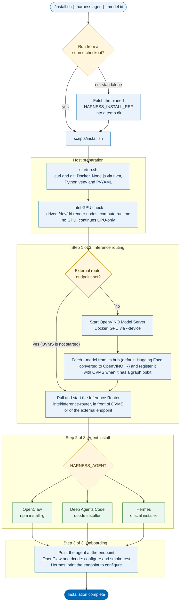
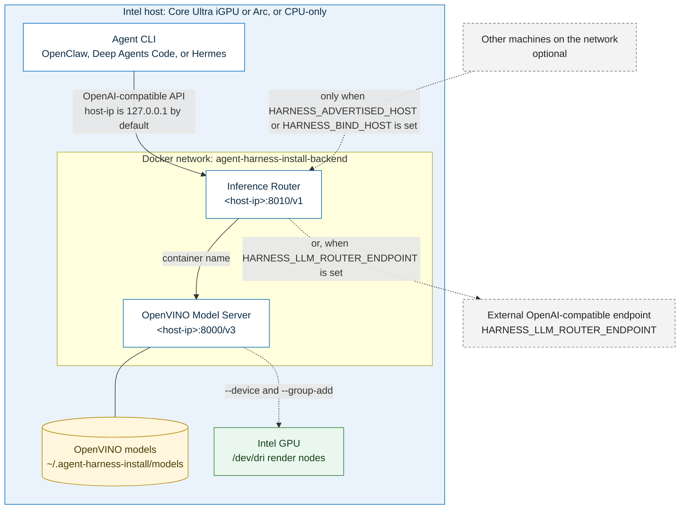
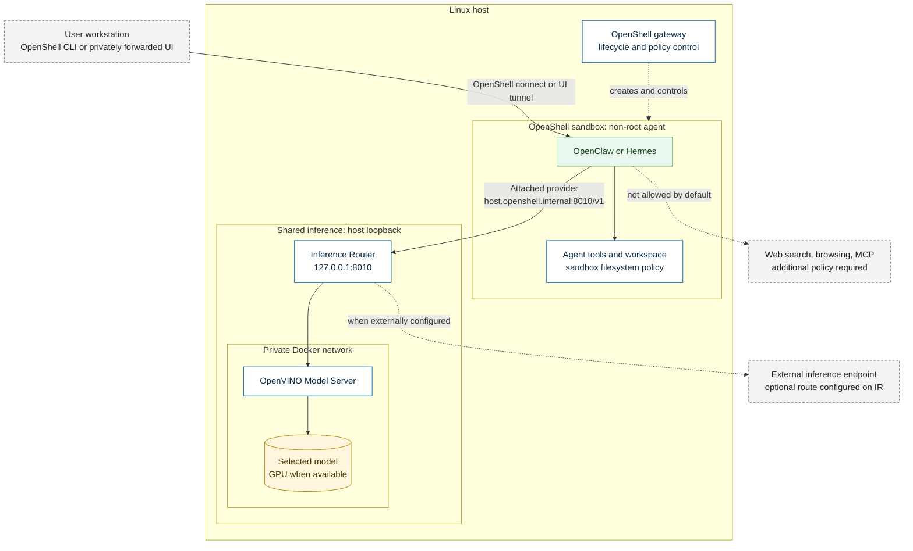

# How it works

## Host-mode install flow

`./install.sh` is the only command you run. It prepares the host, brings up
the inference backend, installs the chosen agent, and wires the two together.
The diagram below describes host mode; OpenShell's automatic model selection,
sandbox lifecycle and onboarding are covered in the
[Agent Sandboxing guide](./agentic-ai-security/agent-sandboxing.md).

Third-party downloads (the Hermes and dcode installers, Docker's convenience
script) are fetched over HTTPS and verified against a SHA-256 before they run.
The Hermes and dcode installers come from pinned upstream commits with their
digests built in, so no flags are needed; the Docker convenience script still
needs a digest or an explicit opt-out.

## Runtime architecture

Once installed, the agent talks to a single OpenAI-compatible endpoint. The
Inference Router sits in front of OVMS (or of an external endpoint), and the
local containers run on a dedicated Docker network. Published ports bind to
127.0.0.1 by default; set `HARNESS_ADVERTISED_HOST` (a specific address) or
`HARNESS_BIND_HOST=0.0.0.0` (all interfaces) to reach them from other machines.
These LAN-publication overrides apply only to host mode; OpenShell mode
reuses the existing loopback publication and private backend network, but
requires inference ports to remain bound to `127.0.0.1` and validates the
running deployment's bindings and, for managed OVMS, backend network.
The diagram below shows the host-mode agent, not an OpenShell sandbox.
Neither service authenticates inbound requests, and Docker-published ports
bypass `ufw`, so restrict access with the `DOCKER-USER` iptables chain or bind
to a specific interface address.

## OpenShell sandbox runtime

For OpenShell, the agent runs in its own non-root sandbox. The attached
inference provider grants access to IR; managed IR-to-OVMS traffic stays on a
private Docker network. Agent UI access is forwarded privately on demand.
See the [Agent Sandboxing guide](./agentic-ai-security/agent-sandboxing.md)
for setup and security details.

