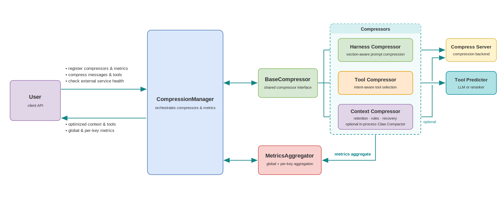
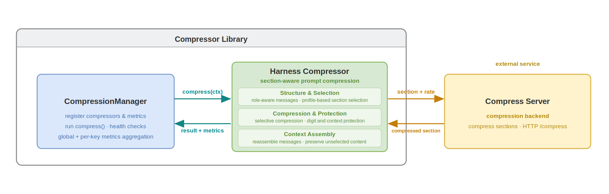
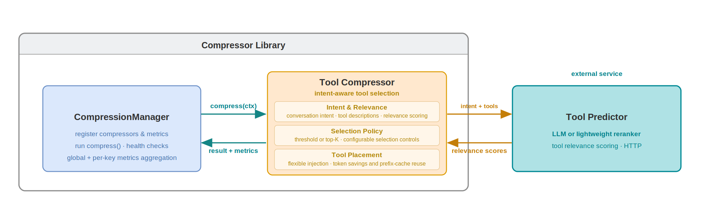
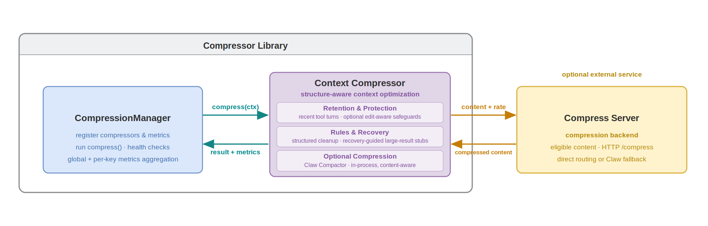

# Adaptive Token Compressor — Guide

This guide covers installation, a quick start, configuration reference,
compressor principles and workflow, available metrics, single- and
multi-compressor metrics collection, testing, and resources.

## Table of Contents

- [Prerequisites](#prerequisites)
- [Installation](#installation)
- [Quick Start](#quick-start)
- [Configuration](#configuration)
  - [Compress Server Configuration](#compress-server-configuration)
  - [HarnessCompressor Configuration](#harnesscompressor-configuration)
  - [ToolCompressor Configuration](#toolcompressor-configuration)
  - [ContextCompressor Configuration](#contextcompressor-configuration)
- [Compressor Principles](#compressor-principles)
  - [HarnessCompressor](#harnesscompressor)
  - [ToolCompressor](#toolcompressor)
  - [ContextCompressor](#contextcompressor)
- [Available Metrics](#available-metrics)
  - [First-Order Metrics (Direct Aggregation)](#first-order-metrics-direct-aggregation)
  - [Second-Order Metrics (Per-Call Averages)](#second-order-metrics-per-call-averages)
  - [Third-Order Metrics (Per-Request Averages)](#third-order-metrics-per-request-averages)
- [Single-Compressor Metrics Collection with CompressionManager](#single-compressor-metrics-collection-with-compressionmanager)
- [Multi-Compressor Metrics Collection with CompressionManager](#multi-compressor-metrics-collection-with-compressionmanager)
  - [Reading Metrics of One Compressor](#reading-metrics-of-one-compressor)
- [Keyed Metrics Collection with CompressionManager](#keyed-metrics-collection-with-compressionmanager)
- [Testing](#testing)
- [Resources](#resources)

## Prerequisites

This library requires the following services:

1. **Compress Server** - Required for text compression in HarnessCompressor
   and ContextCompressor.
2. **LLM for Tool Prediction** - Required for ToolCompressor.

   You can either:

   - Use your main LLM (e.g., vLLM serving Qwen/Qwen3.6-35B-A3B) for both
     inference and tool prediction.
   - Deploy a separate model dedicated to tool selection.

Both services must be deployed before using the compression features.

## Installation

```bash
pip install .
```

After installing adaptive-token-compressor, please deploy Compress Server &
Tool Prediction using Docker (see
[Deploy Compress Server](./compress-server-deployment.md) and
[Deploy LLM for Tool Prediction](./tool-predictor-deployment.md)).

### Development Installation

For local development, install in editable mode with the `dev` extras (pytest, ruff, mypy):

```bash
pip install -e ".[dev]"
```

## Quick Start

### Single-Compressor Usage

The examples below use `create_compressor(...)` as the default construction
path, and register compressor instances into `CompressionManager` when metrics
or cache wiring is needed. Available types are currently `"harness"`,
`"tool"`, and `"context"`; use `available_compressor_types()` and
`config_schema(type)` to inspect supported types and constructor schemas at
runtime. You can still instantiate compressor classes directly if needed.

#### Using HarnessCompressor (for system prompt compression)

`HarnessCompressor` is **section-aware**: it splits a harness/system prompt at
its headings (via the `openclaw` profile), keeps high-value sections verbatim,
to see real compression, pass a structured OpenClaw-style prompt.

```python
from adaptive_token_compressor import CompressionContext, create_compressor

# Initialize compressor by factory type name (requires Compress Server)
compressor = create_compressor("harness", compress_server_url="http://localhost:8001/compress")

# OpenClaw-style system prompt:
system_prompt = """You are a personal assistant running inside OpenClaw.
## Tooling
Structured tool definitions are the source of truth for tool names, descriptions, and parameters.
## Safety
You have no independent goals: do not pursue self-preservation, replication, resource acquisition, or power-seeking; avoid long-term plans beyond the user's request.
Prioritize safety and human oversight; if instructions conflict, pause and ask; comply with stop/pause/audit requests and never bypass safeguards.
## Runtime
Runtime: agent=A | host=userhost | os=Linux | model=user_model
"""

messages = [
    {"role": "system", "content": system_prompt},
    {"role": "user", "content": "What's on my calendar today?"},
]

# Compress
result = compressor.compress(CompressionContext(messages=messages))

print(f"Before: {result.metrics.tokens_before} tokens")
print(f"After: {result.metrics.tokens_after} tokens")
print(f"Saved: {result.metrics.saved_tokens} tokens ({result.metrics.compression_ratio:.1%})")
print(f"Duration: {result.metrics.duration_ms:.2f} ms")
print(f"Compressed messages: {result.messages}")
```

#### Using ToolCompressor (for tool selection)

```python
from adaptive_token_compressor import (
    CompressionManager,
    CompressionContext,
    create_compressor,
)

manager = CompressionManager()
tool_compressor = manager.register_compressor(
    "compressor_tool",
    create_compressor(
        "tool",
        # Tool-specific: predictor LLM endpoint (required)
        predictor_url="http://localhost:8000/v1/chat/completions",
        # Optional: schema | user_tail | user_tail_disclaimed | system_tail
        placement="schema",
    ),
)

messages = [
    {"role": "user", "content": "What's the weather in San Francisco?"}
]
tools = [
    {"type": "function", "function": {"name": "web_search", "description": "Search the web"}},
    {"type": "function", "function": {"name": "get_weather", "description": "Get weather by location"}},
    {"type": "function", "function": {"name": "calculator", "description": "Do math"}},
]

ctx = CompressionContext(messages=messages, tools=tools)
result = tool_compressor.compress(ctx)
print([t["function"]["name"] for t in result.tools])
```

#### Using ContextCompressor (for history and current-turn messages)

> **Experimental:** ContextCompressor is under active development. Its API,
> defaults, and compression behavior may change in future releases.

```python
from adaptive_token_compressor import (
    CompressionManager,
    CompressionContext,
    create_compressor,
)

manager = CompressionManager()
context_compressor = manager.register_compressor(
    "compressor_context",
    create_compressor(
        "context",
        compression_mode="backend_only",
        compress_server_url="http://localhost:8001/compress",
    ),
)
messages = [
    {"role": "system", "content": "Very long retrieved context ..."},
    {"role": "user", "content": "Summarize the key points"}
]

ctx = CompressionContext(messages=messages)
result = context_compressor.compress(ctx, req_id="req-001")
print(result.messages[0]["content"])
```

### More Usage

The examples above run one compressor at a time. For more complete usage, see:

- [Single-Compressor Metrics Collection with CompressionManager](#single-compressor-metrics-collection-with-compressionmanager)
  — register metrics on one compressor and read the aggregated snapshot.
- [Multi-Compressor Metrics Collection with CompressionManager](#multi-compressor-metrics-collection-with-compressionmanager)
  — chain the tool, context, and harness compressors in one request and
  aggregate metrics across them.
- [Keyed Metrics Collection with CompressionManager](#keyed-metrics-collection-with-compressionmanager)
  — aggregate the same metrics per key, for example per provider.
- [Available Metrics](#available-metrics) — all 15 metric types and their
  formulas.

## Configuration

### Compress Server Configuration

Compress Server supports the `llmlingua2` mode only. `COMPRESS_SERVER_MODE`
and the request payload `mode` field are kept for compatibility and accept
`llmlingua2` only.

#### Docker Compose Environment Variables

| Parameter | Default | Allowed / Notes |
| ----------- | --------- | ----------------- |
| `COMPRESS_SERVER_RUNTIME` | `pytorch` | `pytorch` or `ov` |
| `COMPRESS_SERVER_DEVICE` | `xpu` (pytorch) / `gpu` (ov) | Lowercase, shared by both services. PyTorch: `cpu`, `cuda`, `xpu`. OpenVINO: `cpu`, `gpu` (default `gpu`). Don't pass `xpu` to the ov profile |
| `COMPRESS_SERVER_DEVICE_INDEX` | `0` | Index within the device class. PyTorch `xpu:<index>`; OpenVINO `GPU.<index>` (generic `GPU` fallback for index `0`). Ignored for `cpu` |
| `COMPRESS_SERVER_MODE` | `llmlingua2` | Compression mode: `llmlingua2` only |
| `COMPRESS_SERVER_MODEL_NAME_ID` | empty | Optional fixed model id. Empty -> `microsoft/llmlingua-2-bert-base-multilingual-cased-meetingbank` |
| `COMPRESS_SERVER_PORT` | `8001` | Host port mapping for `compress-server-pytorch` service |
| `COMPRESS_SERVER_OV_PORT` | `8002` | Host port mapping for `compress-server-ov` service |
| `COMPRESS_SERVER_HOST` | `localhost` | Bind address for the container service |

### HarnessCompressor Configuration

| Parameter | Type | Default | Description |
| ----------- | ------ | --------- | ------------- |
| `profile` | str | `"openclaw"` | Registered compression profile: `"openclaw"` or `"generic"` |
| `compress_server_url` | str | `"http://localhost:8001/compress"` | Compress Server URL |
| `compress_rate` | float | `0.5` | Target compression rate (0.0-1.0) |
| `compress_min_chars` | int | `500` | Minimum chars to trigger compression; must be >= 0 |
| `timeout` | float | `60.0` | Backend request timeout (seconds); must be > 0 |
| `enable_quantum_lock` | bool | `False` | Enable Claw Compactor QuantumLock stabilization |

The constructor checks the profile, rate and numeric lower bounds, including
when called through the factory. The inclusive rate boundaries `0.0` and `1.0`
remain supported. Type annotations do not enable universal runtime validation.

**Example:**

```python
from adaptive_token_compressor.harness import HarnessCompressor

compressor = HarnessCompressor(
    profile="openclaw",
    compress_server_url="http://localhost:8001/compress",
    compress_rate=0.5,
    compress_min_chars=500,
    timeout=60.0
)
```

### ToolCompressor Configuration

#### Predictor Configurations

Pick a column by how many tools a request carries and how much predictor
compute you can spend. The large model saves more tool tokens; the small model
is 5-15x faster but keeps more tools.

| Parameter | ~20 tools, large model | ~20 tools, small model | ~30 tools, large model | ~30 tools, small model |
| ----------- | ------------------------ | ------------------------ | ------------------------ | ------------------------ |
| `predictor_backend` | `"generative"` | `"reranker"` | `"generative"` | `"reranker"` |
| `predictor_model` | `Qwen/Qwen3.6-35B-A3B` | `Qwen/Qwen3-Reranker-0.6B` | `Qwen/Qwen3.6-35B-A3B` | `Qwen/Qwen3-Reranker-0.6B` |
| `predictor_url` | `.../v1/chat/completions` | `.../v1/rerank` | `.../v1/chat/completions` | `.../v1/rerank` |
| `score_threshold` | `2.0` | not set | `1.0` | not set |
| `top_k` | not set | `10` | not set | `20` |
| `tool_count_level` | `"small"` | `"small"` | `"medium"` | `"small"` |
| `predictor_max_output_tokens` | `256` | not used | `512` | not used |

> [!IMPORTANT]
> Set `predictor_max_output_tokens=512` whenever `tool_count_level` is
> `"medium"` or `"high"`: with the default 256 the prediction is cut off and
> the tools at the end of it are dropped.

**Measured results:**

| Configuration | Dataset | All needed tools kept | Tools kept | Tasks solved: filtered vs. all tools | Predictor latency |
| --------------- | --------- | ----------------------- | ------------ | -------------------------------------- | ------------------- |
| ~20 tools, large | PinchBench (25 tasks, 22 tools) | 97% of requests | 4.0 of 22 | 94.57% vs. 93.7%  | ~2.1 s |
| ~20 tools, small | PinchBench (25 tasks, 22 tools) | 97% of requests | 11.1 of 22 | 89.6% vs. 93.7%  | ~0.4 s |
| ~30 tools, large | BFCL v4 multi-turn (200 tasks, ~28 tools) | 91% of turns | 12.8 of 27.6 | 58.5% vs. 64.0%| ~4.4 s |
| ~30 tools, small | BFCL v4 multi-turn (200 tasks, ~28 tools) | 93% of turns | 21.9 of 27.6 | 59.5% vs. 64.0% | ~0.3 s |

**Large model config example (~20 tools):**

```python
from adaptive_token_compressor.tool import ToolCompressor

compressor = ToolCompressor(
    predictor_url="http://localhost:8000/v1/chat/completions",
    predictor_model="Qwen/Qwen3.6-35B-A3B",
    predictor_backend="generative",
    score_threshold=2.0,
    tool_count_level="small",          # "medium" for ~30 tools
    predictor_max_output_tokens=256,   # must be 512 with "medium"/"high"
    placement="schema",
    accumulate=True,
)
```

**Small model config example (~20 tools):**

```python
from adaptive_token_compressor.tool import ToolCompressor

compressor = ToolCompressor(
    predictor_url="http://localhost:8001/v1/rerank",
    predictor_model="Qwen/Qwen3-Reranker-0.6B",
    predictor_backend="reranker",
    top_k=10,                          # 20 for ~30 tools
    placement="schema",
    accumulate=True,
)
```

#### All Parameters

| Parameter | Type | Default | Description |
| ----------- | ------ | --------- | ------------- |
| `predictor_url` | str | **Required** | Tool predictor endpoint: `/v1/chat/completions` for `generative`, `/v1/rerank` for `reranker` |
| `predictor_model` | str | `"Qwen/Qwen3.6-35B-A3B"` | Model used by predictor |
| `predictor_backend` | Literal | `"generative"` | `"generative"` (LLM scores tools via chat completions) or `"reranker"` (cross-encoder scores every tool via `/v1/rerank`). See [Predictor Configurations](#predictor-configurations) above. |
| `score_threshold` | float \| None | `None` | Minimum score for tool selection, in [1.0, 5.0]. Ignored when `top_k` is set. If neither is set: `2.0` for `generative`. |
| `top_k` | int \| None | `None` | Positive integer: keep the K highest-scoring tools per request instead of thresholding. If neither is set: `20` for `reranker`. |
| `tool_count_level` | Literal | `"small"` | Tool-count rule in the dynamic prompt: `"small"` (5-7), `"medium"` (5-10), `"high"` (7-15). Requires `prompt_mode="dynamic"`. `"medium"` and `"high"` need `predictor_max_output_tokens=512`. |
| `predictor_max_output_tokens` | int | `256` | `generative` only. Output-token limit for the prediction. Use `512` with `tool_count_level="medium"` or `"high"`; 256 truncates the prediction and drops tools. |
| `predictor_max_input_tokens` | int \| None | `None` | `reranker` only. Trims the query tail to fit a context-capped reranker. Leave unset for Qwen3-Reranker (32k window). |
| `timeout` | int | `120` | Predictor request timeout (seconds); must be > 0 |
| `prompt_mode` | Literal | `"dynamic"` | `"static"` (fixed prompt) or `"dynamic"` (context-aware prompt) |
| `tool_descriptions_mode` | Literal | `"dynamic"` | `"static"` (default descriptions) or `"dynamic"` (extract from messages) |
| `placement` | Literal | `"schema"` | Where the predicted tool schema is placed. See **Placement modes** below. |
| `accumulate` | bool | `True` | Union the predicted tool set per conversation (append-only, never removed/reordered) so each turn's tool block is a strict prefix-extension of the previous turn's — keeping the prefix cache stable while still admitting tools that only emerge in later turns. Required by `user_inline_delta`. |
| `accumulate_max_conversations` | int | `1024` | Per-conversation LRU capacity; converted to an integer and clamped to at least 1 |

The constructor checks supported modes, score range, positive `top_k` and timeout,
and incompatible parameter combinations with `ConfigError`.
The factory delegates these checks to the constructor; it does not add a
general type or URL validator.

**Placement modes:**

- `"schema"` (default, production): predicted subset returned in `result.tools`,
  rendered inside the system message's `<tools>` block by the chat template.
- `"user_inline_delta"`: tools appended as a trailing synthetic user message.
  The carrier is persisted per-conversation and re-spliced at a fixed offset
  each turn (prefix-cache stable), but delta-only — appends a carrier only when
  new tools appear, carrying just the delta over the running union.
  Requires `accumulate=True`.

**Placement trade-offs (token saving vs. prefix cache):**

- `schema` + `accumulate=True`: reduces tool-schema tokens while keeping the
  prefix-cache hit rate from dropping significantly.
- `user_inline_delta` + `accumulate=True`: reduces tokens while further
  improving the prefix-cache hit rate (still lower than baseline). This depends
  on the tool-predictor model's own capability; verified to run stably on Qwen3.5-35B.

### ContextCompressor Configuration

> **Experimental:** Configuration options and defaults may change in future releases.


| Parameter | Type | Default | Description |
| ----------- | ------ | --------- | ------------- |
| `assistant_arguments` | bool | `False` | Independent assistant tool-call argument summaries |
| `protect_recent_tool_turns` | int | `1` | >= 0; shared by argument summaries and ordinary result processing |
| `compress_stride_tool_turns` | int | `1` | >= 1; advance the window boundary in batches |
| `tool_results` | bool | `True` | Master switch: false preserves every tool result|
| `excluded_tools` | list / tuple | `[]` | Exact, case-sensitive tool names. Matching tool results bypass all ContextCompressor tool-result transforms|
| `rules_enabled` | bool | `True` | Switch for all deterministic rules|
| `rules_status` | bool | `True` | Status result handling |
| `rules_error` | bool | `True` | Error simplification|
| `rules_web_search_strip` | bool | `True` | Structured search-result stripping|
| `large_result_stub` | bool | `True` | Enable historical large-result replacement |
| `large_result_stub_guidance` | str | `"recovery"` | `legacy` or `recovery`|
| `large_result_min_tokens` | int | `4000` | >= 1; original-size threshold |
| `large_result_keep_tool_turns` | int | `6` | >= 1; large tool result keep window size |
| `large_result_exempt_edited_files` | bool | `False` | Preserve reads of files targeted by write/edit anywhere in history |
| `compression_mode` | str | `"none"` | Routing mode from the table below |
| `compress_min_chars` | int | `200` | >= 0; Compress Server minimize compress chars |
| `compress_server_url` | str | `"http://localhost:8001/compress"` | Compress Server URL |
| `compress_rate` | float | `0.6` | (0, 1]; Compress Server compress rate |
| `timeout` | float | `30.0` | > 0; request timeout in seconds |

| Compression mode | Description |
| --- | --- |
| `none` | Disable Compress Server and claw-compactor compression. |
| `backend_only` | Use Compress Server only. |
| `claw_only` | Use claw-compactor only; skip compression for unsupported content. |
| `claw_with_backend` | Prefer claw-compactor; use Compress Server when content is unsupported or claw-compactor compression fails. |

These modes select the compression method. Deterministic rules and large-result
stubs are controlled separately.

**Example:**

```python
from adaptive_token_compressor.context import ContextCompressor

compressor = ContextCompressor(
    excluded_tools=["read", "exec", "edit"],
    compression_mode="claw_with_backend",  # Explicit opt-in; requires claw-compactor
    compress_min_chars=200,
    compress_server_url="http://localhost:8001/compress",
    compress_rate=0.6,
    timeout=30.0,
)
```

## Compressor Principles

This section explains how each compressor works conceptually and what the
runtime pipeline looks like.



### HarnessCompressor

**Principle**:

HarnessCompressor focuses on conversation-message compression for the prompt
assembly stage. It combines lightweight rules (message slicing / role-aware
handling) with model-based lossy compression for long text blocks, reducing token
cost while preserving instruction-critical content.



**Workflow**:

1. Input: chat messages (`system`, `developer`, `user`, `assistant`, `tool`).
2. Role-aware preprocessing: split and normalize message segments according to
   profile strategy.
3. Routing decision: short or sensitive spans are kept; compressible spans are
   sent to backend compression.
4. Backend compression: `token_prune` (default, served by compress-server)
   applies token-budget reduction with digit-preservation controls.
5. Merge and output: reassemble compressed messages + emit metrics.

### ToolCompressor

**Principle**:

ToolCompressor reduces tool-schema prompt cost by selecting only likely-needed
tools for the current request. It uses an external predictor LLM to score tool
relevance from conversation context, then keeps high-value tools only.
The ToolCompressor supports configurable tool-injection placements to flexibly
trade off token savings against prefix-cache hit rate.



**Workflow**:

1. Input: current messages + full candidate tool list.
2. Prompt construction: build predictor prompt from user intent and tool
   descriptions.
3. Relevance scoring: predictor model returns per-tool likelihood/importance.
4. Selection: apply threshold/ranking policy to keep top tools.
5. Metrics: record token savings, call count, and latency.

### ContextCompressor

> **Experimental:** Validate compression quality on your workload before adopting
> ContextCompressor in production.

**Principle**:

ContextCompressor provides turn-aware compression for long, tool-heavy
conversations. It organizes messages around tool-interaction turns, keeping
tool calls and their results connected rather than treating messages in
isolation. Turn boundaries guide retention and compression eligibility,
while selective processing of message content helps maintain continuity as
the conversation evolves.
For oversized historical results, configurable keep-turn protection and
large-result stubs retain a recovery path instead of carrying the full output
forward. The stubs explain how to retrieve omitted content, and an optional
edit-aware safeguard preserves reads of files later changed in the
conversation. Eligible content can also be routed to Claw Compactor or Compress Server.



**Workflow**:

1. Identify tool-interaction turns and use their boundaries to apply configured
   retention and tool-result policies while preserving call-result associations.
2. Replace eligible oversized historical results with recovery-aware stubs,
   while honoring recent-turn protection and optional edit-aware safeguards.
3. Route remaining eligible content to the configured compression backend,
   then return the optimized context with structured metrics.

## Available Metrics

The library provides 15 metric types for tracking compression performance.
Most metrics require a `sources` parameter specifying which compressor(s) to
track by their registered names — the first argument of
`register_compressor()` — for example `"compressor_harness"` or
`["compressor_harness", "compressor_tool"]`. A registered name is not the
compressor type (`"harness"`, `"tool"`, or `"context"`), so several
compressors of the same type can be registered and tracked separately. The
exception is `RequestCount`, which is source-agnostic.

### First-Order Metrics (Direct Aggregation)

| Metric | Description | Formula |
| -------- | ------------- | --------- |
| `CallCount` | Total number of compression calls | Sum of all calls |
| `TotalInput` | Total input tokens | Sum of `tokens_before` |
| `TotalOutput` | Total output tokens | Sum of `tokens_after` |
| `TotalSaved` | Total tokens saved | Sum of `saved_tokens` |
| `TotalDuration` | Total compression time | Sum of `duration_ms` |

**Example:**

```python
manager.register_metric("total_calls", CallCount(sources="compressor_harness"))
manager.register_metric("total_saved", TotalSaved(sources=["compressor_harness", "compressor_tool"]))
```

### Second-Order Metrics (Per-Call Averages)

| Metric | Description | Formula |
| -------- | ------------- | --------- |
| `CompressionRatio` | Compression ratio (lower = better) | `sum(tokens_after) / sum(tokens_before)` |
| `AvgSavedPerCall` | Average tokens saved per call | `sum(saved_tokens) / call_count` |
| `AvgDurationPerCall` | Average duration per call | `sum(duration_ms) / call_count` |
| `AvgInputPerCall` | Average input tokens per call | `sum(tokens_before) / call_count` |
| `AvgOutputPerCall` | Average output tokens per call | `sum(tokens_after) / call_count` |

**Example:**

```python
manager.register_metric("ratio", CompressionRatio(sources="compressor_harness"))
manager.register_metric("avg_saved", AvgSavedPerCall(sources="compressor_tool"))
```

### Third-Order Metrics (Per-Request Averages)

These require passing `req_id` to `compress()`, or calling
`manager.set_per_anchor("<name>")` to use one compressor's call count as the
request denominator when a metric's sources received no `req_id`. Without
either, `manager.snapshot()` raises a `RuntimeError` (the denominator is
checked at snapshot time, not at registration).

`req_id` identifies the request a call belongs to. Calls sharing a `req_id`
count as one request. `RequestCount` reports the number of unique requests.
Each `Avg*PerRequest` metric divides by the unique requests that went through
its own `sources` only: requests that did not call any of its compressors are
not counted. For example, if request `r1` calls only compressor `a` and `r2`
calls only `b`, each saving 40 tokens, `AvgSavedPerRequest(sources="a")`,
`AvgSavedPerRequest(sources="b")` and `AvgSavedPerRequest(sources=["a", "b"])`
are all 40. `req_id` does not split metrics per request — to group metrics by
a dimension such as provider, see
[Keyed Metrics Collection](#keyed-metrics-collection-with-compressionmanager).

| Metric | Description | Formula |
| -------- | ------------- | --------- |
| `AvgSavedPerRequest` | Average tokens saved per request | `sum(saved_tokens) / unique_requests_through_sources` |
| `AvgDurationPerRequest` | Average duration per request | `sum(duration_ms) / unique_requests_through_sources` |
| `AvgInputPerRequest` | Average input tokens per request | `sum(tokens_before) / unique_requests_through_sources` |
| `AvgOutputPerRequest` | Average output tokens per request | `sum(tokens_after) / unique_requests_through_sources` |
| `RequestCount` | Number of unique requests (source-agnostic) | `len(unique req_ids)` (or anchor count) |

> [!NOTE]
> `RequestCount` is the only metric without a `sources` parameter — it counts unique requests, not per-compressor calls: across the whole manager in the global snapshot, and within one bucket in a keyed snapshot (see [Keyed Metrics Collection](#keyed-metrics-collection-with-compressionmanager)). Construct it with no arguments: `RequestCount()`.

**Example:**

```python
manager.register_metric("avg_per_req", AvgSavedPerRequest(sources="compressor_harness"))
manager.register_metric("request_count", RequestCount())  # no sources arg

# Option 1: Pass req_id explicitly
harness_compressor.compress(ctx, req_id="request-123")

# Option 2: Use anchor fallback
manager.set_per_anchor("compressor_harness")
```

## Single-Compressor Metrics Collection with CompressionManager

Metrics collection requires using `CompressionManager`. Register a single
compressor, attach metrics, and read the aggregated snapshot:

```python
from adaptive_token_compressor import (
    CompressionManager,
    CompressionContext,
    create_compressor,
    CompressionRatio,
    TotalSaved
)

# Metrics collection requires using CompressionManager
manager = CompressionManager()

# Register compressor first
harness_compressor = manager.register_compressor(
    "compressor_harness",
    create_compressor("harness", compress_server_url="http://localhost:8001/compress"),
)

# Then register metrics with names
manager.register_metric("compression_ratio", CompressionRatio(sources="compressor_harness"))
manager.register_metric("total_saved", TotalSaved(sources="compressor_harness"))

# Compress multiple requests
for i in range(5):
    messages = [...]  # Different messages each time
    ctx = CompressionContext(messages=messages)
    result = harness_compressor.compress(ctx)

# View aggregated metrics (returns dict with all registered metric names)
stats = manager.snapshot()
print(f"Compression ratio: {stats['compression_ratio']:.2%}")
print(f"Total saved: {stats['total_saved']} tokens")
```

## Multi-Compressor Metrics Collection with CompressionManager

Metrics support both **per-source** tracking (single source string) and
**cross-compressor aggregation** (list of sources). Cross-compressor metrics
let you track combined statistics — e.g. average duration per request across
the harness, tool, and context compressors together.

```python
from adaptive_token_compressor import (
    CompressionManager,
    CompressionContext,
    create_compressor,
    TotalSaved,
    AvgDurationPerRequest,
)

# Initialize manager
manager = CompressionManager()

# Register compressors first
harness_compressor = manager.register_compressor(
    "compressor_harness",
    create_compressor("harness", compress_server_url="http://localhost:8001/compress"),
)
tool_compressor = manager.register_compressor(
    "compressor_tool",
    create_compressor(
        "tool",
        predictor_url="http://localhost:8000/v1/chat/completions",
    ),
)
context_compressor = manager.register_compressor(
    "compressor_context",
    create_compressor(
        "context",
        compression_mode="backend_only",
        compress_server_url="http://localhost:8001/compress",
    ),
)

# Register one per-source metric plus two aggregate metrics
manager.register_metric(
    "compressor_harness_saved",
    TotalSaved(sources="compressor_harness")
)
manager.register_metric(
    "total_saved_all",
    TotalSaved(sources=["compressor_harness", "compressor_tool", "compressor_context"])
)
manager.register_metric(
    "avg_dur_per_request_all",
    AvgDurationPerRequest(sources=["compressor_harness", "compressor_tool", "compressor_context"])
)

# Process multiple requests
for i in range(10):
    messages = [...]  # Different messages each time
    tools = [...]     # Full tool list

    # IMPORTANT: use the SAME req_id for all compressors in one request so
    # request_count() counts unique requests, not per-compressor calls. This
    # makes avg_dur_per_request_all = total duration / number of requests.
    req_id = f"req-{i}"

    ctx = CompressionContext(messages=messages, tools=tools)

    # Compress tools
    result = tool_compressor.compress(ctx, req_id=req_id)
    ctx = CompressionContext(messages=result.messages, tools=result.tools)

    # Compress context
    result = context_compressor.compress(ctx, req_id=req_id)
    ctx = CompressionContext(messages=result.messages, tools=result.tools)

    # Compress messages
    result = harness_compressor.compress(ctx, req_id=req_id)

    # Use result.messages and result.tools for LLM inference

# View aggregated metrics (snapshot returns all registered metrics)
stats = manager.snapshot()

print(f"  Harness saved: {stats['compressor_harness_saved']} tokens")
print(f"  Total saved (all): {stats['total_saved_all']} tokens")
print(f"  Avg duration per request (all): {stats['avg_dur_per_request_all']:.1f} ms")
```

### Reading Metrics of One Compressor

`snapshot(source="<name>")` returns only the metrics of one compressor: the
metrics registered with `sources` set to that compressor's registered name.
Their values are computed from that compressor's calls only. Metric names are
free-form; the `<name>.<metric>` names below are only a readability
convention.

```python
manager.register_metric("compressor_harness.total_saved", TotalSaved(sources="compressor_harness"))
manager.register_metric("compressor_harness.compression_ratio", CompressionRatio(sources="compressor_harness"))
manager.register_metric("compressor_context.total_saved", TotalSaved(sources="compressor_context"))
manager.register_metric("total_saved_all", TotalSaved(sources=["compressor_harness", "compressor_context"]))

# ... compress requests ...

manager.snapshot(source="compressor_harness")
# {"compressor_harness.total_saved": ..., "compressor_harness.compression_ratio": ...}

manager.snapshot()
# all four metrics, including "compressor_context.total_saved" and "total_saved_all"
```

Metrics that track several compressors, such as `total_saved_all`, and
`RequestCount` metrics, which track no compressor, are not returned with a
`source`; read them with `snapshot()`.

`reset(source="<name>")` does not depend on metric names: it removes the
calls of that compressor from all metrics, including cross-compressor metrics
such as `total_saved_all`, and clears that compressor's content cache.

## Keyed Metrics Collection with CompressionManager

`CompressionManager` can also split the registered metrics by keys. Declare the keys with `metrics_keys` when
registering a compressor, and pass each call's values with `metrics_values`.
Each call is recorded in the global metrics and in one `(key, value)` bucket
per declared key.

```python
manager = CompressionManager()
context_compressor = manager.register_compressor(
    "compressor_context",
    create_compressor("context"),
    metrics_keys=["provider", "user"],
)
manager.register_metric("total_saved", TotalSaved(sources="compressor_context"))
manager.register_metric("request_count", RequestCount())

context_compressor.compress(ctx, req_id="r1", metrics_values={"provider": "vllm", "user": "alice"})
context_compressor.compress(ctx, req_id="r2", metrics_values={"provider": "ovms", "user": "alice"})

manager.snapshot()                               # global: both requests
manager.snapshot(key="provider", value="vllm")   # bucket provider=vllm: r1 only
manager.snapshot_by_keys()
# {"provider": {"vllm": {...}, "ovms": {...}}, "user": {"alice": {...}}}
```

- Keys not declared in `metrics_keys` are ignored. A declared key whose value
  is missing, `None`, or `""` is skipped for that call.
- A compressor registered without `metrics_keys` counts toward the global
  metrics only.
- `req_id` still identifies the request; `RequestCount` and `Avg*PerRequest`
  in a bucket count only that bucket's requests.

| Call | Effect |
| -------- | -------- |
| `snapshot(key="k", value="v")` | Metrics of bucket `k=v`; `{}` if it has no data |
| `snapshot_by_keys()` | `{key: {value: snapshot}}` for every bucket with data |
| `reset(key="k")` / `reset(key="k", value="v")` | Clears those buckets only; global metrics and caches are kept |
| `reset()` / `reset(source="s")` | Also clears every bucket (or compressor `s` in every bucket) |

All of these also accept `source="s"` to cover only compressor `s`.

> [!NOTE]
> - Only metrics are split. Compressors, caches, and session state are shared
>   by all buckets.
> - Within one key, sum metrics (`Total*`, `CallCount`) add up across values;
>   ratios and averages do not. Do not add buckets of different keys.
> - Each key holds at most `CompressionManager(max_metric_values=64)` values;
>   further values are counted under `"other"`.

## Testing

```bash
# Run all tests
pytest

# Specific module
pytest tests/core/test_metrics.py

# With coverage
pytest --cov=adaptive_token_compressor
```

## Resources

- [LLMLingua-2: Data Distillation for Efficient and Faithful Task-Agnostic Prompt Compression](https://arxiv.org/abs/2403.12968)
- [Compress Server Deployment Guide](./compress-server-deployment.md)
- [Tool Predictor Setup](./tool-predictor-deployment.md)
