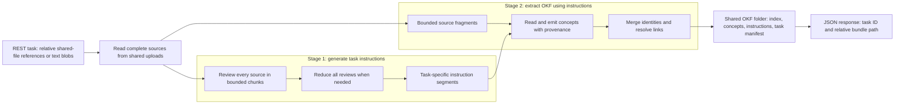

# OKF extractor task pipeline

Two stages: **review every source and generate task instructions**, then
**extract/merge the OKF bundle using those instructions**. Merging is an internal
part of extraction, not a replacement for corpus-wide instruction planning.

## Guarantees

- All source text is reviewed before instruction synthesis; no sampling or tail truncation.
- Every extraction fragment fits the read limits; strict sessions fail rather than skip unread input.
- Generated instructions guide both concept extraction and optional entity canonicalization.
- Original logical source paths survive fragmentation and merging in `source_files`.
- The engine maps task sources to vector chunk asset IDs and stores the bundle per graph source.
- Input files and completed bundles live in the shared upload directory; no archives are transferred.
- Private normalization work is cleaned on success/failure; callers own original inputs/results.

---

Bounded agent sessions

- Read tools reject reads exceeding a session's token budget.
- An incomplete/overflowed batch shrinks by `budget × 0.5` and retries.
- Task extraction never silently accepts an unread fragment or unfinished session.
- Batches run serially and share only existing concept titles, not accumulated source histories.
- Model actions are limited to configured tools, never shell commands.

