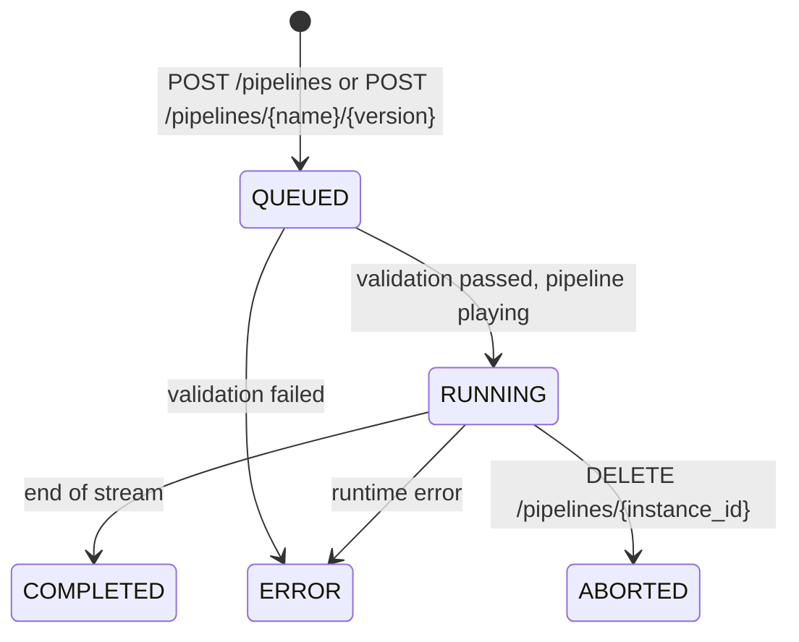

<!--
SPDX-FileCopyrightText: (C) 2026 Intel Corporation
SPDX-License-Identifier: Apache-2.0
-->

# DL Streamer Pipeline Server 2.0 – REST API Reference

**API version: 2.0.0 (Alpha)**

> **Work in progress.** DLSPS 2.0 is an alpha release. Endpoints, request bodies,
> and response shapes may change without notice.

DLSPS 2.0 exposes a REST API for starting, monitoring, and stopping
DL Streamer (GStreamer) pipeline instances. The service runs on
[FastAPI](https://fastapi.tiangolo.com/) and listens on port `8080` by default.
To change the port, set the `REST_SERVER_PORT` environment variable.

Base URL example: `http://<host>:8080`

## Interactive Documentation

FastAPI generates an OpenAPI 3 specification at runtime. Use it as the
authoritative schema for the version you are running:

| Path | Description |
|------|-------------|
| `GET /openapi.json` | OpenAPI 3 specification (JSON). |
| `GET /docs` | Swagger UI. |
| `GET /redoc` | ReDoc UI. |

## Endpoint Summary

| Method | Path | Description | New in 2.0 |
|--------|------|-------------|:----------:|
| `GET` | [/pipelines](#get-pipelines) | List the pipeline definitions loaded from `config.json`. | |
| `POST` | [/pipelines](#post-pipelines) | Start a pipeline from an inline GStreamer launch string. | Yes |
| `POST` | [/pipelines/{name}/{version}](#post-pipelinesnameversion) | **Legacy (1.0) API.** Start a named pipeline defined in `config.json`. See the [DLSPS 1.0 REST API reference](../../docs/user-guide/advanced-guide/detailed_usage/rest_api/restapi_reference_guide.md). | |
| `GET` | [/pipelines/status](#get-pipelinesstatus) | Return the status of all pipeline instances. | |
| `GET` | [/pipelines/{instance_id}](#get-pipelinesinstance_id) | Return the status and configuration of a pipeline instance. | |
| `GET` | [/pipelines/{instance_id}/status](#get-pipelinesinstance_idstatus) | Return the status of a pipeline instance. | |
| `DELETE` | [/pipelines/{instance_id}](#delete-pipelinesinstance_id) | Stop a running pipeline instance. | |

### Differences from DLSPS 1.0

- `POST /pipelines` is new. Use it to submit a raw `gst-launch` pipeline string
  without defining it in `config.json` first.
- Instance IDs are UUID strings, for example
  `3f1c0d2e-8a4b-4d6c-9e1f-2a3b4c5d6e7f`.
- `POST` start endpoints return a JSON object `{"instance_id": "<uuid>"}`.
- Status responses include a new `frame_fps` field. They do not include
  `avg_pipeline_latency`, which 2.0 does not track yet.
- 2.0 does not implement the following 1.0 endpoints:
  - `POST /pipelines/{name}/{version}/{instance_id}`: `image_ingestor` requests.
  - `POST /pipelines/{name}/{version}/{instance_id}/models`: model registry deployment.
- `DELETE /pipelines/{instance_id}` stops `RUNNING` instances only. It does not
  cancel `QUEUED` instances.

## Pipeline Instance Lifecycle

When you start a pipeline, the API returns immediately. Validation and launch
run in the background.



| State | Description |
|-------|-------------|
| `QUEUED` | The instance was accepted and is being validated or submitted to the worker. |
| `RUNNING` | The pipeline is playing. |
| `COMPLETED` | The pipeline reached end of stream. |
| `ERROR` | Validation or execution failed. The `message` field contains the error. |
| `ABORTED` | A client stopped the pipeline with `DELETE /pipelines/{instance_id}`. |

A malformed pipeline string still returns `200` with an `instance_id`. The
instance then moves to `ERROR`. To detect failures, poll
`GET /pipelines/{instance_id}/status`.

## Error Responses

Errors use the standard FastAPI format:

```json
{
  "detail": "Instance 'abc' not found"
}
```

| Status | Meaning |
|--------|---------|
| `400 Bad Request` | The request is invalid, for example an empty `pipeline` string. |
| `404 Not Found` | The pipeline instance or named pipeline does not exist. |
| `409 Conflict` | The instance is not `RUNNING`, so it cannot be stopped. |
| `422 Unprocessable Entity` | The request body failed schema validation, for example a missing required field or wrong type. |
| `500 Internal Server Error` | A named pipeline request could not be converted into a pipeline. |
| `503 Service Unavailable` | The pipeline manager is not initialized, or no `config.json` is loaded (named pipeline API only). |

---

## `GET` /pipelines

Returns the pipeline catalog: the named pipelines from `config.json` that you
can start with [`POST /pipelines/{name}/{version}`](#post-pipelinesnameversion).
Running instances are not included. To list instances, use
[`GET /pipelines/status`](#get-pipelinesstatus).

If no `config.json` is loaded, this endpoint returns an empty list.

### Responses

#### `200 OK`: array of [PipelineDefinition](#pipelinedefinition)

```json
[
  {
    "name": "user_defined_pipelines",
    "version": "pallet_defect_detection",
    "type": "GStreamer",
    "description": "DL Streamer Pipeline Server pipeline",
    "parameters": {
      "type": "object",
      "properties": {
        "detection-properties": {
          "element": {
            "name": "detection",
            "format": "element-properties"
          }
        }
      }
    }
  }
]
```

### Example

```bash
curl http://localhost:8080/pipelines
```

---

## `POST` /pipelines

**New in 2.0.** Starts a pipeline instance from an inline GStreamer pipeline
description in `gst-launch-1.0` syntax.

This endpoint does not substitute `{auto_source}` placeholders. It also does
not translate `source`, `destination`, or `parameters`. The server runs the
string exactly as submitted.

### Request Body: [StartPipelineRequest](#startpipelinerequest)

| Field | Type | Required | Description |
|-------|------|:--------:|-------------|
| `pipeline` | string | Yes | GStreamer launch string. Must not be empty or whitespace-only. |

```json
{
  "pipeline": "filesrc location=/home/pipeline-server/resources/videos/sample.mp4 ! decodebin3 ! gvadetect model=/home/pipeline-server/resources/models/yolo/model.xml device=CPU ! gvametaconvert ! gvametapublish method=file file-path=/tmp/results.jsonl file-format=json-lines ! fakesink sync=false"
}
```

### Responses

#### `200 OK`: [StartPipelineResponse](#startpipelineresponse)

```json
{
  "instance_id": "3f1c0d2e-8a4b-4d6c-9e1f-2a3b4c5d6e7f"
}
```

#### `400 Bad Request`

```json
{
  "detail": "pipeline must not be empty"
}
```

#### `422 Unprocessable Entity`

Returned when the `pipeline` field is missing or is not a string.

### Example

```bash
curl -X POST http://localhost:8080/pipelines \
  -H 'Content-Type: application/json' \
  -d '{"pipeline": "videotestsrc num-buffers=300 ! videoconvert ! fakesink"}'
```

---

## `POST` /pipelines/{name}/{version}

> **Legacy (1.0) API.** DLSPS 2.0 keeps this endpoint for backward
> compatibility. For the path parameters, request body, `config.json` pipeline
> definitions, and examples, refer to the
> [DLSPS 1.0 REST API reference](../../docs/user-guide/advanced-guide/detailed_usage/rest_api/restapi_reference_guide.md)
> and the [DLSPS 1.0 documentation](../../docs/user-guide/index.md).

In DLSPS 2.0, this endpoint returns a
[StartPipelineResponse](#startpipelineresponse) object:
`{"instance_id": "<uuid>"}`.

---

## `GET` /pipelines/status

Returns the status of every pipeline instance known to the server, including
completed, errored, and aborted instances.

### Responses

#### `200 OK`: array of [PipelineStatus](#pipelinestatus)

```json
[
  {
    "id": "3f1c0d2e-8a4b-4d6c-9e1f-2a3b4c5d6e7f",
    "state": "RUNNING",
    "avg_fps": 29.87,
    "frame_fps": 30.02,
    "start_time": 1791366000.123,
    "elapsed_time": 42.51,
    "message": ""
  },
  {
    "id": "9b2e7a10-4c3d-4f5e-8a6b-1c2d3e4f5a6b",
    "state": "ERROR",
    "avg_fps": 0.0,
    "frame_fps": 0.0,
    "start_time": null,
    "elapsed_time": null,
    "message": "validation failed: no element \"badelement\""
  }
]
```

### Example

```bash
curl http://localhost:8080/pipelines/status
```

---

## `GET` /pipelines/{instance_id}

Returns the status fields of a pipeline instance, plus its pipeline
configuration and the original request.

### Path Parameters

| Name | Type | Required | Description |
|------|------|:--------:|-------------|
| `instance_id` | string | Yes | Pipeline instance identifier (UUID). |

### Responses

#### `200 OK`: [PipelineSummary](#pipelinesummary)

Example for an instance started with `POST /pipelines/{name}/{version}`:

```json
{
  "id": "3f1c0d2e-8a4b-4d6c-9e1f-2a3b4c5d6e7f",
  "state": "RUNNING",
  "avg_fps": 29.87,
  "frame_fps": 30.02,
  "start_time": 1791366000.123,
  "elapsed_time": 42.51,
  "message": "",
  "type": "GStreamer",
  "launch_command": "urisourcebin uri=file:///home/pipeline-server/resources/videos/warehouse.avi ! decodebin3 ! gvadetect name=detection model=... device=CPU ! gvametaconvert ! gvametapublish name=destination method=file file-path=/tmp/results.jsonl file-format=json-lines ! fakesink",
  "name": "user_defined_pipelines",
  "version": "pallet_defect_detection",
  "request": {
    "source": {
      "uri": "file:///home/pipeline-server/resources/videos/warehouse.avi",
      "type": "uri"
    },
    "destination": {
      "metadata": {
        "type": "file",
        "path": "/tmp/results.jsonl",
        "format": "json-lines",
        "publish_frame": false
      }
    }
  }
}
```

For instances started with `POST /pipelines`, the `name`, `version`, and
`request` fields are `null`.

#### `404 Not Found`

```json
{
  "detail": "Instance '3f1c0d2e-8a4b-4d6c-9e1f-2a3b4c5d6e7f' not found"
}
```

### Example

```bash
curl http://localhost:8080/pipelines/3f1c0d2e-8a4b-4d6c-9e1f-2a3b4c5d6e7f
```

---

## `GET` /pipelines/{instance_id}/status

Returns only the runtime status of a pipeline instance, without
configuration or request data.

### Path Parameters

| Name | Type | Required | Description |
|------|------|:--------:|-------------|
| `instance_id` | string | Yes | Pipeline instance identifier (UUID). |

### Responses

#### `200 OK`: [PipelineStatus](#pipelinestatus)

```json
{
  "id": "3f1c0d2e-8a4b-4d6c-9e1f-2a3b4c5d6e7f",
  "state": "COMPLETED",
  "avg_fps": 29.91,
  "frame_fps": 0.0,
  "start_time": 1791366000.123,
  "elapsed_time": 60.04,
  "message": ""
}
```

#### `404 Not Found`

```json
{
  "detail": "Instance '3f1c0d2e-8a4b-4d6c-9e1f-2a3b4c5d6e7f' not found"
}
```

### Example

```bash
curl http://localhost:8080/pipelines/3f1c0d2e-8a4b-4d6c-9e1f-2a3b4c5d6e7f/status
```

---

## `DELETE` /pipelines/{instance_id}

Requests a graceful stop of a running pipeline instance. The instance state
changes to `ABORTED` immediately, and the shared worker then tears down the
pipeline. Other running pipelines are not affected.

### Path Parameters

| Name | Type | Required | Description |
|------|------|:--------:|-------------|
| `instance_id` | string | Yes | Pipeline instance identifier (UUID). |

### Responses

#### `200 OK`: [StopPipelineResponse](#stoppipelineresponse)

```json
{
  "instance_id": "3f1c0d2e-8a4b-4d6c-9e1f-2a3b4c5d6e7f"
}
```

#### `404 Not Found`

```json
{
  "detail": "Instance '3f1c0d2e-8a4b-4d6c-9e1f-2a3b4c5d6e7f' not found"
}
```

#### `409 Conflict`

Returned when the instance is not `RUNNING`, for example when it is `QUEUED`,
`COMPLETED`, `ERROR`, or already `ABORTED`.

```json
{
  "detail": "Instance '3f1c0d2e-8a4b-4d6c-9e1f-2a3b4c5d6e7f' is not running (state: COMPLETED)"
}
```

### Example

```bash
curl -X DELETE http://localhost:8080/pipelines/3f1c0d2e-8a4b-4d6c-9e1f-2a3b4c5d6e7f
```

---

## Schemas

### StartPipelineRequest

| Field | Type | Required | Default | Description |
|-------|------|:--------:|---------|-------------|
| `pipeline` | string | Yes | - | GStreamer launch string. |

### StartPipelineResponse

| Field | Type | Description |
|-------|------|-------------|
| `instance_id` | string | UUID of the new pipeline instance. |

### StopPipelineResponse

| Field | Type | Description |
|-------|------|-------------|
| `instance_id` | string | UUID of the instance that was asked to stop. |

### PipelineStatus

| Field | Type | Description |
|-------|------|-------------|
| `id` | string | Instance UUID. |
| `state` | string | One of `QUEUED`, `RUNNING`, `COMPLETED`, `ERROR`, `ABORTED`. |
| `avg_fps` | number | Average frames per second since the pipeline started. |
| `frame_fps` | number | Current (instantaneous) frames per second. |
| `start_time` | number or null | Unix epoch start time in seconds. `null` until the instance is running. |
| `elapsed_time` | number or null | Seconds the instance has been running, or ran in total if it has stopped. `null` until it starts. |
| `message` | string | Error details when `state` is `ERROR`. Otherwise an empty string. |

### PipelineSummary

Contains all [PipelineStatus](#pipelinestatus) fields plus the following:

| Field | Type | Description |
|-------|------|-------------|
| `type` | string | Always `GStreamer`. |
| `launch_command` | string or null | The GStreamer launch string that was executed, after source, destination, and parameter substitution. |
| `name` | string or null | Pipeline name from the URL path. `null` for `POST /pipelines` instances. |
| `version` | string or null | Pipeline version from the URL path. `null` for `POST /pipelines` instances. |
| `request` | object or null | The original request body, with `null` fields omitted and defaults filled in. `null` for `POST /pipelines` instances. |

### PipelineDefinition

| Field | Type | Description |
|-------|------|-------------|
| `name` | string | Always `user_defined_pipelines`. |
| `version` | string | The `name` of the pipeline entry in `config.json`. |
| `type` | string | Always `GStreamer`. |
| `description` | string | Always `DL Streamer Pipeline Server pipeline`. |
| `parameters` | object or null | The pipeline's `parameters` JSON Schema fragment from `config.json`, with `null` fields omitted. |
