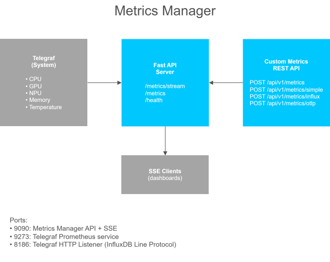

<!--
SPDX-FileCopyrightText: (C) 2026 Intel Corporation
SPDX-License-Identifier: Apache-2.0
-->

# Metrics Manager

This checkout targets **2026.3.0**, which is not yet released. Build locally
until the corresponding image is published; registry commands below show the
target release tag, not a guarantee that it is already available.

**Breaking native metric migration:** 2026.3.0 uses explicit base-unit fields
without legacy aliases. Upgrade collectors and custom queries together;
see the [conversion and configuration guide](./docs/user-guide/get-started/native-metric-migration.md).

A unified metrics collection, ingestion, and relay service that combines Telegraf-based system metrics with a flexible REST API for custom metrics. Supports multiple input formats including JSON, InfluxDB Line Protocol, and OpenTelemetry (OTLP).

- **Get Started:** [Get Started Guide](docs/user-guide/get-started.md) — install and run in 5 minutes
- **Full Documentation:** [Documentation](docs/user-guide/index.md)
- **Issues / feature requests:** [Edge AI Libraries Issues Page](https://github.com/open-edge-platform/edge-ai-libraries/issues) (use the `metrics-manager` label)
- **Container image (Docker Hub):** [`intel/metrics-manager`](https://hub.docker.com/r/intel/metrics-manager) - tagged `intel/metrics-manager:<VERSION>` (e.g. `intel/metrics-manager:2026.3.0`)
- **Helm chart (OCI):** `oci://registry-1.docker.io/intel/metrics-manager:<VERSION>-helm` (see [Helm Deployment Guide](./docs/user-guide/get-started/deploy-with-helm.md))

## Features

- **System Metrics Collection**: CPU, memory, temperature, GPU (Intel GPUs via qmassa), Intel NPU (via PMT sysfs)
- **Optional GPU exporter**: bundled `qmmd` Prometheus exporter (opt-in, see [Environment Variables](./docs/user-guide/get-started/environment-variables.md))
- **REST API**: Push custom metrics via JSON, InfluxDB Line Protocol, or OpenTelemetry format
- **SSE Streaming**: Real-time metrics streaming via Server-Sent Events (`GET /metrics/stream`)
- **Prometheus Compatible**: Metrics endpoint for Prometheus scraping
- **Terminal dashboard**: Responsive Overview, Trends, Details and Alerts with five-minute history, configurable thresholds and process limits. Build and run the standalone [TUI](./docs/user-guide/get-started/terminal-dashboard.md) against the same telemetry endpoint.
- **Native Debian package**: Install collectors, TUI and systemd services without Docker on the target host; see the [bare-metal guide](./docs/user-guide/get-started/bare-metal-package.md). REST API and SSE remain container-only.
- **Custom Telegraf Config**: Mount your own Telegraf configuration
- **Additional native Docker collectors**: Opt in to RAPL, per-CPU powerstat, Turbostat, temperature statistics, IRQ, network and storage with `ENABLE_*=true`; additions default off and mounted drop-ins are loaded at startup ([setup guide](./docs/user-guide/get-started/native-docker-collectors.md))
- **Rate Limiting**: IP-based request throttling with configurable limits
- **Correlation IDs**: Distributed tracing support with automatic ID propagation
- **Structured Logging**: JSON-formatted logs for log aggregators (ELK, Loki)
- **Memory Protection**: Automatic eviction when memory limits reached
- **Graceful Shutdown**: Clean handling of SIGTERM/SIGINT signals

## Data Flow



## Quick Start

### Prerequisites

```bash
cd siv-telemetry/metrics-manager

# (Optional) If behind a proxy, edit .env and uncomment proxy settings
```

> **Note:** The Docker build automatically resolves Python dependencies.
> No local `uv lock` or Python installation is required.

### Pulling the published image (no build required)

Released images are published to Docker Hub as `intel/metrics-manager`:

```bash
docker pull intel/metrics-manager:2026.3.0
```

Pick the run invocation that matches your hardware:

**Minimal — CPU + memory + temperature only:**

```bash
docker run --rm \
  -p 9090:9090 -p 9273:9273 \
  -v /sys:/sys:ro -v /run:/run:ro \
  --pid host \
  intel/metrics-manager:2026.3.0
```

**With Intel® GPU telemetry** (adds `--device /dev/dri` so qmassa can
enumerate render nodes):

```bash
docker run --rm \
  --device /dev/dri \
  -p 9090:9090 -p 9273:9273 \
  -v /sys:/sys:ro -v /run:/run:ro \
  --pid host \
  intel/metrics-manager:2026.3.0
```

**With Intel® NPU telemetry** (NPU readings come from the `intel_pmt`
sysfs interface, which requires `--privileged`):

```bash
docker run --rm --privileged \
  -p 9090:9090 -p 9273:9273 \
  -v /sys:/sys:ro -v /run:/run:ro \
  --pid host \
  intel/metrics-manager:2026.3.0
```

> **Note:** On hosts that have **both** an Intel® GPU and NPU, add `--device
> /dev/dri` to the NPU command above to enable qmassa as well.

On hosts without an Intel® GPU or NPU the corresponding readers detect
the missing hardware, log a single warning, and idle silently — other
metrics (CPU, memory, temperature) continue normally.

Then verify:

```bash
curl http://localhost:9090/health
curl -s http://localhost:9273/metrics | head
```

### Using Docker Compose

The default service uses bridge networking. For host NIC counters, use the
optional `metrics-manager-host-nic` service under `host-nic-telemetry`.
Stop the bridge service first and name the target service explicitly:
activating the profile alone selects both. See
[deployment variants, port settings and exposure](./docs/user-guide/get-started/native-docker-collectors.md#compose-deployment-variants).

```bash
docker compose up --build

# Run with custom Telegraf configuration
TELEGRAF_CONFIG=./my-telegraf.conf docker compose up

# Run in background
docker compose up -d
```

### Using Docker

```bash
docker build -t metrics-manager .

docker run -d \
  --name metrics-manager \
  --privileged \
  -p 9090:9090 \
  -p 9273:9273 \
  -v /sys:/sys \
  -v /dev:/dev \
  metrics-manager
```

### On Kubernetes (Helm)

The existing Helm chart is published at the same OCI repository, distinguished
by the `-helm` tag suffix. The chart remains at its upstream version; the native
Docker migration described here does not update its deployment configuration.

```bash
helm install metrics-manager \
  oci://registry-1.docker.io/intel/metrics-manager \
  --version 2026.2.0-helm \
  --namespace observability --create-namespace
```

The chart exposes Telegraf and the REST/SSE API as a `Service`, supports
`Deployment` or `DaemonSet` mode, and integrates with Prometheus Operator
via an opt-in `ServiceMonitor`. See the [Helm Deployment Guide](./docs/user-guide/get-started/deploy-with-helm.md) for the
complete reference.

## Building the Image

The image version is the **single source of truth** in [`VERSION`](VERSION) (currently
`2026.3.0`). Locally-built images are tagged `metrics-manager:<VERSION>` (no
registry prefix); the **official released image** on Docker Hub is
`intel/metrics-manager:<VERSION>`. Neither tag is `:latest` by default.

### With Make (recommended)

```bash
make version            # → 2026.3.0
make build              # → metrics-manager:2026.3.0    (local build)
make up                 # docker compose up -d
make logs               # tail container logs
make down               # stop & remove
make test               # build test image and run pytest
make clean              # remove built images, volumes, orphaned containers

# Helm chart (requires the `helm` CLI)
make helm-lint          # helm lint helm/metrics-manager
make helm-template      # render the chart with default values
make helm-package       # use the chart's own version from Chart.yaml
make generate-helm      # alias: helm-lint + helm-package
make helm-push          # push the packaged chart to oci://registry-1.docker.io/intel

# Override the tag for a one-off local build (e.g. a feature branch image)
make build TAG=dev      # → metrics-manager:dev

# Build with the published Docker Hub naming (matches what we release)
REGISTRY=intel/ make build              # → intel/metrics-manager:2026.3.0
```

`make clean` removes volumes, including stored custom metrics scripts. Use
`make down` for routine shutdown; back up volume contents before cleanup.

### With Docker Compose directly

The Python build and runtime stages share the digest-pinned `PYTHON_IMAGE`
from `versions.env`, using Debian 13 (trixie). The runtime build applies
available Debian package updates. To refresh the base, update its verified
digest and run `make sync-versions`; to rerun package updates without cached
layers, use `docker compose build --no-cache metrics-manager`.

Build proxies use Docker's predefined proxy arguments without persisting their
values. Empty runtime defaults are preserved; runtime proxies are supplied explicitly
through Compose.

```bash
# Uses the TAG from .env (defaults to 2026.3.0)
docker compose build metrics-manager

# Override on the command line
TAG=2026.3.0-rc1 docker compose build metrics-manager

# Build and run in one step
docker compose up --build -d
```

### Building both release-candidate variants

Keep the project version at `2026.3.0` while validating RC images. Build the
two variants with distinct tags so that one does not overwrite the other:

```bash
# Default: telemetry collectors and API, without OpenVINO or media VA drivers
make build REGISTRY=intel/ TAG=2026.3.0-rc1 INSTALL_OPENVINO=false

# Extended: the same collectors/API plus OpenVINO, vainfo and Intel media VA drivers
make build REGISTRY=intel/ TAG=2026.3.0-extended-rc1 INSTALL_OPENVINO=true
```

The tag alone does not select the variant: always pass `INSTALL_OPENVINO`
explicitly. Both commands build locally and do not push anything. The image's
OCI version label, native collector versions, API version and structured log
version use the build tag. The checked-in project/package version stays
`2026.3.0`; a runtime `SERVICE_VERSION` override changes the API/log identity
only, not the OCI label or native binaries.

To run a locally built RC with Compose, use its matching tag and
`--no-build` (choose one deployment variant as described above):

```bash
REGISTRY=intel/ TAG=2026.3.0-rc1 docker compose up --no-build -d metrics-manager
```

After validation and authorization to publish, push each explicit tag;
do not publish the stable `2026.3.0` or `latest` tags for this RC:

The [release validation scope](./docs/user-guide/get-started/testing.md#release-validation-scope)
distinguishes functional checks from real-hardware validation.

```bash
docker push intel/metrics-manager:2026.3.0-rc1
docker push intel/metrics-manager:2026.3.0-extended-rc1
```

### Releasing a new version

1. **Align the current release mirrors** — update `VERSION`, `pyproject.toml`,
   `.env.example`, `compose.yaml`, both `ARG VERSION` defaults in `Dockerfile`,
   `app/settings.py`, `app/logging_config.py` and current documentation examples.
   Preserve historical release entries and third-party versions. Check your
   local `.env` for an intentional `TAG` override; it is not rewritten for you.
   For 2026.3.0, Helm is outside this work's scope. Do not use the legacy
   `make bump` target for this change: it references old documentation paths
   and does not update every current mirror. Helm packaging reads its version
   from `Chart.yaml`, independently of the application `VERSION`.
2. Review the change: `git diff`.
3. `make build` — the image will be tagged `metrics-manager:2026.3.0` and the
   OCI label `org.opencontainers.image.version` will be stamped automatically
   from the `VERSION` build arg.
4. Verify the running service reports the new version:

   ```bash
   curl -s http://localhost:9090/health | jq .version
   ```

5. Stage only the reviewed changes and commit them. Create a stable release
   tag separately, only after final-release validation and authorization.
   Do not create the stable `v2026.3.0` tag for an RC-only publication.

#### Why so many files?

`VERSION` is the single source of truth, but Python and Docker tooling
needs the value duplicated in a handful of places because each format is
read at a different time:

| File                              | Used by                                                            | When read                                                |
| --------------------------------- | ------------------------------------------------------------------ | -------------------------------------------------------- |
| `VERSION`                         | `Makefile`, `app/__init__.py` (dynamic)                            | Build time and runtime                                   |
| `pyproject.toml`                  | `pip install .`, `python -m build`                                 | Packaging                                                |
| `.env` / `.env.example`           | `docker compose` (without Make)                                    | Build time                                               |
| `compose.yaml`                    | `${TAG:-...}` and `VERSION:` build-arg fallbacks                   | Build time when no `TAG` env is set                      |
| `Dockerfile`                      | Native collector version, OCI label and `SERVICE_VERSION` defaults | Image build; `VERSION` build argument overrides them     |
| `app/settings.py`                 | Pydantic default for `/health` `version` field                     | Runtime fallback when `SERVICE_VERSION` env var is unset |
| `app/logging_config.py`           | Default `version` field in JSON log records                        | Runtime fallback                                         |
| Current README and user guides   | Installation examples and API responses                            | Documentation                                            |
| `helm/metrics-manager/Chart.yaml` | Helm chart `version` (`<X.Y.Z>-helm`) and `appVersion` (`<X.Y.Z>`) | Build time when packaging the chart                      |

`tests/test_versions.py` guards the current non-Helm release mirrors and
third-party pins. Run it with the repository's Python test environment.
`TAG` still overrides Compose image tags/build arguments, and `SERVICE_VERSION`
still overrides the reported service version at runtime. Setting one does not
automatically set the other. Helm metadata is unchanged in this work.

### Verify

```bash
# Health check
curl http://localhost:9090/health

# Push a metric
curl -X POST http://localhost:9090/api/v1/metrics/simple \
  -H "Content-Type: application/json" \
  -d '{"name": "my_metric", "value": 42.5}'

# Read it back
curl http://localhost:9090/api/v1/metrics/latest
```

## Integration Examples

### Python Client

```python
import httpx

httpx.post("http://localhost:9090/api/v1/metrics/simple", json={
    "name": "inference_latency_ms",
    "value": 23.5,
    "tags": {"model": "yolov8", "device": "GPU"}
})
```

### SSE Client (real-time streaming)

```python
import httpx

with httpx.stream("GET", "http://localhost:9090/metrics/stream",
                  headers={"Accept": "text/event-stream"}) as r:
    for line in r.iter_lines():
        if line.startswith("data:"):
            print(line[5:])
```

Or open `http://localhost:9090/metrics/stream` in a browser for a live HTML dashboard.

### Grafana

1. Add data source: Prometheus
2. URL: `http://metrics-manager:9273`
3. Query example: `cpu_usage_percent{host="myhost"}`

### OpenTelemetry Collector

```yaml
exporters:
  otlphttp:
    endpoint: "http://metrics-manager:9090/api/v1/metrics/otlp"
service:
  pipelines:
    metrics:
      exporters: [otlphttp]
```

## Project Structure

```
metrics-manager/
├── app/                     # Python FastAPI application
│   ├── main.py              # Application entry with middleware
│   ├── settings.py          # Pydantic Settings configuration
│   ├── models.py            # Pydantic data models
│   ├── store.py             # Metrics storage with async persistence
│   ├── routes.py            # REST API routes
│   ├── sse.py               # SSE streaming endpoint (/metrics/stream)
│   ├── rate_limit.py        # Rate limiting middleware
│   ├── metrics.py           # Internal service metrics
│   ├── logging_config.py    # Structured logging setup
│   └── responses.py         # API response models
├── tests/                   # Pytest test suite
├── native/                  # Go telemetry plugins
│   ├── cmd/                 # Collector command-line entry points
│   │   ├── mm-plugin-cpu/   # CPU frequency and per-core-class utilisation
│   │   ├── mm-plugin-gpu/   # Intel GPU, parsed from the qmassa named pipe
│   │   └── mm-plugin-npu/   # Intel NPU, read via PMT sysfs
│   └── internal/            # Shared parsing and line-protocol packages
├── helm/                    # Helm chart published as oci://.../metrics-manager:<VERSION>-helm
│   └── metrics-manager/
│       ├── Chart.yaml       # Chart metadata (version, appVersion)
│       ├── values.yaml      # Default values - all tunables
│       ├── .helmignore
│       └── templates/       # Deployment/DaemonSet, Service, ConfigMap,
│                            # PVC, ServiceAccount, ServiceMonitor, NOTES.txt
├── docs/                    # Detailed documentation
│   ├── API.md               # Full API reference
│   ├── ARCHITECTURE.md      # Architecture and data flow
│   ├── CONFIGURATION.md     # Environment variables and Telegraf config
│   ├── HELM.md              # Kubernetes deployment via the Helm chart
│   ├── INSTALLATION.md      # Step-by-step host setup
│   ├── TESTING.md           # Testing guide and smoke tests
│   └── TROUBLESHOOTING.md   # Common issues and solutions
├── telegraf.conf            # Default Telegraf config
├── compose.yaml             # Docker Compose config
├── Dockerfile               # Multi-stage Docker build
├── Makefile                 # Build / run / test targets (reads VERSION)
├── VERSION                  # Image version (single source of truth)
├── entrypoint.sh            # Container entrypoint
├── supervisord.conf         # Process management
└── pyproject.toml           # Python project config
```

## Documentation

| Document                                                                        | Description                                                         |
| ------------------------------------------------------------------------------- | ------------------------------------------------------------------- |
| [Get Started](./docs/user-guide/get-started.md)                                 | Step-by-step setup on a new machine, variants, integration examples |
| [System Requirements](./docs/user-guide/get-started/system-requirements.md)     | Supported platforms and hardware requirements                       |
| [Build from Source](./docs/user-guide/get-started/build-from-source.md)         | Building the metrics manager from source code                       |
| [Environment Variables](./docs/user-guide/get-started/environment-variables.md) | Configuration through environment variables and Telegraf config     |
| [Custom Metrics](./docs/user-guide/get-started/custom-metrics.md)               | Using the REST API for custom metrics                               |
| [Deploy with Helm](./docs/user-guide/get-started/deploy-with-helm.md)           | Kubernetes deployment via the published OCI Helm chart              |
| [Testing](./docs/user-guide/get-started/testing.md)                             | Unit tests, smoke tests, development setup                          |
| [How It Works](./docs/user-guide/how-it-works.md)                               | Architecture, data flow, and component relationships                |
| [API Reference](./docs/user-guide/api-reference.md)                             | All endpoints, formats, examples, response models                   |
| [Troubleshooting](./docs/user-guide/troubleshooting.md)                         | Common issues and solutions                                         |
| [Release Notes](./docs/user-guide/release-notes.md)                             | Version history and changelog                                       |

## Reporting issues

Please open issues and feature requests in the upstream repository:
<https://github.com/open-edge-platform/edge-ai-libraries/issues>
(label them `metrics-manager`).

## License

Copyright (C) 2025-2026 Intel Corporation
SPDX-License-Identifier: Apache-2.0
