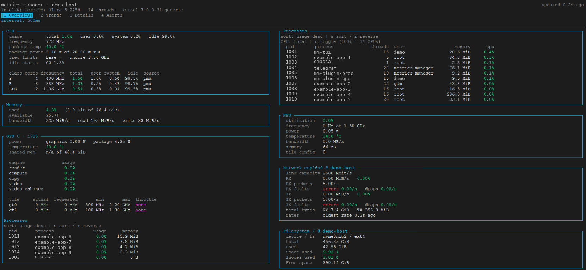
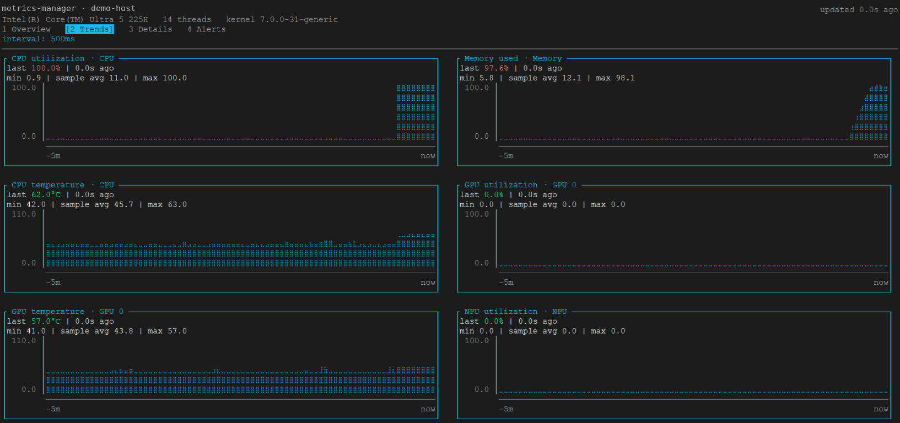
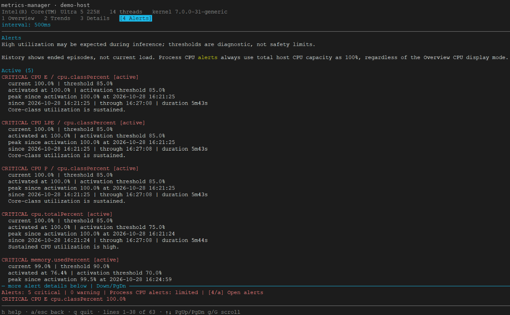

<!--
Copyright (C) 2026 Intel Corporation
SPDX-License-Identifier: Apache-2.0
-->

# Metrics Manager — bare-metal package

**2026.3.0 breaking change:** native telemetry now uses explicit base-unit
fields without old aliases. Upgrade the plugins and TUI together and migrate
custom queries and DRAM chart settings using the
[unit migration guide](./native-metric-migration.md), also installed beside
this README.

Collects CPU, memory, GPU and NPU telemetry on an Intel edge system, publishes
it on a local Prometheus endpoint, and renders it in a terminal dashboard.

The package covers telemetry collection and the dashboard. The REST API and the
SSE stream remain container-only.

The amd64 package requires a systemd-based Debian/Ubuntu system with glibc
2.34 or newer. Install it with `apt`, which resolves the declared runtime
libraries and maintainer-script dependencies (`adduser`, `systemd`, `kmod`).
Installing with `dpkg -i` alone does not fetch missing dependencies.

## Quick start

```bash
sudo apt install ./metrics-manager_<version>_amd64.deb
mm-tui
```

Everything starts at installation and again at boot. The raw readings are at
`http://127.0.0.1:9273/metrics`.

Additional inputs and the RAPL collector require manual activation: see
[temperature and basicstats](#enable-inputstemp-and-aggregatorsbasicstats),
[device interrupts](#enable-inputsinterrupts) and
[per-CPU powerstat](#enable-inputsintel_powerstat-per-cpu-fields) and
[turbostat](#enable-inputsturbostat), and
[RAPL platform power](#enable-rapl-package-and-platform-power). Each has its own commands and
verification step below.

## Building the package

You need Docker and about 2 GB of free disk. You do **not** need a Go or Rust
toolchain on the machine: the collectors, Telegraf and qmassa are lifted out of
the container image, which pins its own toolchains, and the dashboard is
compiled with that same pinned Go image. The package and the image therefore
ship byte-identical binaries, so a reading that differs between the two
deployments cannot be blamed on a different build.

```bash
cd microservices/metrics-manager
./native/build.sh
```

The image is built first if it is not already present. The result lands in:

```
native/packaging/dist/metrics-manager_<version>_amd64.deb
```

While iterating on the dashboard or the packaging, reuse the image instead of
rebuilding it every time (but rebuild after changing a collector or adding
`mm-plugin-rapl`, since the plugin binaries are copied from the image):

```bash
SKIP_IMAGE_BUILD=1 ./native/build.sh
```

Reuse an image built with the same version as the package. For the `2026.3.0`
package, the default local source is `metrics-manager:2026.3.0`; the separate
Docker Hub RC tags are not package inputs, because their embedded collector
versions include the RC suffix. Building the package does not publish images.
The builder checks the image's OCI version label before changing its staging
directory and rejects mismatched or missing versions.

The package is amd64 only. qmassa is Rust, and cross-building it for arm64 has
not been set up.

To check what you are about to install before installing it:

```bash
dpkg-deb --info native/packaging/dist/metrics-manager_*_amd64.deb
dpkg-deb --contents native/packaging/dist/metrics-manager_*_amd64.deb
```

## Installing and checking it works

```bash
sudo apt install ./native/packaging/dist/metrics-manager_*_amd64.deb
```

Installation creates the service account, prepares runtime files, attempts to
load the `msr` module, and starts the default services when systemd is running.
Failure to prepare runtime files fails installation; optional module and service
startup failures produce diagnostics. Give it a few seconds, then check the
services came up:

```bash
systemctl list-units 'metrics-manager-*' --no-legend
```

Six units, all `active running`, is the answer you want. This form names them,
which `systemctl is-active` does not, and that matters when only one is
missing. Anything else has a reason in the journal:

```bash
journalctl -u 'metrics-manager-*' -n 40 --no-pager
```

Then look at the readings. The endpoint is the source of truth; the dashboard
only renders it.

```bash
curl -s http://127.0.0.1:9273/metrics | grep -v '^#' | sed 's/{.*//' | sort -u | wc -l
```

Expect roughly seventy metric families, though the exact number depends on the
hardware: a machine with no NPU publishes none of the `npu_` ones.

```bash
mm-tui
```

### What you should see, and how to tell it is real

The quickest way to trust a reading is to make it move.

**Memory bandwidth.** Watch the `DRAM bandwidth` row in the Memory panel while
writing a few gigabytes into RAM. Its `read`, `write` and `total` columns should
jump from a fraction of a GB/s to several GB/s and settle back. If the row is absent, the service may be
running but unable to open perf counters; see
[No memory bandwidth](#when-something-is-missing).

```bash
dd if=/dev/zero of=/dev/shm/mmtest bs=1M count=8000; rm -f /dev/shm/mmtest
```

**CPU and processes.** Load one core and watch the P row and the process table.
The busiest process should reach the top within a second or two.

```bash
timeout 20 sh -c 'while :; do :; done'
```

**Idle states.** On an unloaded machine the deepest state the part supports
should hold most of the residency. Under the load above, C0 rises.

Readings that stay at zero are not automatically wrong. GPU engines idle at
zero, an NPU with nothing scheduled reports zero utilisation and zero
frequency, and qmassa reports zero GPU power on some platforms. The
distinction the dashboard draws is between zero, which is a measurement, and
`—`, which means nothing published the metric at all.

Cross-check anything that looks suspicious against its source. The NPU is the
easiest, because the driver publishes the same facts in sysfs where anyone can
read them:

```bash
NPU=$(ls -d /sys/bus/pci/drivers/intel_vpu/0000:* | head -1)
cat "$NPU"/npu_memory_utilization "$NPU"/npu_max_frequency_mhz
curl -s http://127.0.0.1:9273/metrics | grep -E '^npu_(memory_bytes|frequency_max_hz)'
```

### Stopping it without removing it

```bash
sudo systemctl stop 'metrics-manager-*'
```

Stopping only Telegraf leaves the privileged collectors running with nowhere to
send samples; they will report the socket has gone and keep retrying. Stopping
all of them together avoids the noise. To start again:

```bash
sudo systemctl start 'metrics-manager-*' --all
```

`--all` is not optional here. A unit glob expands to units systemd currently
has loaded, and stopping them unloads them, so without it the command matches
nothing and silently starts nothing — systemd says as much in a warning that is
easy to scroll past.

To keep it installed but not running at boot:

```bash
sudo systemctl disable 'metrics-manager-*'
```

## What gets installed

| Path | Contents |
|---|---|
| `/usr/bin/mm-tui` | Terminal dashboard |
| `/usr/libexec/metrics-manager/` | Telegraf, qmassa and the collector plugins |
| `/etc/metrics-manager/telegraf.conf` | Collection and publishing configuration |
| `/etc/metrics-manager/telegraf-powerstat.conf` | Privileged package power and idle-state collection |
| `/etc/metrics-manager/metrics-manager.env` | Settings shared by every service |
| `/etc/metrics-manager/tui-dashboard.json` | Dashboard thresholds, alert behavior and process display limit |
| `/etc/metrics-manager/tui-charts.json` | Trend history window, chart size and selected metrics |
| `/etc/metrics-manager/telegraf.d/` | Drop-in directory for local configuration |
| `/etc/metrics-manager/powerstat.d/` | Optional privileged powerstat input drop-ins |
| `/etc/metrics-manager/custom-metrics.d/` | Operator-supplied metric scripts |
| `/run/metrics-manager/` | Ingest socket and the qmassa FIFO |

## The dashboard

`mm-tui` reads the same Prometheus endpoint the package publishes, so it shows
exactly what any scraper would see. It keeps only a bounded in-memory trend
history and alert history, writes nothing, and needs no privileges; running it as an ordinary user
is enough.

```bash
mm-tui
```

| Key | Action |
|---|---|
| `q`, `Ctrl+C` | Quit |
| `h` | Open or close help: keyboard shortcuts, startup options and examples |
| `a` | Open Alerts, or return from Alerts to the previous tab |
| `Esc` | Close help first, then alert details; quit from a dashboard tab |
| `Tab`, `Shift+Tab` | Cycle through Overview, Trends, Details and Alerts |
| `1`, `2`, `3`, `4` | Open Overview, Trends, Details or Alerts directly |
| `s`, `r` | In Overview, cycle process sorting / reverse sort direction |
| `c` | In Overview, toggle process CPU between per-core and whole-host percentage |
| Click tab | Switch to that tab, including Alerts |
| `↑` `↓`, `k` `j` | Scroll the current view a line |
| `PgUp` `PgDn`, `Space` | Scroll a screen |
| `Home` `End`, `g` `G` | Jump to the top or the bottom |

### Screenshots

These sanitized examples show an earlier build. Hostnames and process/user
identifiers have been replaced; measurement values are unchanged. Layout and
available panels depend on terminal width, hardware and enabled collectors.
The current NPU memory label is **MiB**, rather than the older **MB** label
visible in the Overview capture.

**Overview:** grouped hardware readings, process tables and optional network
and filesystem telemetry.



**Trends (charts):** recent metric history, using a five-minute window by default.



**Alerts:** diagnostic threshold episodes with current values, peaks and durations.
Thresholds are diagnostic aids, not hardware safety limits.



NPU frequency arrives from the plugin in Hz. Overview chooses Hz/kHz/MHz/GHz
for readability, while frequency charts use MHz: `1600000000 Hz` becomes
`1.60 GHz` in Overview and `1600 MHz` on a chart. NPU bandwidth arrives in
bytes/second and is displayed in decimal MB/s without differentiation.
NPU memory arrives in bytes and is displayed in MiB. Unavailable readings
remain unavailable rather than becoming zero.

### Built-in help

Show startup options, their defaults and examples without starting the TUI
or requiring running collectors:

```bash
mm-tui -h
mm-tui --help
```

Both forms are supported (`-help` also works). Option names accept one or two
leading dashes, for example `-interval 1s` or `--interval 1s`.

While the TUI is running, press `h` to open a scrollable help screen. It includes
navigation shortcuts, alert status explanations and the same startup reference
as `--help`. The listed defaults are not the current session's settings.
Use arrows, `PgUp`/`PgDn`, `Home`/`End` to scroll. Press `h` or `Esc` to return to
the previous tab or alert view, preserving its scroll position and selected
metric. Help remembers its own scroll position. Collection and history continue
while help is open. Tab shortcuts leave help; `a` goes directly to alerts.
`q` and `Ctrl+C` still quit the application.

### Dashboard layout and history

Overview responds to terminal width while prioritizing CPU/GPU diagnostics:

- **Wide (224 columns or more, with a GPU):** CPU, Memory and NPU on the left;
  GPUs in the middle; general CPU processes starting at the top right.
- **Medium (153 columns or more):** CPU, Memory and GPUs on the left;
  general CPU processes starting at the top right, followed by NPU.
- **Narrow:** CPU, CPU processes, Memory, GPUs and NPU in a single column.

Each column stacks its panels independently. **Every GPU's metrics and process
table share one frame**, keeping device activity and its clients together.
Absent optional devices are omitted. **Network and Storage fill the available
space below the main panels in each column**, rather than waiting for the tallest
column or occupying separate full-width rows. Each additional panel goes into
the currently shortest column, without moving CPU, Memory, NPU, GPU or process
panels. Network is placed first, followed by Storage; these panels may appear
side by side. Their placement can change when panel heights change or the
terminal is resized. In a single column they remain after the main panels.
All columns scroll vertically together; the CPU process table is not pinned
to the screen.

Process tables keep **one process per row** and use their column's width, with
more space reserved for the six-column CPU process table. Padding contracts when
needed; tables never switch to vertical process cards. If columns still do not
fit, use **Left/Right** in Overview to scroll horizontally. Tables share the scroll
position, each clamped to its own right edge. A column-range hint identifies
partially visible tables; resizing recalculates the available width and scroll bounds.
In `-once` output, use a wider terminal to see columns hidden at a narrow width.
Other hardware tables can still switch to labelled rows, preserving idle time,
throttle reasons and similar measurements. Long descriptive values wrap within
their panel.

Device and metric-group panels have borders, including Trends plots and
Details sections. Borders are included in the responsive width calculation.
All edges use the same fixed color, independent of metric thresholds. Titles
cannot reset the color halfway through a border. Square corners use common
box-drawing glyphs. The active tab is highlighted with reverse video as well as
brackets; highlighting does not change the mouse hitboxes.
The header displays the age of the last successful poll; the highlighted `interval:` line shows
the configured TUI polling interval. Use `mm-tui -interval 1s` to change it.
This does not change the Telegraf collection interval (normally 1 second).
Request time and failure backoff can make actual polls less frequent.

The header, tabs, two-line bottom alert preview and footer stay fixed while content
scrolls. The preview always reserves a separator and two content rows, with the alert counts and highest
severity event, so a new alert does not shift the device panels. It shows a
no-events message when empty. Set `alerts.bottomBar=false` to recover those rows;
counts then appear above the body. The separator prevents clipped panel content
from running directly into alerts in any tab. On very short terminals the preview is omitted.
Overview, Trends, Alerts and help highlight the viewport boundary when content
is hidden: `more metrics below`, `more charts below`, `more alert details below`
or `more help below`. After scrolling, the upper boundary similarly indicates
content `above`. Use arrows, `PgUp`/`PgDn`, `Home`/`End`, or the mouse wheel
(outside help) to navigate. Each indicator disappears when no content remains
hidden on that side. Narrow terminals use shorter labels. These hints reuse
existing separators, consume no additional content rows and also work with
`alerts.bottomBar=false`. Details retains its separate metric-list indicator.
The footer
reports which content lines you are looking at, as in `lines 1-28 of 42`, so
a short terminal hides content rather than dropping it. The header reports how
long ago the last successful read was; when the endpoint stops answering, the
readings stay on screen and the age keeps climbing rather than the panel
emptying.

CPU and memory panels are always present; GPU appears once qmassa reports a
device, and NPU on machines that have one. The RAPL power panel and the DRAM
bandwidth row inside Memory appear only when their collectors publish samples. The
opt-in panels for high-resolution package temperature, DRAM power, per-CPU
telemetry, device IRQ counters and NIC driver statistics also require samples.
Merely installing the package does not add empty panels. The GPU heading names the
kernel driver, as in `GPU 0 · i915`, because it decides what can be read.

What each panel shows:

| Panel | Contents |
|---|---|
| Header | CPU model, thread count, kernel release |
| CPU | Usage, frequency, package temperature and power against TDP, base and per-class turbo ceilings, uncore frequency, idle-state residency, and a row per core class with the evidence for the split |
| Memory | Used and available RAM; when collected, one `DRAM bandwidth` row with `read`, `write` and `total` columns (`-` for a missing reading) |
| GPU | Power, temperature, memory, engine occupancy, per-tile frequencies and throttle reasons, and the processes using the device |
| NPU | Utilisation, frequency, power, temperature, bandwidth, memory, tile configuration and PCI power state (`D0`–`D3cold`) when published |
| Processes | The busiest by CPU and RSS, with OS thread count and owner |
| RAPL power | Top-level RAPL domains including `package-0` and `psys` platform power (W), when readable; not the per-component subdomains |
| Package temperature (100 ms) | Opt-in sample and one-second min/max/mean of package sensors |
| Per-CPU telemetry / DRAM power | Opt-in table with one row per CPU (`CPU 1`, `CPU 8`, etc.), `frequency` and `temperature` columns (`-` where one reading is missing); DRAM RAPL power where supported |
| Device interrupts (counters) | Opt-in cumulative `interrupts_total` per numbered device IRQ; use `rate()` for IRQ/s |
| NIC driver | Opt-in `ethtool_*` readings per interface; available fields depend on the NIC driver |
| Turbostat | Opt-in table with one row per CPU and `IRQ`/`NMI` columns (`-` for a missing reading); IPC, SMI and other available per-CPU diagnostics remain below the table |

These additional panels are in Overview. If the extra rows exceed the terminal
height, scroll the Overview. The Memory row uses
`memory_bandwidth_*_bytes_per_second` when `mm-plugin-membw` can read the controller
counters. RAPL power uses
`rapl_power_power_w{domain="..."}` from the optional `mm-plugin-rapl` service.
The RAPL panel appears only after that service is manually enabled and
publishes readings. Details also offers DRAM read, write and total bandwidth
charts, and a separate RAPL power chart for each available domain; these are
not added to the default Trends charts.

On an upgrade, `/etc/metrics-manager/tui-charts.json` is preserved if locally
modified. If Details does not list the new plots, add these entries to its
`details.metrics` array (or merge them from `tui-charts.json.dpkg-dist`) and
restart `mm-tui`:

```json
{"metric": "memory.readGBps", "title": "DRAM read", "unit": "GB/s"},
{"metric": "memory.writeGBps", "title": "DRAM write", "unit": "GB/s"},
{"metric": "rapl.powerW", "title": "RAPL power", "unit": "W"}
```

The existing `memory.bandwidthGBps` entry is the total bandwidth chart.

The Trends tab retains the most recent five minutes by default. It shows CPU
utilisation, memory usage, CPU temperature, and utilisation and temperature for
each available GPU and the NPU. Missing hardware produces no empty chart.

The time axis always spans the configured window ending at the current time.
New samples appear near the right edge during startup; a short history is never
stretched to look like five minutes of data. Time buckets are anchored to fixed
clock boundaries, not regrouped around each new poll time. Each bucket displays
its highest observed value. Between boundaries, new samples change only their
bucket; at a boundary, the previous buckets shift together. With an unchanged
scale, width and historical measurements, closed interior columns keep their
shape. The oldest bucket can lose expired samples as the window advances.

For `N` time columns, the interval is the history window divided by `N-1`
(rounded up to nanoseconds), allowing partial buckets at the window edges.
For example, five minutes across 101 columns advances one column every three
seconds, not every 500ms TUI poll. Braille has two time columns per terminal
cell. Changing the terminal width or graph mode recomputes the time resolution.
Plots use Braille dots by default, with two time columns and four vertical
positions per terminal cell. Measured zero has a visible baseline dot, and a
full-scale value fills the dot column. Use `solid` for background cells without
special glyphs if the terminal font does not support Braille.
Columns with no samples stay blank, including interruptions and the part of
the window before TUI startup. There is no interpolation or zero-filling.
Gaps shorter than a column's time interval may share a column with valid data.

`last` is the latest retained sample, accompanied by its age, not a claim that
the value is still current. Min, sample average and max are calculated from all
retained samples inside the displayed window, not from the plotted peaks.
The average is sample-weighted, not time-weighted, and missing samples do not
contribute. A missing/non-finite metric or a failed poll does not add a sample;
a successfully measured zero does. The clock advances and expires history
once per second even while a request is blocked or the poller is backing off.
Fully expired series disappear until a valid measurement is received again.

For CPU, memory and device readings, history timestamps describe when the TUI received a successful poll, not when
the underlying hardware counter was sampled. An endpoint returning cached
values cannot be distinguished from a fresh hardware measurement here.
Network rates retain their source measurement timestamps.
GPU utilisation is the busiest engine on that device for each sample. When
there are more samples than terminal columns, each horizontal bucket keeps its
peak so a short spike does not disappear during downsampling.

### Details: inspect one metric

Press `3` for a full-width chart above a selectable list of metrics. CPU
utilisation is selected initially, using the same five-minute window as Trends.
History for supported metrics is collected while any tab is open, so changing
the selection does not restart collection or discard earlier samples.

- Arrow keys select a neighbouring metric; `j`/`k`/`l` also move down/up/right.
  Use the left arrow to move left: `h` now opens help in every view. Selection
  updates the chart immediately; `Enter` also selects the focused entry.
- `PgUp`/`PgDn` page through the list; `Home`/`End` select its first/last entry.
- Click a metric to select it, or use the mouse wheel to move up/down the list.
  Mouse capture also supports tab clicks and scrolling in the other tabs.
  Help releases capture. Set `mouse=false` in the dashboard configuration to
  disable all mouse capture (for ordinary terminal text selection).
  `details.mouse=false` in the charts configuration disables metric selection
  only; tab clicks remain available when the global mouse option is enabled.
- `a` opens alert details and `h` opens help. Returning preserves the selected metric.

The metric list uses up to three columns within labelled sections, always in
the order **CPU, Memory, RAPL power (if available), each GPU separately, NPU**. GPU IDs sort numerically
where numeric IDs are available. Different sections never share a row.
Core-class readings stay in CPU, and each GPU's temperature, engines, frequency,
power and VRAM stay together. Keyboard navigation skips section headings;
clicking a heading or an empty cell does not change the selected metric.
The current section is also named above the list, including when its heading
has scrolled out of view.

Only the list scrolls; the chart stays at the top and reduces its height when
necessary. Very short terminals show a
request for more height instead of hiding the selector beneath a large plot.
Missing readings are shown as unavailable, not zero. A selected GPU/engine
remains selected if it disappears, even after its retained history expires.
No metric is substituted silently.

The default selection includes CPU total and per-class P/E/LP-E usage,
temperature, frequency and package power; RAM use and DRAM read, write and
total bandwidth (decimal GB/s); RAPL power for each published domain (W);
per-GPU aggregate/engine utilisation, temperature, per-tile actual frequency,
graphics power and dedicated VRAM percentage; NPU utilisation, temperature,
frequency, power and memory. Frequency charts use MHz. NPU memory uses MiB
(converted from the collector's byte count). VRAM percentage is unavailable
when dedicated memory total is zero, as on an iGPU. These are existing
device-level measurements, not new per-process NPU telemetry or GPU VRAM
bandwidth counters.

One figure is easy to misread. **Memory bandwidth is whole-system DRAM
throughput, not GPU bandwidth.** Neither Intel GPU driver publishes a
per-device byte counter: `i915` exposes engine occupancy, frequencies and
resident memory sizes but nothing counting transfers, and `xe` defines five
events in total, none of them a byte counter. It is reported under Memory
rather than under GPU for that reason, though on a machine whose GPU has no
dedicated memory the GPU is competing for exactly this bandwidth.

Two placeholders mean different things, and the difference is worth knowing:

| Shown | Meaning |
|---|---|
| `—` | The metric is absent. Nothing published it during this refresh. |
| `n/a` | The metric exists but this driver does not report it. |

`shared mem  n/a` on an `i915` GPU is the common case: unlike `xe`, that driver
does not expose shared memory usage, and the endpoint carries a zero for it. A
zero would read as "no memory in use", which is not what the kernel is saying,
so the dashboard declines to show one.

For a one-off reading, or to compare a machine against a container, render a
single frame instead of starting the interface:

```bash
mm-tui -once -width 100
```

A dashboard on another machine, or against the containerised service, is a
matter of pointing it elsewhere:

```bash
mm-tui -endpoint http://192.0.2.10:9273/metrics -interval 1s
```

The endpoint is unauthenticated and bound to loopback by default, so reaching
one across the network means you have deliberately exposed it. See
[Reachability](#reachability).

## Services and privileges

The services run without sharing a privilege level. Each
collector holds the smallest privilege that was measured to work, and nothing
more.

| Service | Runs as | Why |
|---|---|---|
| `metrics-manager-telegraf` | `metrics-manager`, no capabilities | Collects unprivileged metrics, publishes the endpoint |
| `metrics-manager-proc` | `metrics-manager`, no capabilities | Busiest processes; needs to see other processes, not to be privileged |
| `metrics-manager-npu` | `metrics-manager` + `CAP_DAC_READ_SEARCH` | NPU telemetry is `0440 root:root` in sysfs |
| `metrics-manager-membw` | `metrics-manager` + `CAP_PERFMON` | Memory controller counters are read through perf |
| `metrics-manager-rapl` (opt-in) | `metrics-manager` + `CAP_DAC_READ_SEARCH` | Top-level RAPL `energy_uj` counters are typically root-readable only |
| `metrics-manager-powerstat` | `metrics-manager` + `CAP_SYS_RAWIO`, `CAP_DAC_READ_SEARCH` | Package power, TDP and idle states come from MSRs and RAPL |
| `metrics-manager-qmassa` | `root` + `CAP_SYS_RAWIO`, `CAP_PERFMON`, `CAP_SYS_PTRACE`, `CAP_DAC_READ_SEARCH` | GPU power and temperature come from model-specific registers; client usage requires reading other users' DRM `fdinfo` |

Telegraf is the component with an attack surface: it listens on two loopback
sockets, parses whatever arrives on them, and executes the scripts in
`custom-metrics.d`. It is therefore the component that holds nothing worth
stealing. Collectors that need privileges are separate, single-purpose services
with no input of their own, and they hand their samples to Telegraf through the
unix socket at `/run/metrics-manager/collect.sock`.

Only qmassa runs as root, and only because upstream leaves no alternative:

```rust
if unsafe { libc::geteuid() } != 0 { return false; }   // qmlib/src/msr.rs
```

Both the perf-event path and the MSR fallback check this, so granting
`CAP_SYS_RAWIO`, `CAP_DAC_OVERRIDE` or `CAP_DAC_READ_SEARCH` to an unprivileged
user instead was measured to leave the power and temperature arrays empty even
though the MSR device itself opened successfully.

Being root is necessary but not sufficient, which matters if you harden the
unit further. Restricting the following settings in
`metrics-manager-qmassa.service` can make telemetry disappear without an
explicit error:

- `CapabilityBoundingSet` has to retain `CAP_SYS_RAWIO`. Uid 0 confers
  capabilities only up to that bound, so emptying it takes the MSR access away
  from root as surely as it would from anyone else. `CAP_PERFMON` alone is not
  enough on a host that reads the registers through the device node.
- GPU client usage comes from `/proc/<pid>/fdinfo` across user IDs. The unit
  needs both `CAP_SYS_PTRACE` for the procfs access check and
  `CAP_DAC_READ_SEARCH` to open other users' fdinfo files under its restricted
  bounding set. This additional GPU-client access is granted to qmassa, not
  Telegraf. The capabilities are not scoped to GPU files: `CAP_SYS_PTRACE`
  permits cross-process access and `CAP_DAC_READ_SEARCH` bypasses filesystem
  read/search permission checks. The service's remaining sandbox restrictions
  therefore still matter.
- `DeviceAllow` has to name the driver as `/proc/devices` does, which is
  `cpu/msr` and not `msr`. Under `DevicePolicy=closed` a rule that matches
  nothing is indistinguishable from no rule at all.

`ProtectProc` is left at its default to support cross-user process discovery.
`ProtectProc=invisible` hides processes owned by other users, not every process
except qmassa. `CAP_SYS_PTRACE` can bypass that restriction, so enabling it
with the current capability set would not provide cross-user process isolation.
Removing `ProtectProc=invisible` alone is not a substitute for the capabilities
needed to read DRM fdinfo.

After changing these settings, check that power, temperature and GPU-client
readings survived while a known GPU workload runs as a non-root user:

```bash
curl -s http://127.0.0.1:9273/metrics | grep -E '^gpu_(power|temperature|client_)'
```

Confirm that the workload's PID appears in the client metrics, not just that
some GPU metrics exist. Client export must be enabled; the native package uses
`-clients -clients-limit 10`, so only the top ten processes per GPU are exported.

## Reachability

Both listeners are bound to `127.0.0.1`:

- `127.0.0.1:9273` — Prometheus endpoint
- `127.0.0.1:8186` — InfluxDB Line Protocol ingest, `POST /write`

Neither is authenticated. Anything that can reach the ingest endpoint can
fabricate metrics, and anything that can reach the Prometheus endpoint learns
what the machine is doing. Put a reverse proxy that terminates TLS and performs
authentication in front of either one before exposing it off the host.

## Configuration

Settings shared by every service live in
`/etc/metrics-manager/metrics-manager.env` — the `host` tag, Turbostat executable
and sampling interval, qmassa sampling interval and process limit. Telegraf itself is configured by
`/etc/metrics-manager/telegraf.conf`, with local additions in
`/etc/metrics-manager/telegraf.d/*.conf`, which is read afterwards and left
alone by upgrades.

```bash
sudo systemctl try-restart 'metrics-manager-*.service'
```

These files are marked as configuration, so an upgrade preserves your edits and
leaves the new packaged version alongside as `.dpkg-dist`.

### Collector startup settings

| Variable | Default | Meaning |
| -------- | ------- | ------- |
| `TURBOSTAT_INTERVAL` | `5` | Positive integer sampling cadence in seconds for the optional Turbostat input |
| `TURBOSTAT_BIN` | `/usr/bin/turbostat` | Absolute host path to Turbostat; normally the distribution wrapper selecting the running kernel's tools |
| `METRICS_MANAGER_HOSTNAME` | empty (kernel hostname) | Stable `host=` tag shared by Telegraf and every native collector |

These settings are for native services: there is no bind mount or `make up`
binary resolution. Install tools matching the running kernel. A custom binary
must be executable and accessible inside the powerstat service's sandbox:
avoid home directories and private temporary directories; prefer `/usr/local/bin`
or `/usr/lib/linux-tools/...`. Revisit version-specific paths after kernel upgrades.

Edit the shared environment file directly, or use the configuration script below.
For example, an options file containing only:

```ini
TURBOSTAT_INTERVAL=2
TURBOSTAT_BIN=/usr/local/bin/turbostat
METRICS_MANAGER_HOSTNAME=lab-node-42
```

changes these startup settings without enabling any collector. Add
`ENABLE_TURBOSTAT=true` to enable that input too. Omitted startup settings remain
unchanged; `METRICS_MANAGER_HOSTNAME=` restores the kernel hostname. Values in
the helper's options file are unquoted literals: no shell expansion, spaces in
binary paths, or `$(uname -r)`. Host tags may contain letters, digits, `_`, `.`,
`:` and `-`. `auto` applies only to `ENABLE_*` options, not startup settings.

The current Turbostat example reads `${TURBOSTAT_BIN}` and
`${TURBOSTAT_INTERVAL}s` from the environment. When explicitly setting either
Turbostat option, the helper also wires that field in existing active or
disabled `powerstat.d/turbostat.conf` drop-ins, retaining all other settings.
If editing the environment manually after upgrading, replace the old hard-coded
`path` / `interval` assignments with those references first. The service has
fallback defaults for older environment files that lack the new variables.
Restart running services after direct edits; no `daemon-reload` is needed for
environment-only changes. The helper performs the restart automatically.

### Optional telemetry: enable individual plugins

The package ships these examples outside the active configuration directories.
Install only the collectors you want; none is enabled by default. Check whether
the destination already exists before using `install`, since it would replace
local settings.

These commands require an **installed package built after these examples were
added**, not merely the source files or a built `.deb` on disk. Check before
enabling an input:

```bash
dpkg-query -W metrics-manager
test -f /usr/share/doc/metrics-manager/examples/telegraf-powerstat-extra.conf
systemctl list-unit-files metrics-manager-powerstat.service
```

If `dpkg-query` reports no package or the example/unit is missing, [build and
install the current package](#building-the-package) first (installation starts
the Metrics Manager services). On this checkout the package is
under `native/packaging/dist/`; from the `microservices/metrics-manager`
directory, install the built package with:

```bash
sudo apt install ./native/packaging/dist/metrics-manager_*_amd64.deb
```

An older package with the same version string may lack newly added examples;
verify the installed files, not only the version.

#### Configure optional telemetry with a script

From the source checkout, edit
[`native/metrics-options.conf`](https://github.com/open-edge-platform/edge-ai-libraries/blob/main/microservices/metrics-manager/native/metrics-options.conf)
in a repository checkout, then run the repository's helper:

```bash
./native/configure-metrics.sh
# Or use a separate options file:
./native/configure-metrics.sh /path/to/metrics-options.conf
```

The Bash script uses `sudo` when not already running as root and requires the
installed package described above. It reads assignments as data, not shell
commands. Each `ENABLE_*` option accepts `true` (enable), `false` (disable), or `auto`
(leave its current configuration and enablement unchanged). Omitted options
default to `auto`; the [startup settings](#collector-startup-settings) above
are also accepted and are left unchanged when omitted. Review the selected values in your options file before running
the script. Unknown keys, duplicate keys
and invalid values are rejected before applying any changes.

| Option | Controls |
| ------ | -------- |
| `ENABLE_RAPL` | `metrics-manager-rapl.service` |
| `ENABLE_POWERSTAT_EXTRA` | Per-CPU powerstat fields in `powerstat.d/extra.conf` |
| `ENABLE_TURBOSTAT` | `powerstat.d/turbostat.conf` |
| `ENABLE_TEMPERATURE` | `telegraf.d/temperature.conf`, including basicstats |
| `ENABLE_INTERRUPTS` | `telegraf.d/interrupts.conf` |
| `ENABLE_NETWORK` | `telegraf.d/network.conf`, including ethtool |
| `ENABLE_NETWORK_VIRTUAL` | `telegraf.d/network-virtual.conf`, traffic and ethtool counters for host-side `veth*`/`lxc*` links |
| `ENABLE_STORAGE` | `telegraf.d/storage.conf` |

For example, set `ENABLE_RAPL=true` and `ENABLE_POWERSTAT_EXTRA=true` to enable
both, or set either to `false` to disable it. RAPL uses `systemctl enable --now`
or `disable --now`. Drop-ins are installed from the packaged examples only
when no local configuration exists. Existing active files are preserved except
for explicitly selected Turbostat startup fields;
disabled files are restored on enable. Disabling renames a drop-in to
`.conf.disabled`, retaining local settings. If both files already exist,
disabling fails rather than overwriting either file.

`ENABLE_NETWORK_VIRTUAL` is independent of `ENABLE_NETWORK`: disabling one
does not disable the other. The new virtual example adds separate `net` and
`ethtool` selections without changing an existing primary drop-in. Ensure
local primary selections do not also include `veth*`/`lxc*` interfaces.
No extra privileges are required.

Finally, the script runs `systemctl try-restart 'metrics-manager-*.service'`
to reload all running Metrics Manager services. Unlike plain `restart`, this
does not start stopped services, including a RAPL service just disabled by
`ENABLE_RAPL=false`. It also does not enable a stopped baseline collector:
powerstat drop-ins require `metrics-manager-powerstat.service` to be running.
Command failures are reported and stop the script; changes already applied
are not rolled back.

Hardware and kernel prerequisites still apply. In particular, install matching
Turbostat tools first (the script checks the effective `TURBOSTAT_BIN --version`
when enabling Turbostat or setting its binary path), and review
Network interface and Storage mount/device selection as described below.
Verify actual metrics at the endpoint; enabling a collector does not guarantee
hardware support or immediate removal of cached samples.

#### Enable `inputs.temp` and `aggregators.basicstats`

For 100 ms CPU package samples and one-second min/max/mean, run:

```bash
sudo install -o root -g root -m 0644 \
  /usr/share/doc/metrics-manager/examples/telegraf-temperature.conf \
  /etc/metrics-manager/telegraf.d/temperature.conf
sudo systemctl restart metrics-manager-telegraf.service
curl -fsS http://127.0.0.1:9273/metrics |
  grep -E '^temp_highres_temp(_(min|max|mean))?[{ ]'
```

This adds `temp_highres_temp` and `temp_highres_temp_{min,max,mean}`. The
existing one-second `temp_temp` stays unchanged. To disable only the
high-resolution samples while retaining the configuration for later:

```bash
sudo mv -i /etc/metrics-manager/telegraf.d/temperature.conf /etc/metrics-manager/telegraf.d/temperature.conf.disabled
sudo systemctl restart metrics-manager-telegraf.service
```

#### Enable `inputs.interrupts`

For per-device IRQ counters (only numbered IRQs), run:

```bash
sudo install -o root -g root -m 0644 \
  /usr/share/doc/metrics-manager/examples/telegraf-interrupts.conf \
  /etc/metrics-manager/telegraf.d/interrupts.conf
sudo systemctl restart metrics-manager-telegraf.service
curl -fsS http://127.0.0.1:9273/metrics | grep '^interrupts_total{'
```

The example explicitly retains `cpu_as_tag = false`: each numbered IRQ has
`interrupts_total` plus `interrupts_CPU0`, `interrupts_CPU1`, etc. For D device
IRQs and C CPUs this is approximately **D * (C + 1)** exported series per host.
For example, 200 IRQs on 128 CPUs produce 25,800 series, even if the TUI shows
only a few rows. The `irq` filter excludes non-numbered and soft IRQ entries.
If only totals are needed, deliberately add `fieldinclude = ["total"]` inside
`[[inputs.interrupts]]`, **before** `[inputs.interrupts.tagpass]`; this reduces
export to D series without changing the `interrupts_total` name.

`interrupts_total` is a cumulative **counter**, not an IRQ/s gauge: use
`rate(interrupts_total[1m])` in Prometheus to calculate IRQ/s. To disable
this input without deleting its configuration:

```bash
sudo mv -i /etc/metrics-manager/telegraf.d/interrupts.conf /etc/metrics-manager/telegraf.d/interrupts.conf.disabled
sudo systemctl restart metrics-manager-telegraf.service
```

#### Enable `inputs.intel_powerstat` per-CPU fields

Per-CPU frequency and temperature need the **privileged** Telegraf service,
not the regular `telegraf.d` directory:

```bash
sudo install -o root -g root -m 0644 \
  /usr/share/doc/metrics-manager/examples/telegraf-powerstat-extra.conf \
  /etc/metrics-manager/powerstat.d/extra.conf
sudo systemctl restart metrics-manager-powerstat.service
sudo systemctl restart metrics-manager-telegraf.service
curl -fsS http://127.0.0.1:9273/metrics |
  grep -E '^powerstat_core_cpu_(frequency_mhz|temperature_celsius)'
```

The extra input collects only new fields, avoiding duplicates of the existing
package power and C-state metrics. To collect DRAM RAPL power as well, first
verify that the host exposes a readable DRAM RAPL subzone; then edit
`/etc/metrics-manager/powerstat.d/extra.conf` to set
`package_metrics = ["current_dram_power_consumption"]` and restart
`metrics-manager-powerstat.service`. Without that subzone the plugin logs an
error on every interval. To disable **only these additional fields** while
retaining the baseline package-power and C-state readings:

```bash
sudo mv -i /etc/metrics-manager/powerstat.d/extra.conf /etc/metrics-manager/powerstat.d/extra.conf.disabled
sudo systemctl restart metrics-manager-powerstat.service
sudo systemctl restart metrics-manager-telegraf.service
```

Restart `metrics-manager-powerstat.service`, not
`metrics-manager-telegraf.service`: the former loads `powerstat.d`. To disable
*all* powerstat readings instead, run
`sudo systemctl disable --now metrics-manager-powerstat.service`. Telegraf may
continue exposing cached samples briefly after the powerstat service stops.

#### Enable RAPL package and platform power

The `mm-plugin-rapl` binary and `metrics-manager-rapl.service` are installed
but **not started or enabled by default**. Unlike `inputs.turbostat`, RAPL
runs as its own service because its sysfs energy counters need
`CAP_DAC_READ_SEARCH`; the unprivileged Telegraf service only receives its
samples over the existing local collection socket. No `powerstat.d` drop-in
or Telegraf restart is needed.

```bash
sudo systemctl enable --now metrics-manager-rapl.service
curl -fsS http://127.0.0.1:9273/metrics |
  grep '^rapl_power_power_w'
```

The TUI shows the RAPL power panel only after a reading arrives. The plugin
reports top-level domains such as `package-0` and `psys` where available;
`psys` is platform power, not a DRAM subdomain. To stop collection now and
keep it disabled after reboot:

```bash
sudo systemctl disable --now metrics-manager-rapl.service
```

Previously exposed samples may remain briefly in Telegraf's Prometheus cache.
If the enabled service publishes nothing, see
[No RAPL power](#when-something-is-missing).

#### Enable `inputs.turbostat`

Turbostat is an opt-in diagnostic for IPC, SMI, IRQ/NMI, core temperature and
other CPU details. It runs in the **privileged** powerstat Telegraf service
because it reads CPU MSRs; do not copy this example into `telegraf.d`. It needs
`TURBOSTAT_BIN` (default `/usr/bin/turbostat`) backed by tools for the *running kernel*. A wrapper
present in `/usr/bin` is not sufficient if it reports that no matching binary
exists. On Debian/Ubuntu, install the matching `linux-tools-$(uname -r)`
package if available, then verify `turbostat --version` succeeds before enabling.
Use `--version` for this check: some versions return a nonzero exit status for
`--help` even when the binary works.

```bash
turbostat --version
sudo install -o root -g root -m 0644 \
  /usr/share/doc/metrics-manager/examples/telegraf-turbostat.conf \
  /etc/metrics-manager/powerstat.d/turbostat.conf
sudo systemctl restart metrics-manager-powerstat.service
curl -fsS http://127.0.0.1:9273/metrics |
  grep -E '^turbostat_(ipc|smi)'
```

The example collects every `TURBOSTAT_INTERVAL` seconds (default five),
independently of Telegraf's 1s interval. Configure it and the executable through
the [startup settings](#collector-startup-settings). Additional fields depend on
the CPU and kernel. The TUI shows a
Turbostat panel only when measurements arrive; a running service alone does
not prove the external binary or its MSR permissions work. If the check above
returns nothing, inspect `journalctl -u metrics-manager-powerstat.service`.
To disable the input without removing its settings:

```bash
sudo mv -i /etc/metrics-manager/powerstat.d/turbostat.conf /etc/metrics-manager/powerstat.d/turbostat.conf.disabled
sudo systemctl restart metrics-manager-powerstat.service
sudo systemctl restart metrics-manager-telegraf.service
```

This leaves the baseline `intel_powerstat` collector running. The endpoint
may retain the last Turbostat samples briefly after the input stops.

### Process columns and ownership

The CPU process table follows this order:
**PID, Process, Threads, User, Memory, CPU**.
Each process stays on one row. Left/Right scrolls the columns if the table cannot
fit its panel. GPU client tables follow the same behavior and show
**PID, Process, Usage, Memory** inside their respective GPU frames.

With native defaults, CPU process collection and qmassa GPU sampling run every
**1 second**, while the TUI polls every **500 ms**. The CPU
`processes.maxSampleAge` default of **3 seconds** is a freshness cutoff, not the
refresh interval. GPU client rows currently have no equivalent cutoff: a client
that stops publishing can remain visible until Telegraf's Prometheus cache
expires its series (by default about **60 seconds** after the last sample).
Idle processes holding GPU clients can also appear; presence does not imply
active GPU work.

- **Threads** is the number of OS threads from `/proc/<pid>/stat`, including
  sleeping threads. It is not the number of busy CPUs or Go goroutines.
  No generic warning threshold is applied to it.
- **PID** identifies the process; it is not a CPU or thread count. Linux can
  reuse a PID after a process exits.
- **Process** is the process name, not its full command line.
- **User** is the name associated with the process's real UID from
  `/proc/<pid>/status`, resolved on the monitored host. It is not necessarily
  the effective user of a setuid program. If no name is resolved, the numeric
  UID is shown. Static native builds use local account records, so a
  directory-only account may be displayed as a UID.
- **Memory** remains RSS, and **CPU** retains the selectable scale described
  below. Neither metric changes because these columns were added.
  RSS is memory currently resident in RAM, not virtual address space or
  uniquely owned memory; shared pages can appear in more than one process's RSS.

#### Why can Threads exceed the CPU count?

A thread is an execution context within a process. The **Threads** column counts
the process's OS threads whether they are running, runnable and waiting for CPU
time, or sleeping while waiting for work, I/O or synchronization.

**16 threads on a host with 14 logical CPUs is normal.** The operating system
schedules runnable threads onto available logical CPUs. Each thread runs on at
most one logical CPU at a time and may move between CPUs; it is not permanently
assigned to a core. At most 14 of those threads can execute simultaneously on
14 logical CPUs, and other processes compete for the same CPUs. The remaining
threads wait or sleep. A process with 16 mostly sleeping threads may use almost
no CPU, whereas one continuously busy thread can use about 100% in per-core mode.
Thread count alone therefore does not indicate overload.

A **logical CPU** is a scheduling unit visible to the OS. It is not necessarily
a physical core: SMT (often called Hyper-Threading) can expose multiple logical
CPUs per physical core. Those logical CPUs share physical resources, so twice
as many logical CPUs does not imply twice the performance. Neither Threads nor
the process CPU column identifies the CPU on which a thread is currently running.
Runtime tasks such as Go goroutines are also not OS threads and are not counted
individually here.

#### Collector compatibility and ownership

Older collectors can still be monitored: missing Threads/User are shown as
absent, not zero or an invented user. To obtain these fields, upgrade the
process collector as well as TUI. Missing/invalid owner metadata leaves CPU,
RSS and Threads available; unexpected read/lookup errors are reported by the
collector. The UID can still be shown when only name resolution fails.

The endpoint now includes UID/account-name labels. Full command-line arguments
are still never collected. Treat account names as part of the telemetry when
deciding who can access or receive it.

When owner labels change, Telegraf may temporarily retain both identities.
TUI selects the newest CPU sample and matches the remaining numeric fields to
its labels and timestamp. It does not combine an old user's RSS or Threads
with a new owner's CPU. Ambiguous newest identities are unavailable and
reported through the existing CPU alert-coverage diagnostics.

### Process CPU display modes

Press `c` in Overview to toggle the CPU column in Processes:

- `total` (default): the per-core reading divided by the monitored host's reported
  logical CPU count. For example, 140% per-core is 10% total on a 14-CPU host.
  This is the share of aggregate CPU time, not a frequency-weighted measure
  of compute performance or a percentage of the process's cgroup CPU quota.
- `per-core`: a diagnostic view where 100% means one logical CPU. CPU time
  includes all threads, so a multithreaded process can exceed 100%.

#### Why can CPU show 1500%?

The collector measures the increase in the process's user and kernel CPU time
across **all its threads**, divided by elapsed wall-clock time:

```text
per-core CPU % = process CPU time during the interval / elapsed time * 100
total CPU %   = per-core CPU % / monitored logical CPU count
```

For example, 15 CPU-seconds accumulated during one elapsed second means **1500%
per-core**: the equivalent of 15 logical CPUs continuously busy on average.
It does not mean one core is running at 15 times its capacity, and it does not
mean the process has exactly 15 threads. On a host with 16 logical CPUs, that
same reading is **93.75% total** (about 93.8% when rounded).

For a host reporting **14 logical CPUs**:

| Work performed during the interval | Per-core CPU | Total CPU |
| ---------------------------------- | ------------ | --------- |
| One logical CPU about half busy | 50% | about 3.6% |
| One logical CPU continuously busy | 100% | about 7.1% |
| Two logical CPUs continuously busy | 200% | about 14.3% |
| All 14 logical CPUs continuously busy | 1400% | 100% |

These are CPU-time equivalents, not fixed assignments of threads to cores.
With a stable, correctly reported CPU count, the expected aggregate ceiling is
approximately `100 * logical CPU count` in per-core mode and 100% in total mode.
**Sustained 1500% on a host with only 14 logical CPUs is not explained by having
16 threads.** Check the monitored endpoint's `platform_logical_cpus`, collector
CPU visibility/affinity and sampling consistency. Small short-lived deviations
can occur due to measurement timing and counter granularity; a sustained
mismatch warrants investigation rather than treating it as normal load.
TUI does not clamp the process reading to hide a mismatch.

#### Colors, alerts and startup preference

The panel shows the current mode and its 100% reference. The shortcut affects
only the CPU process table, not GPU process usage, host charts, sorting,
collector output or alert state. It is inactive in other tabs and help.
Colors, thresholds and alert evidence always use **total host CPU in both modes**.
Switching the view cannot raise or clear an alert. The per-core panel reminds
you that its displayed numbers use a different scale from the health assessment.
On a 14-CPU host, 95.2% per-core is 6.8% total and stays below the default
50/70/90 careful/warning/critical thresholds.

For a persistent startup preference, add `"cpuMode": "total"` (or
`"per-core"`) to the existing `processes` object in
`/etc/metrics-manager/tui-dashboard.json`, or the file selected by `-config`:

```json
"processes": {
  "maxDisplayed": 10,
  "sortBy": "usage",
  "descending": true,
  "cpuMode": "total"
}
```

Restart `mm-tui` after editing. Keyboard toggles are session-only and do not
write configuration. Configurations without `cpuMode` now default to `total`.
An explicit installed `"cpuMode": "per-core"` is preserved; change it to
`"total"` for the new default view. No collector or Telegraf restart is needed.

**Threshold migration:** `thresholds["process.cpuPercent"]` now describes
total host CPU, regardless of an existing display preference. Custom threshold
numbers are preserved but their scale changes; review them when upgrading.
The exported `process_cpu_percent` metric remains per-core for existing clients.

The denominator comes from `platform_logical_cpus` on the monitored endpoint,
never from the machine running the TUI. Without a positive, finite, whole-number
CPU count, total readings show `n/a` with an explanatory panel message; switch
back to per-core to inspect the original values without health coloring.
Without that CPU count, process CPU alerts cannot be evaluated; Alerts shows
limited coverage instead of guessing a denominator. Existing episodes lose
observation rather than being reported as recovered. On restricted deployments,
verify that the platform collector sees all host CPUs: a count limited by
CPU affinity does not describe the whole host.

For comparison with btop, enable its `per-core` option for our `per-core` mode,
or disable it for our `total` mode. Sampling windows and rounding can still
produce differences: our process collector defaults to 1 second, TUI polls
every 500 ms, and btop's interval is independently configurable.

Process CPU and RSS memory are read from `/proc/<pid>/stat` by
`mm-plugin-proc`. In the native package it runs as a separate unprivileged
service and sends samples to Telegraf's Unix socket. Telegraf exposes them
through its Prometheus endpoint; TUI displays that data without rescanning
local processes. The collector selects the union of the top CPU and top RSS
processes, not the complete process list.

### Dashboard thresholds and warnings

The dashboard colors monitored readings as OK, careful, warning or critical.
By default, only warning and critical events appear in the alert summary and
details; careful remains a color on the measurement. Set `alerts.showCareful`
to `true` to include careful events too.

An event appears only after three consecutive samples support its threshold.
It clears after three consecutive samples below the threshold exit,
with a 5% hysteresis by default so a value close to a boundary does not make the
alert repeatedly appear and disappear. Missing measurements and failed polls
break consecutive-sample runs; they do not count as recovery.
For process CPU and Network, only distinct source measurement timestamps
advance activation/recovery streaks. Repeated scrapes of a cached measurement
do not count again. Process CPU samples without a timestamp, from the future,
or older than `processes.maxSampleAge` (3 seconds by default) cannot confirm alerts.

The process collector publishes the union of top CPU and top memory processes.
When a process leaves that set or exits, Telegraf can retain its last series
until the exporter cache expires (60 seconds by default). TUI excludes samples
older than `processes.maxSampleAge` **before** applying the display or alert-evaluation limit,
so cached values cannot crowd out current processes. Excluded entries are
listed as neutral `Retained process samples` diagnostics in Alerts. Their
presence alone does not produce `limited` while current process data remains.
This is age-based filtering, not proof that a particular process exited or
left the collector's top list; no process-name exclusions are used.

Set `"maxSampleAge": "3s"` inside the existing `processes` object in
`/etc/metrics-manager/tui-dashboard.json` (or the file selected by `-config`).
Accepted durations range from `1s` to `5m`; use `"10s"` to retain the previous
timeout. Existing configurations without this field inherit the new `3s`
default. Restart TUI after editing; the collector and Telegraf do not need
restarting for this setting.

The limit measures time since the last source sample, not since process exit.
A sample exactly at the limit is still accepted; it is hidden on the next
render after exceeding the limit, even without a new successful scrape.
Choose a value above the collector interval plus delivery delay to avoid
hiding live processes during normal delays. Missing timestamps are diagnosed
but cannot be age-filtered; they remain subject to Telegraf's exporter expiry.
This option does not change Network sample age or Telegraf's cache lifetime.

Missing timestamps, future timestamps and inconsistent current samples still
limit alert confirmation. Loss of all current process samples from a previously
observed source is also reported, even after its cached entries disappear.
A process source never observed in this session remains optional.
Collection is not disabled by these diagnostics.
The alert status shows `Process CPU alerts: limited` (shortened to
`CPU alerts limited` or `CPU!` in narrow layouts). Open Alerts for the affected
process names/PIDs, precise reasons and source/check timestamps. Diagnostics also
identify missing/non-finite CPU readings, out-of-order timestamps and conflicting
values at the same timestamp. Expiration or disappearance of an active event's
process ends the episode as `no longer observed`, never as confirmed recovery.
Coverage uses the same current process candidates as the
alert tracker, not the current display sort order. Keep Telegraf
`export_timestamp = true`. Other metric families retain their existing
successful-poll-based debounce behavior.

The status hint `[4/a] Open alerts` (or `[4/a] Alerts`) opens alert information,
not the metric Details tab. Press `4`, click Alerts, or press `a` to open the
fourth, scrollable tab. Each entry
identifies the metric and device (including the GPU engine), its severity,
value and threshold with units, start time and duration through the latest
successful snapshot, and diagnostic guidance. Press `a` or `Esc` to return to
the same tab and scroll position. Tab shortcuts also leave alert details.

The details view retains up to `alerts.maxHistory=50` ended events, newest
first, in memory for the current TUI session only. Set this to `0` to disable
history or choose a limit up to `1000`. Recovery below the displayed severity
ends an event; warning/critical transitions within one episode keep its start
time. Each episode retains the value and threshold at activation, the peak
value and its timestamp since activation, and (for recovered episodes) the
sample that confirmed recovery. The `last observed` reading is the final
reading while the event was still active, which can already be below the
threshold during recovery debounce. It is **not** the value that triggered
the alert; use the activation and peak lines for that evidence. An episode
that escalates can have an activation threshold below its last active threshold.
After three missing samples, an event ends as
`no longer observed`, not `recovered`. Earlier measurements still explain why
the event was raised; the label means subsequent observations stopped. For a
process, this can mean it exited or left the monitored top-N list, not
necessarily a collector failure. Before then it is marked as waiting for data.
A failed poll keeps last-known events but marks the summary and details as disconnected/stale.
History is not written to disk and is not a record of events before TUI startup.
Evidence cannot be reconstructed for episodes from an earlier TUI session.

Process CPU alerts include the PID and use **the whole host as 100%**,
including activation, peak, last-observed and recovery evidence. For example,
90% total corresponds to 1260% per-core on a 14-CPU host. A process saturating
one logical CPU uses roughly 7.1% total on that host: it can be a single-thread
bottleneck without loading the whole machine. High CPU alone does not prove
that an application is malfunctioning. There are no per-process history plots
in Trends or Details. An alert naming `mm-tui` refers to the monitor's own
process and is not suppressed; it should be investigated like any other process.
`Recent history` entries are ended episodes, while `Active (0)` means no alert
is currently active. Current graphs need not show the same value as past events.

The defaults and the maximum number of displayed processes are configured in
`/etc/metrics-manager/tui-dashboard.json`. The installed file documents the
complete JSON shape. After editing it, restart `mm-tui`; the collection services
do not need to be restarted.

The default thresholds are diagnostic starting points, not hardware safety
limits. Temperature behavior depends on the processor, accelerator, cooling
solution and sensor location, so tune the values for the deployed platform.
High utilization during inference may be expected, not a hardware fault.
An existing configuration with invalid JSON, unknown fields, unsupported metric
names or unordered thresholds prevents the dashboard from starting and reports
the exact validation error instead of silently using different values.

By default, `PROCESS_LIMIT=10` in `metrics-manager.env` controls how many CPU and
memory candidates the collector publishes, while `processes.maxDisplayed=10`
controls how many combined CPU-process rows and how many rows per GPU `mm-tui`
renders. The GPU collector also has its own limit in the Telegraf configuration.
Raising the collector limit
increases Prometheus series churn; raise only the display limit when the desired
processes are already present at the metrics endpoint.

In Overview, `s` cycles process sorting through `usage`, `memory` and `pid`;
`r` reverses the direction. Usage means CPU utilization for host processes and
GPU utilization for GPU processes. Memory means RSS for host processes and
reported GPU memory for GPU processes. Sorting is applied before the display
limit, with numeric PID tie-breaking and unavailable readings last. It does not
change which processes are evaluated for alerts or request more processes from
the collector. Defaults are `processes.sortBy="usage"` and
`processes.descending=true`. Interactive changes last for the session only.

Color coverage is shared between Overview and Details:

| Measurement | Threshold / behavior |
|---|---|
| CPU total, CPU core-class total | `cpu.totalPercent`, `cpu.classPercent` |
| RAM usage | `memory.usedPercent` |
| GPU aggregate and individual engines | Both use `gpu.utilizationPercent` |
| Dedicated VRAM occupancy | `gpu.vramPercent`; unavailable if total is zero |
| GPU process utilization | `gpu.processPercent` |
| NPU utilization, CPU process utilization | `npu.utilizationPercent`, `process.cpuPercent` |
| CPU/GPU/NPU temperature | Corresponding `*.temperatureC` threshold |
| Network RX/TX link utilization | `network.rxPercent`, `network.txPercent`; neutral/unavailable without a known capacity |
| Network RX/TX errors and drops | Shared `network.errorsPerSecond`, `network.dropsPerSecond` thresholds, evaluated separately per direction |
| Frequency, watts, bandwidth, absolute memory, CPU user/system/idle and C-state shares | Neutral: a high number alone does not establish an unhealthy condition |

Core-class, VRAM and GPU-process thresholds also produce debounced alert events.
New VRAM defaults are 70/85/95 percent; core-class and GPU-process defaults match
the corresponding utilization thresholds. No universal wattage/frequency limits
are inferred from clock ceilings or CPU TDP.

### Optional Network monitoring

Network collection is **opt-in**. The package installs an example outside the
active Telegraf configuration directory; upgrading does not enable it.
The TUI automatically displays interfaces when `net_*` metrics are available:

- Overview: a frame per interface with independent RX/TX transfer in MiB/s,
  packets/s, errors/s, drops/s, link utilization and cumulative byte totals.
- Trends: five-minute RX/TX charts per interface with the new default chart list.
- Details: one group per interface, with ten selectable rate/utilization charts.
- Alerts: timestamp-aware Network events and the existing bottom alert preview.
- Overview also adds a NIC driver panel per interface when the optional
  `ethtool_*` series exist; this panel shows the driver's raw counters, not the
  derived Network rates.

The updated example enables both native
[`net` input](https://github.com/influxdata/telegraf/tree/v1.40.3/plugins/inputs/net)
and `inputs.ethtool`. Copy it only if the destination does not already exist:

```bash
sudo install -o root -g root -m 0644 \
  /usr/share/doc/metrics-manager/examples/telegraf-network.conf \
  /etc/metrics-manager/telegraf.d/network.conf
sudoedit /etc/metrics-manager/telegraf.d/network.conf
```

For an existing, locally tuned `network.conf`, **do not run `install`**: edit
the file and add the `[[inputs.ethtool]]` block from the updated example,
preserving your `net` interface selection. `ethtool` needs driver support and
only matches `eth*`/`en*` interfaces in the example; its exposed fields vary by
NIC. It does not replace the `net_*` counters or their rate calculations.

The new primary example selects `eth*`/`en*` in both inputs, rather than all UP
interfaces. These are naming patterns, **not physical-device detection**:
`eth0` in a container may itself be virtual. Replace both `interfaces` and
`interface_include` with your intended interfaces (`ip -brief link`), for
example `["enp1s0"]`, `["bond0"]` or `["wlan0"]`. Custom names are not excluded
by a hard-coded device classifier. An empty `interfaces` list collects UP,
non-loopback interfaces, including virtual devices; it does not disable input.
Keep each interface in only one `net` and one `ethtool` input.
The TUI does not sum bridge/member/veth traffic into a host total.

```bash
sudo systemctl restart metrics-manager-telegraf.service
curl --fail --silent http://127.0.0.1:9273/metrics |
  grep -E '^(net_(bytes|packets|err|drop|speed)|ethtool_)'
mm-tui
```

Keep `metric_version = 1` and `export_timestamp = true` in the existing
`outputs.prometheus_client` configuration. Expected names include `net_bytes_recv`,
`net_bytes_sent`, `net_packets_recv`, `net_err_in`, `net_drop_in` and `net_speed`,
with `interface` and normally `host` labels and a final timestamp in milliseconds.
The pinned Telegraf 1.40.3 exporter uses these names without an added `_total`.
No root service, capabilities or sandbox relaxation are required by this input.
If samples are absent, inspect `journalctl -u metrics-manager-telegraf.service`
and interface selection before changing service permissions.

To disable collection without deleting the local configuration:

```bash
sudo mv -i /etc/metrics-manager/telegraf.d/network.conf \
  /etc/metrics-manager/telegraf.d/network.conf.disabled
sudo systemctl restart metrics-manager-telegraf.service
```

The `.conf.disabled` file is not loaded. Telegraf configuration changes require
a service restart; dashboard-only changes require restarting `mm-tui`.
Container host-network visibility is a separate deployment concern: the native
setup does not imply that an isolated container sees the host's interfaces.

#### Virtual NIC counters and container metric coverage

A container's `eth0` may use the `veth` driver, while the host's physical NIC
uses a driver such as `e1000e`. The following container counters do not have
equivalents on every physical NIC:

- `ethtool_peer_ifindex`
- `ethtool_rx_pp_alloc_*` and `ethtool_rx_pp_recycle_*`
- `ethtool_rx_queue_0_drops` and `ethtool_rx_queue_0_xdp_*`
- `ethtool_tx_queue_0_xdp_xmit` and `ethtool_tx_queue_0_xdp_xmit_errors`

The existing Telegraf `ethtool` input supports these driver counters; no extra
collector or synthetic zero values are needed. To collect them from host-side
container links, install the current package, set `ENABLE_NETWORK_VIRTUAL=true`
in `native/metrics-options.conf`, and run `native/configure-metrics.sh`.
The separate packaged `telegraf-network-virtual.conf` example selects `veth*`
and `lxc*` for both `net` traffic and `ethtool` driver counters, independently
of the primary input. Existing local settings are retained; adjust interface patterns in
`/etc/metrics-manager/telegraf.d/network-virtual.conf` if needed.
Set the option to `false` to disable this drop-in, or `auto` to leave it unchanged.

```bash
curl --fail --silent http://127.0.0.1:9273/metrics |
  grep -E '^ethtool_(peer_ifindex|rx_pp_|rx_queue_0_|tx_queue_0_)'
```

These are the host endpoints' counters, not the same series as container
`eth0`: `host`, `interface`, `peer_ifindex`, RX/TX direction and values may
differ. Matching metric names establishes counter availability, not equality
of monitored interfaces or readings. No matching links means no such series.
The new example adds its own `inputs.net` block. On upgrade, an existing primary
`interfaces = []` would overlap it: narrow the primary selection before adding
virtual traffic, and preserve local choices rather than overwriting drop-ins.
Existing virtual drop-ins remain driver-only until you add the `net` block.
Avoid summing physical, bridge and virtual traffic as independent traffic.

GPU frequency and throttling data also exist natively under different names.
The native frequency fields are Hz, not MHz; divide by `1e6` for MHz comparisons:

| Container name | Native name |
| --- | --- |
| `gpu_throttle_act_freq_mhz` | `gpu_frequency_act_freq_hz` |
| `gpu_throttle_driver_freq_mhz` | `gpu_frequency_cur_freq_hz` |
| `gpu_throttle_throttled` | `gpu_throttle_status` |
| `gpu_throttle_throttle_pl1` | `gpu_throttle_pl1` |
| `gpu_throttle_throttle_pl2` | `gpu_throttle_pl2` |
| `gpu_throttle_throttle_prochot` | `gpu_throttle_prochot` |
| `gpu_throttle_throttle_thermal` | `gpu_throttle_thermal` |

Use native `gpu_id`, `driver` and `tile` labels instead of `card` and `gt`;
the device identifiers must be matched to the actual hardware, not assumed
numerically identical. No duplicate aliases are added. Compare available
names separately from values, labels and Prometheus `TYPE` declarations:
coverage is not a promise of an identical schema between deployments.

#### Counter rates and missing data

Rates use `(new counter - previous counter) / elapsed measurement seconds`,
not elapsed time between TUI polls. Polling faster than Telegraf never creates
alternating zero/spike rates: repeated source timestamps retain the last rate
and do not append history points or advance Network alert activation/recovery.
Three distinct qualifying rate measurements are required with default alerts.
Each history point is dated at the end of its measured interval; the value is
an average over that interval, not an instantaneous peak.

The first measurement establishes a baseline. `-once` therefore shows totals
but cannot calculate rates. Resets, missing/invalid counters, failed polls and
interface disappearance break the baseline; new rate data needs another
measurement. Out-of-order samples do not rewind the baseline. Missing timestamps
leave totals readable but rates unavailable. Samples from the future or older
than `network.maxSampleAge` are rejected. Overview explains these conditions;
unavailable measurements are never shown as a green zero. Missing measurements
can end an active event as `no longer observed`, never as confirmed recovery.

Network configuration in `tui-dashboard.json`:

```json
"network": {
  "interfaces": [],
  "maxInterfaces": 8,
  "maxSampleAge": "10s",
  "speedMbps": {}
}
```

- `interfaces`: an exact-name allowlist for display and evaluation, at most 32
  names; empty accepts all exported interfaces. It does not reconfigure Telegraf.
- `maxInterfaces`: 1-32, default 8. Admission is deterministic by host/interface.
  Overview reports omissions. Only admitted interfaces consume rate state;
  all history remains subject to the existing 128-series limit.
- `maxSampleAge`: 1s-5m, default 10s. Set above the collector interval plus
  expected flush latency. It applies to the source timestamp, not TUI refresh.
- `speedMbps`: optional known-capacity overrides keyed by exact interface name,
  for example `{"enp1s0": 1000}`. Values must be positive, finite and at most
  10000000 Mbit/s. Overrides apply to that name on every exported host; use a
  single-host endpoint when interfaces with the same name have different limits.

Without an override, utilization uses Telegraf's reported link speed in Mbit/s.
Unknown/negative speed (common for virtual or wireless interfaces) means no
percentage or utilization alert; byte and packet rates still work. Speed and
byte-counter timestamps must match. RX and TX are compared separately, not
summed: this is a full-duplex capacity diagnostic, not measured application
goodput. Wireless, shared and half-duplex links may need operator-provided
capacity estimates. A reported speed can also change; utilization then reflects
the capacity reported at the interval end. Incorrect limits can produce values
above 100%; values are not clamped, although default percentage plots end at 100%.

#### Network threshold defaults

| Threshold key | Careful | Warning | Critical | Unit |
|---|---:|---:|---:|---|
| `network.rxPercent` | 70 | 80 | 90 | % of link capacity |
| `network.txPercent` | 70 | 80 | 90 | % of link capacity |
| `network.errorsPerSecond` | 0.1 | 1 | 10 | events/s, separately RX and TX |
| `network.dropsPerSecond` | 0.1 | 1 | 10 | events/s, separately RX and TX |

The 70/80/90 capacity bands follow the established
[Glances v4.5.2 Network defaults](https://github.com/nicolargo/glances/blob/v4.5.2/conf/glances.conf).
They are practical monitoring defaults, **not a universal industry standard**.
The error/drop bands are configurable **project diagnostic heuristics**, not
Glances defaults or hardware limits. They use interval increments rather than
lifetime counters or a percentage that could become misleading at very low
traffic. Consider traffic volume and driver behavior when interpreting them;
a high-speed production link may need a very different error budget.

Colors in Overview and Details use exactly the same thresholds as alerts.
The default three-sample debounce, 5% hysteresis and warning/critical-only event
visibility also apply to Network. Raw transfer, packet rates and byte totals
remain neutral because a large number alone does not identify a fault.
All four thresholds can be tuned in `thresholds` without changing the collector.

#### Upgrading an existing TUI configuration

Existing dashboard files inherit the new Network settings and threshold keys
when omitted. Explicit `charts` and `details.metrics` arrays, however, replace
the defaults; they are not merged. Preserve local customizations and add the
Network entries from the new packaged `tui-charts.json` (or its `.dpkg-dist`
upgrade copy). A fresh configuration contains RX/TX Trends and all ten Network
Details metrics. No empty Network groups appear before an interface is observed.

### Optional Storage monitoring

Storage is **opt-in**, like Network. This implementation uses the existing
Telegraf 1.40.3 [`disk`](https://github.com/influxdata/telegraf/tree/v1.40.3/plugins/inputs/disk)
and [`diskio`](https://github.com/influxdata/telegraf/tree/v1.40.3/plugins/inputs/diskio)
inputs, not a new native collector or a scan of the TUI machine.
No service capabilities, device permissions or container mounts are changed.

These inputs are useful for edge video recording, model/dataset storage,
application logs and cache: filesystem usage detects capacity pressure, while
device I/O helps explain model loading or recording delays.

#### Enable collection

```bash
sudo cp -i /usr/share/doc/metrics-manager/examples/telegraf-storage.conf \
  /etc/metrics-manager/telegraf.d/storage.conf
sudoedit /etc/metrics-manager/telegraf.d/storage.conf
sudo systemctl restart metrics-manager-telegraf.service
curl -fsS http://127.0.0.1:9273/metrics | grep -E '^disk(io)?_'
```

Choose `mount_points` for application filesystems and `devices` for the I/O layer
you want to observe (for example `nvme0n1`). The example samples every second
with per-input nanosecond precision (exported as millisecond timestamps), avoiding
whole-second rounding into the future. It
excludes virtual filesystems such as tmpfs/overlay/squashfs and filters loop/ram
devices from export. It keeps `ID_MODEL` when available but disables serial and
WWID export by default. Existing main configuration must
retain `metric_version = 1` and `export_timestamp = true`.
Upgrading never activates the example automatically.

For an existing local `storage.conf`, apply the following settings in
`[[inputs.diskio]]`, **before** `[inputs.diskio.tagdrop]`, to adopt the new
privacy defaults:

```toml
skip_serial_number = true
device_tags = ["ID_MODEL"]
tagexclude = ["serial", "wwid"]
```

`skip_serial_number` alone does **not** suppress WWID in Telegraf 1.40.3;
the tag filter is required. To explicitly export durable identifiers, set
`skip_serial_number = false`, remove `serial` and `wwid` from `tagexclude`,
and optionally add `ID_SERIAL_SHORT` to `device_tags`. Retain any unrelated
local exclusions. Metadata availability still depends on the kernel/udev.
The TUI works without these identifiers. This is an export policy, not a
promise that Telegraf never reads device metadata internally.

Keep `mount_points` as exact mount paths and `devices` as kernel names/globs
(for example `["dm-0"]` or `["md0"]` for a selected logical layer).
Partitions, RAID and device-mapper are supported; no physical-only classifier
is applied. `devices = ["*"]` keeps all layers except the loop/ram tag filter;
choose one layer for capacity/performance interpretation, never sum layers.
To monitor an intentionally selected loop/ram device, also adjust `tagdrop`.
An empty/omitted device or mount list is not a way to disable collection.

Preserve local selections and restart Telegraf. Updating the packaged example
does not overwrite an active local file. Review custom `device_tags`,
`name_templates` and other inputs separately if they encode identifiers.
Changing labels starts new downstream time series; it does not delete
previously exported identifiers from databases, retained samples or logs.

To disable, move the drop-in out of the `*.conf` set and restart Telegraf:

```bash
sudo mv -i /etc/metrics-manager/telegraf.d/storage.conf \
  /etc/metrics-manager/telegraf.d/storage.conf.disabled
sudo systemctl restart metrics-manager-telegraf.service
```

**Visibility matters:** `disk` sees the collector's mount namespace, not
necessarily every host mount. `ProtectHome`, `PrivateTmp`, inaccessible paths
and container bind mounts can hide mounts or expose private equivalents.
`ProtectSystem` can also make mounts look read-only inside the service; the TUI
does not infer host filesystem failure from that mode. Verify that the expected
paths are exported from the installed service. Do not broadly disable its
sandbox or give the endpoint service root/privileged access. Monitoring protected
mounts needs an operator-reviewed deployment configuration. Container/Helm host
storage visibility is a separate deployment concern; running this input in an
ordinary container does not validate host filesystem coverage.
Disk I/O counters come from procfs/sysfs. Device-name metadata may be unavailable
in a restricted container: Telegraf can log a warning and retain the kernel name
while still exporting counters.

#### Export selection versus TUI selection

Telegraf `mount_points`, `devices`, interface lists and IRQ field/tag filters
control what reaches **all** exporters, the Metrics Manager API and downstream
storage. TUI `storage.mountPoints`, `storage.devices`, `network.interfaces`,
`maxFilesystems`, `maxDevices`, `maxInterfaces` and row limits only restrict
display/evaluation; they do not reduce collection, exported series or identifier
exposure. Keep both layers aligned when limiting telemetry volume.

#### Reading the TUI

- **Overview:** separate Filesystem frames (path, device, filesystem type, total,
  used/free GiB, space and inode percentages) and Storage I/O frames per device.
- **Trends:** space-used percentage per filesystem, read and write MiB/s per
  device; five minutes, Braille by default.
- **Details:** space, inode and free-space charts, plus read/write transfer,
  IOPS, await, busy time, average queue depth and instantaneous I/O in progress.
- **Alerts:** capacity/inode warnings, optional operator-defined I/O thresholds,
  and explicit data-quality/coverage diagnostics (`Storage!` in the summary).

Filesystem paths and block devices are intentionally separate identities. A
mount may sit above LVM, RAID or encryption, and several paths may share one
device. No guessed path-to-device mapping, capacity total or I/O sum is made.
Do not add a physical disk's I/O to its partitions or device-mapper layers:
the same requests may appear at multiple levels.

| Metric | Meaning |
|---|---|
| Space used | Telegraf `used_percent`: `used / (used + free) * 100`; reserved blocks can make this differ from `used / total` |
| Free / used / total GiB | Filesystem byte readings divided by 2^30; free means available to an unprivileged user |
| Inodes used | Filesystem object allocation; many small files can prevent new files even with free bytes |
| Read/write MiB/s | Delta bytes / measurement interval / 2^20 |
| Read/write IOPS | Delta completed read/write requests / measurement interval |
| Read/write await (ms) | Delta accumulated read/write time / corresponding completed requests; includes queueing, not end-to-end application latency |
| I/O busy time (%) | Delta `io_time` milliseconds / elapsed milliseconds * 100 |
| Average queue depth | Delta `weighted_io_time` milliseconds / elapsed milliseconds |
| I/O in progress | Instantaneous outstanding-I/O gauge, not an interval average |

Rates require two valid, distinct **source timestamps**. Repeated scrapes do
not fabricate zero rates, append duplicate points or advance alert streaks.
Resets, missing/future/stale/out-of-order samples and conflicting values are
diagnosed rather than replaced with zeros. Await requires matching start and
end timestamps for both counters. An interval with no completed requests has
unavailable await, not a measured zero latency. Missing/zero inode capacity
produces unavailable inode usage. Missing/zero filesystem capacity cannot
confirm space alerts. Samples expire on clock ticks even without a fresh scrape;
history remains visible within the configured history window.

Busy time is **not percent of maximum device throughput**. SSD/NVMe devices
process requests in parallel, and kernel accounting is approximate. A busy
device is not automatically saturated or unhealthy. The chart deliberately
does not clamp busy time to 100% or diagnose an SSD fault from it.
SMART health, temperature, endurance, NVMe media errors and Linux RAID/ZFS
health are not collected by these two inputs. Telegraf's
[`smart`](https://github.com/influxdata/telegraf/tree/v1.40.3/plugins/inputs/smart)
(including NVMe), `mdstat` and `zfs` are possible later stages; SMART requires
additional tools and a separately reviewed privileged collection path.

#### Storage configuration and thresholds

The `storage` object in the dashboard configuration defaults to:

```json
"storage": {
  "mountPoints": [],
  "devices": [],
  "ignoreFilesystems": ["tmpfs", "devtmpfs", "devfs", "iso9660", "overlay", "aufs", "squashfs"],
  "maxFilesystems": 4,
  "maxDevices": 4,
  "maxSampleAge": "10s"
}
```

`mountPoints` and `devices` are exact-name allowlists, not glob patterns, and
accept at most 32 entries each. Mount paths must be absolute. Empty means
automatic selection; loop/ram device names are excluded unless explicitly
selected. `ignoreFilesystems` accepts at most 32 exact filesystem types.
The limits accept 1-32 each, apply independently, and bound display, counter
state and alert evaluation. Admission is deterministic by resource identity
(including host); a limit indicator warns when resources were excluded.
Use filters to prioritize application data mounts. `maxSampleAge` accepts
1s-5m; choose it above collection cadence plus delivery delay.

| Threshold key | Careful | Warning | Critical |
|---|---:|---:|---:|
| `storage.usedPercent` | 70 | 80 | 90 |
| `storage.inodesPercent` | 70 | 80 | 90 |

These are configurable starting points, not universal safety guarantees.
Three distinct samples confirm activation/recovery by default, with the
existing 5% hysteresis. Missing data never confirms recovery. `Storage!` warns
about unavailable configured assessments, resource limits or a previously
observed source disappearing; it does not mean the disk has failed.

I/O metrics stay neutral unless you add a threshold for `storage.readMiBps`,
`storage.writeMiBps`, `storage.readIOPS`, `storage.writeIOPS`,
`storage.readAwaitMs`, `storage.writeAwaitMs`, `storage.busyPercent`,
`storage.queueDepth` or `storage.inProgress`. Select those thresholds using
your device and workload requirements rather than generic bandwidth numbers.

Old dashboard files inherit omitted storage settings and capacity thresholds.
Explicit `charts` and `details.metrics` arrays still replace defaults: copy
the desired `storage.*` entries from the new packaged chart configuration
(or `.dpkg-dist` file) to enable the new plots on upgrade. No empty Storage
groups appear until data is observed. History shares the existing 128-series
budget with other devices; reaching it is reported rather than allocating
unbounded storage.

### Trend chart configuration

`/etc/metrics-manager/tui-charts.json` controls the bounded history and the
order and range of the charts. The defaults are a five-minute window, 600
points per series (five minutes at the default 500 ms polling cadence), and
six-row charts. Supported metrics are:

- `cpu.totalPercent`
- `cpu.temperatureC`
- `memory.usedPercent`
- `memory.bandwidthGBps`
- `gpu.utilizationPercent`
- `gpu.temperatureC`
- `npu.utilizationPercent`
- `npu.temperatureC`
- `cpu.classPercent` (one series per reported core class)
- `cpu.frequencyMHz`
- `cpu.powerW` (CPU package power)
- `gpu.enginePercent` (one series per GPU engine)
- `gpu.frequencyMHz` (actual frequency per GPU tile)
- `gpu.powerW` (graphics-domain power)
- `gpu.vramPercent`
- `npu.frequencyMHz`
- `npu.powerW`
- `npu.memoryMiB`
- `network.rxMiBps`, `network.txMiBps`
- `network.rxPercent`, `network.txPercent`
- `network.rxPacketsPerSecond`, `network.txPacketsPerSecond`
- `network.rxErrorsPerSecond`, `network.txErrorsPerSecond`
- `network.rxDropsPerSecond`, `network.txDropsPerSecond`

#### Plot appearance and xterm compatibility

Both Trends and the selected Details chart use a vertical blue gradient:
dark blue at the baseline, progressively lighter blue toward the top of the
axis. The shade depends only on the row's position within the plot, not on
thresholds, trend direction or each column's individual peak. At the same
scale and size, equal-height columns therefore have identical shading and a
tall column contains the gradient from its base upward.
The palette uses a subtle linear RGB blend, without accelerated brightening or
cyan color stops. On dark terminal themes it runs from muted blue (`#1e5a96`)
to a moderately lighter blue (`#69a9df`), avoiding strongly contrasting bands.
This affects colors only, not the scale or plotted heights.
There is no extra color-mode setting: `solid` uses background shades, while
`unicode`, `ascii` and `braille` use foreground shades. Light terminal themes
use a darker palette for legibility. True-color terminals display the full
gradient, 256-color terminals approximate it, 16-color terminals use two blue
shades, and monochrome output retains its visible glyph fallback.

If a new palette still looks unchanged, check the environment in the same shell
that launches `mm-tui`:

```bash
printf 'TERM=%s\nCOLORTERM=%s\n' "$TERM" "$COLORTERM"
```

`TERM=xterm` with an empty `COLORTERM` normally selects the 16-color fallback,
so changes to the full RGB palette cannot appear. If your terminal emulator
actually supports 256 colors, try this per-command setting:

```bash
TERM=xterm-256color mm-tui
```

For an emulator with confirmed true-color support, `COLORTERM=truecolor mm-tui`
enables RGB color detection. These settings affect only that invocation; they
do not add color capabilities to the terminal. Do not persist an inaccurate
terminal type, particularly through `tmux` or `screen`. Restart `mm-tui` after
installing an updated binary.

Numeric readings in Overview and Details and the `last` statistic still use
the configured metric thresholds (green OK, cyan careful, amber warning, red
critical); readings without a health threshold remain neutral. Alert events
still require the configured consecutive samples. `last` remains a
historical reading with a displayed age when current data is unavailable.

For nonnegative metrics (utilization, frequency, power, memory and Network
rates), omitting `min` means a zero baseline. The upper bound is automatically
scaled unless `max` is explicitly configured. With automatic bounds, an initially
all-zero series uses `0..1`, with only the baseline occupied rather than half the plot.
This also applies to existing configurations without `min`;
no configuration replacement is required. An explicit nonnegative `min` can
still zoom the range; negative `min` or nonpositive `max` is rejected for these
metrics. Celsius temperatures are not subject to that domain restriction.
Missing samples remain gaps, not fabricated zero measurements.

Automatic bounds use outward-rounded 1/2/5 decade steps instead of following
every small fluctuation. They expand immediately to include new peaks. A range
that would be at most half the current span must persist for 30 seconds before
the scale shrinks; this also avoids sudden contraction when an old peak expires.
Scaling state is shared by the views for each retained series. Explicit bounds
are never overridden. A scale change necessarily rescales historical heights.
Small nonzero values below `0.1` use two significant digits (scientific notation
when appropriate), so low Network traffic does not show two `0.0` axis labels.

The top-level `graphMode` setting in `tui-charts.json` applies to both tabs:

- `"braille"` (default): dotted fill, with two horizontal time columns and four
  vertical dot positions per terminal cell. It uses the same stable time buckets
  and vertical blue gradient, but requires a font with Unicode Braille support.
- `"solid"`: colored backgrounds on ordinary spaces, with full-cell
  vertical resolution. No partial-block font glyphs are required. A measured
  zero still fills one baseline cell, distinct from missing data. In monochrome
  output, `#` is used so the plot does not disappear with the colors.
- `"unicode"`: optional eighth-cell blocks for finer vertical resolution, requiring
  a font that supports every partial-block character.
- `"ascii"`: `#` for full cells, `+` for partial cells and `_` for the lowest
  partial cell/zero baseline, with ASCII plot axes. Colors and data are unchanged.

To switch an existing installation to dotted plots, set `"graphMode": "braille"` at the top level of the
charts configuration loaded by `-charts-config`, then restart `mm-tui`.
New installations and configurations without an explicit mode default to
`"braille"`; no change is required to get stable
scrolling and scaling in existing modes.

If xterm displays empty squares or broken glyphs,
its selected font may lack Braille or partial-block characters. Set:

```json
"graphMode": "solid"
```

Add this property at the top level of your existing charts configuration and
restart `mm-tui`. Alternatively use an xterm font with the required Unicode
glyphs. Terminal name alone does not reliably identify font coverage, so the
TUI does not guess a mode from `TERM`. This option changes the plot symbols,
not all UI text or panel borders. Missing samples remain blank; measured zero
keeps a visible baseline in every mode. Configurations omitting `graphMode`
inherit `braille`. Explicit older modes such as `"solid"` and `"unicode"` are
preserved: change the mode to `"braille"` in the file actually loaded by
`-charts-config` to use dotted plots, or keep `"solid"` for font compatibility.
Package upgrades preserve locally installed configuration; reinstalling alone
does not override an explicit mode.

The same file also configures Details through its `details` object:

| Setting | Default | Meaning |
|---|---|---|
| `defaultMetric` | `cpu.totalPercent` | Initial metric; must occur in `metrics` |
| `chartHeight` | `10` | Preferred plot height, 3–20 rows; adapts to terminal height |
| `mouse` | `true` | Enable click/wheel selection while Details is open |
| `metrics` | Packaged metric list | Ordered list of chart specifications for the selector |

Each entry in `details.metrics` uses the same `metric`, `title`, `unit`, `min`
and `max` fields as `charts`; a device-specific metric expands into individual
devices, engines or tiles. Both lists accept 1–64 unique metric types. Old
configuration files without a `details` object use the built-in defaults.
The configured metric order is preserved within each hardware section; the
section order remains fixed even if the configuration interleaves device types.
Network metric cells show short titles such as `RX transfer` or `TX errors`.
The host and interface remain in the group and selected-chart headings, rather
than consuming each cell's label space. Device identity, selection and history
are unchanged.
Details reserves space for a closing edge below the visible metric rows.
When a group continues outside the viewport, the edge says `more metrics below`;
at the last metric it closes normally. That edge is separate from the fixed
alert separator and cannot be clicked to select a hidden metric.
The top-level `historyDuration` and `maxPoints` apply to both tabs; no additional
configuration file is needed. Selecting an unsupported or currently absent
hardware measurement cannot make its collector expose data.

Omit `min` or `max` to derive that side of the scale from the retained data.
The history duration accepts Go duration syntax such as `30s`, `5m` or `1h`.
The file is validated at startup, including metric names, duplicate charts,
ranges and memory bounds. Use `mm-tui -charts-config <path>` to try another
file without changing the packaged configuration. Both `historyDuration` and
`maxPoints` are retention limits; when `-interval` is reduced, raise
`maxPoints` if the configured time window must remain fully represented.
With fewer retained points, the uncovered part of the time axis remains blank
instead of being rescaled. History is capped at 128 series; reaching this cap
displays a notice, and expired series free slots for newly observed devices.
At extremely narrow widths the statistics remain readable and the view asks
for more space for the plot rather than drawing outside the terminal.

## Adding your own metrics

For anything that needs no privileges, drop an executable into
`/etc/metrics-manager/custom-metrics.d/`. It runs every ten seconds and writes
InfluxDB Line Protocol on stdout, in the style of `/etc/cron.daily`:

```bash
#!/bin/sh
printf 'fan_speed,location=intake rpm=%di\n' "$(cat /sys/class/hwmon/hwmon2/fan1_input)"
```

```bash
sudo install -m 0755 fan.sh /etc/metrics-manager/custom-metrics.d/fan
```

The directory is root-owned and not writable by the service user, because
Telegraf executes whatever is in it.

Programs that already speak line protocol can `POST` to the ingest endpoint
instead:

```bash
curl -X POST http://127.0.0.1:8186/write --data-binary 'build,job=nightly duration=91.4'
```

## Adding a collector that needs privileges

Scripts in `custom-metrics.d` inherit Telegraf's privileges, which are none. A
collector that has to read a root-owned sysfs file, open a device node or read
an MSR belongs on the other side of the boundary, as its own service.

Nothing in `telegraf.conf` changes: the socket multiplexes, so collectors are
added by installing units, not by editing configuration.

**1. Write to the socket instead of stdout.** Plugins built from this
repository take a flag for it:

```bash
/usr/libexec/metrics-manager/mm-plugin-example -out unix:///run/metrics-manager/collect.sock
```

Any program can do this — connect to the socket and write line protocol,
exactly as it would write to stdout.

**2. Install a unit modelled on `metrics-manager-npu.service`.** Grant the
smallest privilege that works, and check that it does rather than assuming:

- a root-owned file readable by its owner needs `CAP_DAC_READ_SEARCH`, not root
- a device node is usually better reached by adding the service user to the
  owning group than by granting a capability
- `User=root` is a last resort, for code that checks its own uid

Keep the rest of the hardening. A privileged collector should have
`PrivateNetwork=true`, `ProtectSystem=strict`, `NoNewPrivileges=true` and
`ReadWritePaths=/run/metrics-manager` and nothing more; it needs to read
hardware and write one socket.

**3. Verify what you granted.**

```bash
systemd-analyze security metrics-manager-example.service
```

**4. Confirm the metrics arrive.**

```bash
curl -s http://127.0.0.1:9273/metrics | grep '^example_'
```

**No GPU power on a machine using the xe driver.** qmassa reports zero for both
the graphics and package rails on Panther Lake, and it does so as plain root
outside the service too, so this is not the packaging holding it back. Use the
CPU panel's package power, which comes from a different source and does work
there.

**Fewer idle states than expected.** Which C-states a part implements varies:
Meteor Lake reports C0, C1, C6 and C7, Panther Lake only C0. The collector asks
for all of them and the plugin skips the unsupported ones with a single
warning, so a short list is the platform speaking rather than a fault.

**No turbo or base frequency.** Panther Lake publishes a max turbo of zero and
no base frequency at all. A ceiling of 0 MHz says nothing about the part, so
the dashboard omits it rather than showing it.

## Known limitations

What this tool cannot show, why, and what it would take to change that. Each
entry says how the claim was established, because "not supported" and "not
measured" are different things and only one of them is worth re-checking on new
hardware.

### Cannot be measured with current drivers

**Per-device GPU memory bandwidth.** Neither Intel GPU driver publishes a byte
counter per device. On `i915` four independent sources were checked on
hardware: the PMU exposes engine occupancy, semaphore and wait time,
frequencies, rc6 residency and interrupts; DRM `fdinfo` reports engine time in
nanoseconds and *resident* memory sizes rather than transfers; the card's sysfs
attributes are frequencies; and no OA metric sets are registered. On `xe` the
driver defines exactly five events — `gt-c6-residency`,
`engine-active-ticks`, `engine-total-ticks`, `gt-actual-frequency`,
`gt-requested-frequency` — confirmed both in the driver source and on a Panther
Lake machine. qmassa's own device state carries no bandwidth field either.

*Delivered instead:* whole-system DRAM throughput from the integrated memory
controller, reported under Memory rather than GPU. On a machine whose GPU has
no dedicated memory the GPU competes for exactly this bandwidth, so it is the
closest available signal; on a discrete card it says correspondingly less.

*To unblock:* a driver that exposes per-device byte counters. A discrete GPU
may expose counters on its own memory controller; that has not been tested.

**Per-process NPU utilisation.** The `intel_vpu` driver implements no
per-client accounting. Opening `/dev/accel/accel0` and reading
`/proc/self/fdinfo/<fd>` yields zero `drm-*` fields, where the same test on
`i915` and `xe` yields twenty-six. Verified on kernel 6.17 with Meteor Lake and
6.18 with Panther Lake. There is no NPU PMU either.

*To unblock:* a kernel where `intel_vpu` implements `show_fdinfo`. This is a
missing implementation rather than an architectural limit — the DRM usage-stats
interface already exists and both GPU drivers use it.

### Partially available

**P-state residency.** These machines run the `intel_pstate` driver with
hardware-managed states, so there is no `cpufreq/stats` directory and no
enumerable P-state table to attribute time to: the processor picks frequencies
in hardware along a continuum. What is reported instead is the base frequency,
the single-core turbo ceiling for each core kind, the uncore frequency, the
actual frequency per core class, and C-state residency.

*To unblock:* booting with `intel_pstate=disable` exposes
`cpufreq/stats/time_in_state` under `acpi-cpufreq`, at the cost of no longer
measuring how the machine actually runs.

**NPU PCI power state.** `npu_power_state` maps the driver's `power_state` to
`D0=0`, `D1=1`, `D2=2`, `D3hot=3`, `D3cold=4`. The collector emits `-1` when
the sysfs attribute is missing, unreadable or unknown; the TUI displays that
sentinel as `unknown`, not as a valid power state. This field is collected by
the NPU plugin, not by the optional Turbostat input.

**Which C-states exist varies by platform.** Meteor Lake reports C0, C1, C6 and
C7; Panther Lake reports only C0. Unsupported states are detected and skipped
with a single warning, so a short list is the platform speaking rather than a
fault.

### Not yet verified

**Discrete GPUs.** No discrete card was available. qmassa enumerates several
devices, the dashboard renders one panel per GPU, the VRAM fields are populated
and shown when non-zero, and the systemd device rule covers the whole DRM class
precisely so that additional card and render nodes are reachable. None of that
is a substitute for running it.

*To verify:* a machine with an Intel discrete GPU. Check for one panel per
device, non-zero `gpu_memory_vram_*`, and whether qmassa reports power for the
discrete card.

**NPU under load.** All readings were taken on an idle NPU, where they agree
exactly with the driver's own sysfs attributes: `npu_memory_utilization`
byte for byte, and `npu_busy_time_us` of zero matching a reported utilisation
of zero. What has not been seen is the counters rising.

*To verify:* any NPU inference workload, for example OpenVINO's
`benchmark_app -d NPU`, then confirm that utilisation, frequency, power and
bandwidth move.

### Upstream behaviour, not fixable here

**GPU power reads zero on Panther Lake.** qmassa returns zero for both the
graphics and package rails there. It does so as plain root outside the service
too, so this is not the sandboxing. Temperature and every other GPU reading
work. CPU package power comes from a different collector and does work, at
1.27 W against a 25 W thermal design power on that machine. No GPU `hwmon`
exposing power exists on that class of part.

**qmassa requires root.** Upstream gates both its perf-event and MSR paths on
the effective user id being zero, so no capability substitutes. One service of
six therefore runs as root; it reads hardware counters, writes one FIFO, and
accepts no input from anywhere.

### Deliberate scope decisions

- **amd64 only.** qmassa is Rust and an arm64 cross-build has not been set up.
- **Loopback and unauthenticated.** Both listeners bind to `127.0.0.1`. Put a
  reverse proxy that terminates TLS and authenticates in front of either one
  before exposing it.
- **Per-process series are capped**, ten by CPU and ten by resident memory for
  processes, ten per device for GPU clients. Those points are tagged with
  process ids, which are not reused predictably, so an uncapped stream would
  grow the series count for as long as a scrape runs.
- **Size.** The package is 92 MB and 324 MB installed, of which 301 MB is the
  official Telegraf binary, carried unmodified so that the package and the
  container image ship identical bytes. Telegraf's `custom_builder` would cut
  that substantially at the cost of that property.

## When something is missing

Start with the journal; every service logs there.

```bash
journalctl -u metrics-manager-telegraf -u metrics-manager-qmassa -u metrics-manager-npu -n 50
```

**No package power, TDP or idle states.** These come from
`metrics-manager-powerstat`, which needs the `msr` module for the same reason
qmassa does.

```bash
journalctl -u metrics-manager-powerstat -n 20
```

On a platform without a DRAM RAPL domain, adding
`current_dram_power_consumption` to `package_metrics` logs an error every
interval rather than being skipped. Unsupported C-states are handled
differently: the plugin reports one warning and carries on, so the default list
is safe to leave alone.

**No memory bandwidth.** The counters are read through perf, which the kernel
gates behind `perf_event_paranoid`. The collector says so on startup rather
than reporting zeros. An `active (running)` unit may still be idling with no
samples.

```bash
journalctl -u metrics-manager-membw -n 20 --no-pager
cat /proc/sys/kernel/perf_event_paranoid
sudo /usr/libexec/metrics-manager/mm-plugin-membw -once
```

On the tested host `perf_event_paranoid=4` denied uncore `perf_event_open`
even with the unit's effective `CAP_PERFMON`; a diagnostic run with
`CAP_SYS_ADMIN` could count. The root `-once` command above checks whether
the counters themselves work without changing the service. An administrator
can assess whether a less restrictive **host-wide** perf policy is acceptable;
do not grant this service broad `CAP_SYS_ADMIN` merely to make the metric
appear. Restart `metrics-manager-membw.service` after changing the host policy:
the idling collector must reopen its counters. When available, it publishes
`memory_bandwidth_{read,write,total}_bytes_per_second` (system-wide bytes/s, displayed as GB/s), corresponding
to tcmi's DRAM read/write/total GB/s after unit conversion.

The collector reads the decimal CPU list from each PMU's `cpumask` and opens
read/write events on every listed representative, including nonzero CPUs on
other dies/sockets. Each distinct PMU type and representative is counted once.
Where counters are split into `cas_count_*_schN`, all advertised subchannels
must have read/write pairs and are included without also adding an aggregate.
The TUI still shows one host total, not per-socket panels. No external `perf`
binary is needed. Missing/invalid masks, incomplete event pairs and inaccessible
controllers fail visibly instead of publishing a partial total.

If both free-running and programmable IMC families publish bandwidth pairs,
the collector refuses to sum potentially overlapping coverage. Inspect the
PMUs and, only after verifying coverage, use the existing `-devices` option to
select one complete family, for example:

```bash
sudo /usr/libexec/metrics-manager/mm-plugin-membw -once \
  -devices '/sys/bus/event_source/devices/uncore_imc_free_running_*'
```

Do not narrow this to one controller and interpret its output as a host total.
Pinned events prevent multiplexed undercounts; an unavailable counter slot can
cause an explicit scheduling/read error. On transient read failure the next
complete sample averages over the full elapsed interval. A reset or wrap drops
the whole interval and re-primes all counters. `-once` exits unsuccessfully on
a sampling error; the long-running service logs and retries subsequent samples.
Restart after CPU/PMU topology changes to refresh the startup discovery.

A machine whose memory controller exposes no supported bandwidth pair cannot
report this at all; the service idles instead of restarting in a loop.

**No RAPL power.** The Go collector reads top-level
`/sys/class/powercap/intel-rapl:N/energy_uj` (not `:N:M` subdomains) once per
second and converts energy deltas to watts, correcting counter wrap using
`max_energy_range_uj`. It reports each available domain as
`rapl_power_power_w{domain="package-0"}` or
`rapl_power_power_w{domain="psys"}`; `psys` depends on hardware support.
Once enabled, `metrics-manager-rapl.service` runs with read-only
`CAP_DAC_READ_SEARCH` and sends readings to Telegraf's collection socket.
If it is running but there are no series, check the startup diagnostic and
the sysfs zones:

```bash
journalctl -u metrics-manager-rapl.service -n 20 --no-pager
ls -l /sys/class/powercap/intel-rapl:*/energy_uj
sudo /usr/libexec/metrics-manager/mm-plugin-rapl -once
curl -fsS http://127.0.0.1:9273/metrics | grep '^rapl_power_power_w'
```

The `-once` check only verifies counter readability; it does not change the
installed service or the host's RAPL permissions.

**No process list.** `metrics-manager-proc` needs no privileges, but it does
need to see other processes. Hardening it with `ProtectProc=invisible`, or
mounting `/proc` with `hidepid`, leaves it able to see only itself.

**No GPU power or temperature, but the rest of the GPU panel works.** The `msr`
module is not loaded. Nothing reports this as an error — the readings are
simply absent.

```bash
lsmod | grep -w msr || sudo modprobe msr
```

If the module cannot be loaded at all, for instance because Secure Boot rejects
it, GPU power and temperature are not available on that machine.

**No GPU metrics at all.** qmassa blocks until the reader opens the FIFO, so
check that Telegraf is running first; then confirm the FIFO exists with the
right ownership.

```bash
ls -l /run/metrics-manager/qmassa.fifo    # expect: prw-r----- root metrics-manager
```

**No NPU metrics.** Either the machine has no NPU, or the capability was
dropped. The plugin says which on startup:

```bash
sudo -u metrics-manager /usr/libexec/metrics-manager/mm-plugin-npu -once
```

Run under `sudo` that will fail on the permissions — that is the expected way
to tell an absent NPU from a permissions problem.

**Nothing at all, and Telegraf will not start.** A stale socket is the usual
cause after an unclean shutdown; the unit clears it on start, so a restart is
normally enough.

```bash
sudo systemctl restart metrics-manager-telegraf
```

## Removal

```bash
sudo apt remove metrics-manager     # stops and removes the services
sudo apt purge metrics-manager      # also removes /etc/metrics-manager and the service account
```

To confirm nothing was left behind:

```bash
systemctl list-unit-files 'metrics-manager*' --no-legend | wc -l   # 0
id metrics-manager                                                # no such user
ls -d /etc/metrics-manager /run/metrics-manager /usr/libexec/metrics-manager
ls /etc/modules-load.d/metrics-manager.conf
ss -ltn | grep -E ':(9273|8186)'                                  # nothing
```

After a purge every one of those should be absent and the ports free.

The `msr` module is deliberately left loaded: something else on the machine may
be using it by the time the package is removed. Unload it by hand if you want
the machine back exactly as it was.

```bash
sudo modprobe -r msr
```
