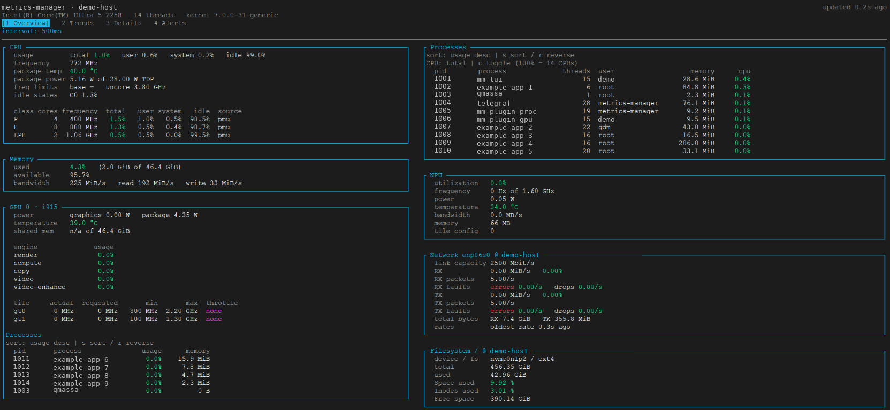
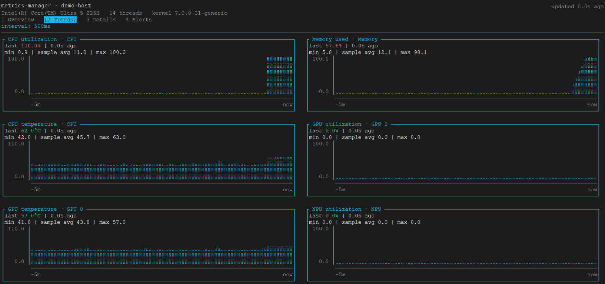
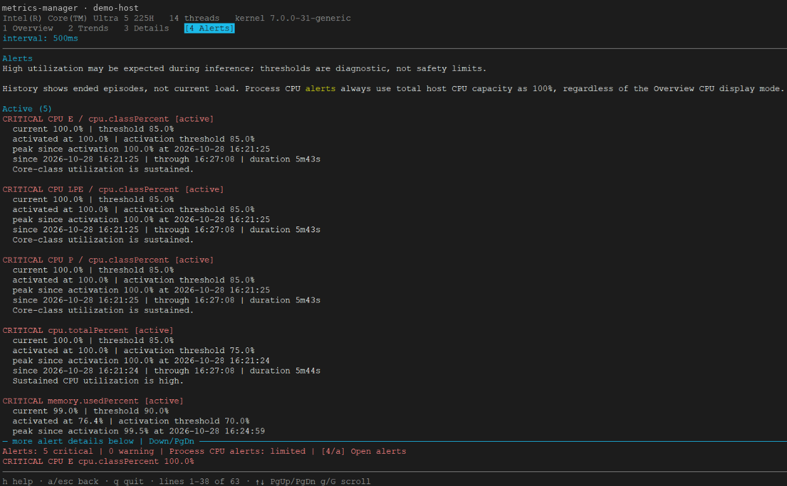

<!--
SPDX-FileCopyrightText: (C) 2026 Intel Corporation
SPDX-License-Identifier: Apache-2.0
-->

# Terminal dashboard

`mm-tui` is a read-only terminal dashboard for Metrics Manager's Prometheus
endpoint. It runs as an ordinary user, independently of the collectors and
REST API. It keeps bounded history in memory and does not write telemetry to
disk. Use the native collectors and dashboard from the same release; see the
[metric migration guide](./native-metric-migration.md).

## Build and start

This guide is also shipped with the Debian package. Repository links point to
source/build assets that are not installed with it; package users can run
`mm-tui` directly using the installed defaults.

The Docker service image supplies telemetry, not the interactive dashboard.
Build the standalone Linux binary from `microservices/metrics-manager` using
Docker and the pinned Go toolchain; no host Go installation is required:

```bash
. ./versions.env
mkdir -p native/bin
docker run --rm --cap-drop ALL --security-opt no-new-privileges \
  --user "$(id -u):$(id -g)" \
  -e HTTP_PROXY -e HTTPS_PROXY -e NO_PROXY \
  -e http_proxy -e https_proxy -e no_proxy \
  -e GOCACHE=/tmp/gocache -e GOMODCACHE=/tmp/gomodcache \
  -e GOTOOLCHAIN=local -e GOFLAGS=-mod=readonly -e CGO_ENABLED=0 \
  -e MM_VERSION="$(cat VERSION)" \
  -v "$PWD/native:/src:ro" -v "$PWD/native/bin:/out" -w /src \
  "$GO_IMAGE" sh -ec \
  'go build -trimpath -ldflags "-s -w -X main.version=$MM_VERSION" -o /out/mm-tui ./cmd/mm-tui'

./native/bin/mm-tui --version
./native/bin/mm-tui --help
```

Start a telemetry backend using the [Docker guide](https://github.com/open-edge-platform/edge-ai-libraries/blob/main/microservices/metrics-manager/docs/user-guide/get-started.md), then run:

```bash
./native/bin/mm-tui \
  -endpoint http://127.0.0.1:9273/metrics \
  -config ./native/packaging/etc/tui-dashboard.json \
  -charts-config ./native/packaging/etc/tui-charts.json
```

This polls Telegraf directly, not the API's custom-metrics-only `/metrics`.
No additional host privileges are needed for the dashboard. Optional hardware
still requires appropriately configured collectors. Protect telemetry endpoint
access; do not expose it publicly just to connect a remote terminal.

For a single Overview frame, without an interactive terminal:

```bash
./native/bin/mm-tui -once -width 160
```

## Navigation

| Key | Action |
|---|---|
| `q`, `Ctrl+C` | Quit |
| `h` | Open or close scrollable help |
| `Tab`, `Shift+Tab`; `1`, `2`, `3`, `4` | Select Overview, Trends, Details or Alerts |
| `a` | Open Alerts or return to the previous tab |
| `Esc` | Close help first, then alert details; otherwise quit |
| Up/Down, `k`/`j` | Move or scroll in the current view |
| `PgUp`, `PgDn`, `Space`; `Home`, `End`, `g`, `G` | Page or jump through content |
| `s`, `r` in Overview | Cycle process sorting or reverse direction |
| `c` in Overview | Toggle total-host/per-core process CPU percentages |
| Left/Right in Overview | Scroll narrow process tables horizontally |

Mouse support includes tab selection and scrolling. Help explains
view-specific controls, including Details metric selection. Header, tabs,
alert preview and footer remain visible while the content scrolls; boundary
indicators show whether more content is above or below.

## Responsive views

Overview adapts without requiring a restart:

- At least 224 columns, with a GPU: hardware panels, GPU panels and CPU
  processes occupy three independently stacked columns.
- At least 153 columns: hardware and process panels use two columns.
- Narrower terminals: panels stack in one scrollable column.

Each GPU shares its frame with its process table. Network and Storage enter
the shortest available column below the main panels. Optional panels appear
only when their metrics are available. Process rows remain tabular; use
horizontal scrolling if the columns cannot fit.

Trends shows CPU utilization, memory usage, CPU temperature, and utilization
and temperature for available GPUs and NPU. Details provides a larger selected
chart with grouped CPU, Memory, RAPL, GPU, NPU, network and storage metrics.
Selection is preserved if a device temporarily disappears.

### Screenshots

These sanitized captures show an earlier build. Host and process/user
identifiers were replaced; values were not changed. Layout depends on terminal
size and available metrics. The current NPU memory label is MiB, not the older
MB label in the Overview image.







## Configuration

Two JSON files control the dashboard independently:

- [tui-dashboard.json](https://github.com/open-edge-platform/edge-ai-libraries/blob/main/microservices/metrics-manager/native/packaging/etc/tui-dashboard.json):
  process limits/sorting, thresholds, alerts, mouse, network and storage.
- [tui-charts.json](https://github.com/open-edge-platform/edge-ai-libraries/blob/main/microservices/metrics-manager/native/packaging/etc/tui-charts.json):
  history window, graph style, chart sizes, Trends and Details selections.

Without explicit paths, the dashboard looks for these names under
`/etc/metrics-manager/`. Missing configuration files use built-in defaults.
Invalid configuration reports an error. Restart `mm-tui` after editing a file;
configuration does not hot-reload.

### Processes and sampling

The default is ten displayed processes per table, sorted by usage descending.
Change `processes.maxDisplayed` to display more; this does not increase the
number published by the collector. `processes.cpuMode` defaults to `total`:
100% means all logical CPUs are busy. In `core` mode, one busy CPU is 100% and
a multithreaded process can exceed 100%. Runtime `c` changes display mode,
not collection or saved configuration. Process CPU alerts use total-host CPU.

The default poll interval is 500 ms; `-interval 1s` changes polling, not
Telegraf's collection interval. `processes.maxSampleAge` defaults to 3 seconds;
network and storage use 10 seconds. Missing or stale samples are not fresh zero
measurements. Failed polls report an error, retain the last display and increase
its age while retrying with bounded backoff.

### Thresholds and alerts

Thresholds are configurable diagnostic aids, not hardware safety limits or
universal industry limits. Sustained utilization may be intentional.

| Reading | Careful | Warning | Critical |
|---|---:|---:|---:|
| CPU total/core-class utilization (%) | 65 | 75 | 85 |
| Memory, GPU/NPU utilization, process CPU (%) | 50 | 70 | 90 |
| CPU/NPU temperature (degrees C) | 70 | 85 | 95 |
| GPU temperature (degrees C) | 60 | 70 | 80 |
| GPU dedicated VRAM (%) | 70 | 85 | 95 |
| Storage space/inodes, network RX/TX link utilization (%) | 70 | 80 | 90 |
| Network errors/drops per second | 0.1 | 1 | 10 |

Threshold coloring progresses from normal through careful, warning and critical.
By default an alert requires three samples to raise and three to clear, with
5% hysteresis to reduce flapping. Careful events are hidden unless
`alerts.showCareful=true`. History retains at most 50 episodes.
The fixed bottom preview shows counts and the highest-severity event;
`alerts.bottomBar=false` recovers that screen space.

Alerts includes current/peak evidence and episode duration. Missing measurements
must not be interpreted as recovery; inspect the poll age and missing-data state
before concluding that a problem has cleared.

### Charts and units

Defaults are `historyDuration: "5m"`, `maxPoints: 600`, `chartHeight: 6`,
`graphMode: "braille"`, and a 10-row Details chart. Use `solid` when the terminal
font does not support Braille. Both history time and point count bound retention;
faster polling may hit the point limit before the full time window is filled.

Charts retain a fixed time axis rather than stretching a short history.
Time buckets show peaks and move together at bucket boundaries. Missing
samples and interruptions remain gaps; measured zero remains visible.
Min/average/max describe retained samples, not plotted bucket peaks.
The average is sample-weighted. History continues to expire while polling fails.
For device gauges, timestamps generally reflect receipt, not proof that an
upstream cached hardware reading is fresh.

Raw native metrics use Hz, bytes and bytes/second. The dashboard converts only
for presentation: adaptive clock units in Overview, MHz in frequency charts,
MiB/GiB for memory, decimal GB/s for DRAM and MB/s for NPU bandwidth.
Bandwidth is already a rate; do not differentiate it again. Whole-system DRAM
throughput is not GPU-specific bandwidth. Unavailable data is distinct from zero.

### Optional network and storage

Enable the relevant collectors using the
[native Docker collector guide](https://github.com/open-edge-platform/edge-ai-libraries/blob/main/microservices/metrics-manager/docs/user-guide/get-started/native-docker-collectors.md). Configuration
filters change the display, not collection or permissions:

- `network.interfaces`, `maxInterfaces` (default 8), and `speedMbps` overrides
  select interfaces and supply known link speeds. Without a usable speed,
  percentage utilization is unavailable; RX and TX are evaluated separately.
- `storage.mountPoints`, `devices`, `ignoreFilesystems`, `maxFilesystems` and
  `maxDevices` select filesystem and block-device views (four of each by default).
  Space/inode usage and block I/O are separate measurements. Resets, stale
  counters and incompatible intervals do not become fabricated rates.

Bridge-mode containers report their own network namespace. Use the documented
host-NIC profile when host-interface telemetry is required. The TUI cannot
recover host metrics that the endpoint never collected.
