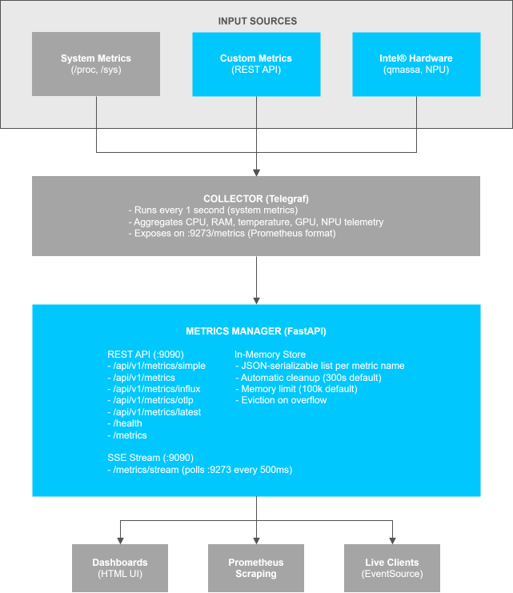
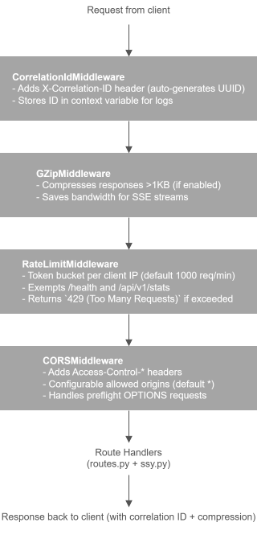
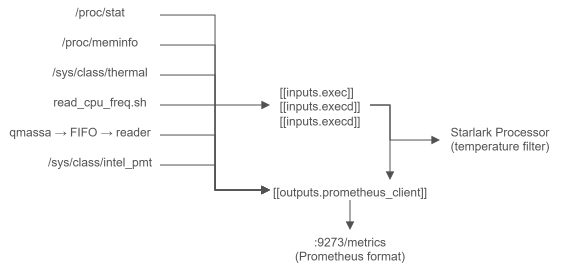

# How It Works

This document provides information about the architecture, data flows, and internal mechanisms of Metrics Manager.

## High-Level Architecture

Metrics Manager is a unified metrics platform that collects, stores, and streams metrics from three main sources:

1. **System Metrics** — Telegraf agents collect CPU, memory, temperature, GPU, NPU data
2. **Custom Metrics** — REST API accepts JSON, InfluxDB Line Protocol, OpenTelemetry formats
3. **Real-time Streaming** — Server-Sent Events (SSE) broadcasts metrics to live dashboards



---

## Component Breakdown

### Telegraf (System Metrics Collector)

Telegraf is a lightweight metrics agent that runs inside the container and collects:

**Inputs:**

- `/proc/stat` → CPU usage (user, system, idle) per core
- `/proc/meminfo` → Memory (total, used, available)
- `/sys/class/thermal/` → CPU temperature
- `read_cpu_freq.sh` (custom script) → CPU frequency
- `qmassa` (GPU reader) → Intel Arc GPU metrics (via named pipe)
- `npu_reader.py` (custom script) → Intel NPU metrics
- `Telegraf HTTP listener :8186` → Custom metrics from Metrics Manager

**Processing:**

- All inputs go through a Starlark processor (temperature filtering)
- Aggregated into Prometheus text format

**Outputs:**

- `:9273/metrics` — Prometheus endpoint (scraped by SSE clients)
- `:8186/write` — HTTP listener (accepts InfluxDB Line Protocol from FastAPI)

### Metrics Manager (FastAPI Application)

The FastAPI application provides:

**REST API Endpoints:**

- `POST /api/v1/metrics/simple` — Single metric (easiest format)
- `POST /api/v1/metrics` — JSON batch (multiple metrics with multiple fields)
- `POST /api/v1/metrics/influx` — InfluxDB Line Protocol batch
- `POST /api/v1/metrics/otlp` — OpenTelemetry (OTLP) format
- `GET /api/v1/metrics` — List all stored metrics (JSON)
- `GET /api/v1/metrics/latest` — Latest value per metric name
- `GET /api/v1/metrics/names` — Metric name list
- `DELETE /api/v1/metrics` — Clear all custom metrics
- `GET /health` — Basic health check
- `GET /api/health` — Detailed health with service statistics
- `GET /metrics` — Prometheus format (custom metrics only)

**SSE Stream Endpoint:**

- `GET /metrics/stream` — Server-Sent Events stream
  - Polls Telegraf `:9273/metrics` every 500ms (configurable)
  - Broadcasts all metrics as `data: {...}` events
  - Each client polls independently (no shared queue)
  - Browser support: serves HTML page with live table; SSE clients get raw stream

**In-Memory Storage:**

- Stores custom metrics with configurable retention (default 300 seconds)
- Automatic cleanup of expired metrics
- Automatic eviction when memory limit reached (default 100k metrics)
- Debounced persistence to Telegraf `:8186/write` (default 100ms debounce)

### Supervisor (Process Manager)

Manages three long-running processes inside the container:

1. **Telegraf** (priority 10) — System metrics collection
2. **Metrics Manager / uvicorn** (priority 20) — FastAPI application
3. **qmassa** (priority 30) — Intel GPU reader (writes to named pipe)

Priority determines startup order, with lower priority starting first. All are auto-restarted if they crash.

### Container Startup Sequence

When the container starts, the `entrypoint.sh` script initializes the environment and supervisor manages process startup:

```
entrypoint.sh
  │
  ├── Create directory: /app/custom-metrics
  ├── Create named pipe: /app/qmassa.fifo
  ├── Rebuild /etc/telegraf/active.d with only the drop-ins enabled by ENABLE_*
  │   (empty by default; see Hardware Telemetry Collectors below)
  └── Start supervisord
        │
        ├── [priority 10] telegraf --config telegraf.conf --config-directory active.d
        │   └── Starts immediately
        │       ├── Reads /proc/stat, /proc/meminfo, /sys/class/thermal/
        │       ├── Listens on :9273 (Prometheus output)
        │       ├── Listens on :8186 (HTTP write endpoint)
        │       └── Waits for custom metric inputs
        │
        ├── [priority 20] uvicorn app.main:app --port 9090
        │   └── Starts after Telegraf is ready
        │       ├── Initializes MetricsStore
        │       ├── Registers routes (/api/v1/*, /metrics/stream, /health)
        │       ├── Sets up middleware (CORS, rate limiting, compression)
        │       ├── Calls lifespan startup hooks
        │       └── Waits for requests
        │
        └── [priority 30] qmassa --to-json /app/qmassa.fifo
            └── Starts last
                ├── Enumerates Intel Arc GPUs
                ├── Writes JSON metrics to named pipe
                └── Telegraf reads from pipe and publishes on :9273
```

**Startup takes ~2–5 seconds.** The service is ready when all three processes are RUNNING (check with `supervisorctl status`).

---

## Custom Metrics Flow

```
HTTP POST client
  │
  ├── /api/v1/metrics         (JSON batch)
  ├── /api/v1/metrics/simple  (single metric)
  ├── /api/v1/metrics/influx  (InfluxDB Line Protocol)
  └── /api/v1/metrics/otlp    (OpenTelemetry)
         │
         ▼
  Parsing (Pydantic validation)
         │
         ▼
  Conversion to Metric object
         │
         ▼
  MetricsStore.add_metric(s)
  ├── Check memory limits (max 100k metrics)
  │   └── If exceeded → eviction of oldest entries
  ├── Save in _metrics[name] with expires_at
  ├── Schedule debounced persistence (default 100ms)
  │   └── asyncio.Task → HTTP POST to Telegraf :8186/write
  │       (fire-and-forget with error callback)
  └── Returns: {"accepted": N, "message": "..."}
         │
         ▼
  Metric visible in next SSE event
  (after Telegraf persistence, debounced ~100ms)
```

**Key Details:**

- All ingestion endpoints are **fire-and-forget** — the response is sent immediately while persistence happens in the background
- **No blocking**: Custom metrics do not block system metrics collection
- **Debounced persistence**: Multiple metrics pushed within 100ms are batched together in a single HTTP POST to Telegraf
- **Exponential backoff**: Failed HTTP POSTs retry with exponential backoff (not implemented yet, logged only)

---

## FastAPI Middleware Stack

The Metrics Manager FastAPI application uses a layered middleware stack to handle cross-cutting concerns like request tracing, compression, rate limiting, and CORS. Middleware is applied in the order shown below (outer to inner):



**Important Details:**

- **Correlation IDs**: Every request and response includes an `X-Correlation-ID` header. Use this ID to track a request through logs across services
- **Rate Limiting**: Applied to all endpoints except `/health`, `/api/v1/stats`, and SSE (`/metrics/stream`) — ensure critical endpoints remain accessible
- **GZIP Compression**: Automatic for responses >1 KB; especially useful for SSE streams with many metrics
- **CORS**: By default allows all origins (`*`). Restrict via `CORS_ORIGINS` environment variable in production

See [Environment Variables](./get-started/environment-variables.md#security) for security-related settings.

---

## System Metrics Collection



**Telegraf Inputs:**

| Input   | Source                | Interval   | Fields                                                           |
| ------- | --------------------- | ---------- | ---------------------------------------------------------------- |
| `cpu`   | `/proc/stat`          | 1s         | usage_user, usage_system, usage_idle (per core + total)          |
| `mem`   | `/proc/meminfo`       | 1s         | total, used, available, used_percent                             |
| `temp`  | `/sys/class/thermal/` | 1s         | temperature (per sensor, filtered to coretemp)                   |
| `exec`  | `read_cpu_freq.sh`    | 10s        | cpu_freq_mhz (per core)                                          |
| `execd` | `qmassa_reader.py`    | continuous | gpu\_\* (engine usage, frequency, power)                         |
| `execd` | `npu_reader.py`       | 1s         | npu_power, npu_frequency, npu_temperature, npu_utilization, etc. |

**Telegraf Output:**

- Listens on `:9273` and exposes all metrics in Prometheus text format
- Metrics include a `host=` tag (hostname or `METRICS_MANAGER_HOSTNAME` override)

Additional, opt-in inputs (power, DRAM bandwidth, disk, network, interrupts, turbostat) are described in [Hardware Telemetry Collectors](#hardware-telemetry-collectors).

---

## Hardware Telemetry Collectors

The optional collectors described in [Hardware Telemetry Collectors](./get-started/hardware-telemetry.md) are shipped as Telegraf drop-in files in `/etc/telegraf/telegraf.d/` and switched on with `ENABLE_*` environment variables.

```
/etc/telegraf/telegraf.d/        read-only; all shipped drop-ins (10-power.conf, 20-dram-bw.conf, ...)
        │
        │  entrypoint.sh, at every start:
        │    1. delete and recreate /etc/telegraf/active.d
        │    2. copy a drop-in only if its ENABLE_* variable is on
        │       (and, for turbostat and DRAM bandwidth, only if the binary it needs is usable)
        ▼
/etc/telegraf/active.d/          writable; only the enabled drop-ins

telegraf --config /etc/telegraf/telegraf.conf --config-directory /etc/telegraf/active.d
```

- **Why a separate directory.** The source directory is bind-mounted read-only from the host, so the entrypoint cannot rename or delete files in it. Assembling the active set elsewhere also means the directory always reflects the current environment: changing a toggle and recreating the container is the whole procedure, and there is no hot reload.
- **Nothing loads by default.** With every toggle off, `active.d` is empty and Telegraf runs on `telegraf.conf` alone. This holds for a custom `telegraf.conf` too, because `--config-directory` is merged with whichever base config is mounted.
- **Only shipped names are copied.** A file you add to the mounted `telegraf.d/` directory is not loaded. Put your own inputs in a custom `telegraf.conf`.
- **A missing dependency never takes Telegraf down.** The entrypoint skips turbostat (a service input that makes Telegraf fail at startup if its binary cannot run) and `ENABLE_DRAM_BW=auto` without `perf`, and logs a `[WARN]` or `[INFO]` line. The `execd` readers idle quietly and log why when their hardware source is absent.

### Native inputs and `execd` readers

Telegraf pulls metrics from native plugins on its own clock. `execd` readers are long-running Python scripts that Telegraf starts once and that print InfluxDB Line Protocol on stdout whenever they choose (`signal = "none"`). Both end up in the same buffer and look identical on `:9273`.

The design prefers native plugins (`intel_powerstat`, `diskio`, `net`, `ethtool`, `interrupts`, `temp`, `turbostat`) and uses a small `execd` reader only where no plugin reaches the data:

| Reader | Why a reader |
|--------|--------------|
| `rapl_reader.py` | `intel_powerstat` exposes the package and DRAM RAPL domains but not the platform (`psys`) domain, the best proxy for whole-board power |
| `dram_bw_reader.py` | `inputs.intel_pmu` needs per-model perfmon event files that the image does not ship, returns raw multiplexed cache-line counts rather than GB/s, and its `*_CAS_COUNT_FREERUN` events read zero in our tests. `perf stat` on the IMC free-running counters gives GB/s directly and matched the `intel_pmu` CAS counts on Meteor Lake. See [Hardware Telemetry Collectors](./get-started/hardware-telemetry.md) |
| `gpu_throttle_reader.py` | The existing GPU reader reports requested frequency but not achieved frequency or throttle reasons |

Each reader follows the same contract as the NPU reader: if its tool, counter or permission is missing, it parks itself and logs the reason to its trace log instead of exiting, because Telegraf restarts an `execd` child that exits and that would flood the log.

Other choices worth knowing:

- **Interrupts keep only numbered IRQs** (`irq = ["[0-9]*"]`) and the per-IRQ `total` field. Device interrupts are numbered on x86, while kernel housekeeping counters are symbolic and differ by SoC, so a denylist would need constant maintenance. The per-CPU fields scale with core count and are dropped.
- **Visualization stays outside the service.** Metrics Manager exposes Prometheus metrics and ships a scrape-job snippet (`dashboards/prometheus-scrape-job.yml`). It does not ship Grafana dashboards or a Prometheus stack.
- **Counters vs gauges.** `diskio_*`, `net_bytes_*` and `interrupts_total` are monotonic counters; wrap them in `rate()`. Power, temperature, frequency and bandwidth are gauges.

---

## SSE Streaming

```
SSE Client (browser or script)
  │
  └── GET http://localhost:9090/metrics/stream
        │
        ▼  each client runs its own independent event_stream()
        │  coroutine — there is no shared queue or subscriber state
        │
  sse.py: event_stream()
  │
  ├── Loop: every PROMETHEUS_POLLER_INTERVAL_MS (default 500ms)
  │   └── HTTP GET http://localhost:9273/metrics
  │       └── Parse Prometheus text format
  │           └── Convert to flat metric list
  │               └── yield: data: {"timestamp": ..., "metrics": [...]}
  │
  └── Each event contains all metrics available at that moment
     (system metrics from Telegraf + persisted custom metrics)
```

**Event Format:**

```json
{
  "timestamp": 1777461975860,
  "metrics": [
    {
      "name": "cpu_usage_user",
      "labels": { "cpu": "cpu-total", "host": "myhost" },
      "value": 0.14,
      "timestamp": 1777463430000
    },
    {
      "name": "memory_used_mb",
      "labels": { "host": "myhost" },
      "value": 2048.5,
      "timestamp": 1777463430000
    }
  ]
}
```

**Content Negotiation:**

- Browser request (`Accept: text/html`) → served HTML page with in-place updated metrics table
- SSE request (`Accept: text/event-stream`) → raw event stream
- No `Accept` header → defaults to event stream for backwards compatibility

**Connection Model:**

- Each client connection is independent
- No shared queue or subscriber state
- If a client connects after a metric is published, that metric appears in the next polling cycle (~500ms)
- If a client disconnects, no cleanup needed (connection closed immediately)

---

## Metric Lifecycle

```
1. Metric arrives (via API or custom script)
   │
   ▼
2. Parsed and validated (Pydantic)
   │
   ▼
3. Converted to Metric object with tags
   │
   ▼
4. Wrapped in StoredMetric(metric, expires_at=now + METRICS_RETENTION_SECONDS)
   │
   ▼
5. Added to MetricsStore._metrics[name] (list per metric name)
   │
   ▼
6. Memory check: if > MAX_METRICS_IN_MEMORY → _evict_oldest()
   │
   ▼
7. Debounced persistence (default 100ms):
   │   ├─ If >= 100ms since last push → persist immediately
   │   │   └── HTTP POST to Telegraf :8186/write (fire-and-forget)
   │   │       └── InfluxDB Line Protocol format
   │   │       └── Error callback logs failures (no retry yet)
   │   └─ Otherwise → asyncio.Task(_delayed_persist) after sleep
   │       └── Checks _pending_persist inside lock (no race)
   │       └── Makes one HTTP POST with accumulated metrics
   │
   ▼
8. Metric visible in Prometheus endpoint (:9273/metrics)
   │   └── Available to SSE clients in next polling cycle (~500ms)
   │
   ▼
9. After METRICS_RETENTION_SECONDS (default 300s):
   │   └── Metric expires and is removed on next store access
   │
   ▼
10. Cleanup: _cleanup_expired() runs on every store access
    └── Removes all metrics where expires_at < now
```

---

## Key Classes and Architecture

```
main.py (FastAPI application)
  │
  ├── lifespan.startup
  │   └── MetricsStore.get_instance() → singleton initialization
  │
  ├── middleware stack
  │   ├── CorrelationIdMiddleware (X-Correlation-ID headers)
  │   ├── GZipMiddleware (compress responses >1KB)
  │   ├── RateLimitMiddleware (token bucket per IP)
  │   └── CORSMiddleware (configurable origins)
  │
  ├── routes.py (REST endpoints)
  │   ├── POST /api/v1/metrics/*
  │   ├── GET /api/v1/metrics
  │   ├── GET /health
  │   └── etc.
  │
  └── sse.py (SSE endpoint)
      └── GET /metrics/stream
          └── event_stream() — polls :9273 per client
```

---

## Data Formats

### InfluxDB Line Protocol (Internal Persistence Format)

```
measurement[,tag1=val1,tag2=val2] field1=val1[,field2=val2] [timestamp]
```

**Example:**

```
cpu_usage,host=myhost,cpu=cpu0 usage=45.2 1704067200000000000
memory,host=myhost used_percent=67.5 1704067200000000000
```

Used for:

- Telegraf input/output
- Custom metrics persistence to Telegraf
- `/api/v1/metrics/influx` endpoint input

### Prometheus Text Format (Query Output)

```
metric_name{label1="value1",label2="value2"} value
metric_name{label1="value1",label2="value2"} value
```

**Example:**

```
cpu_usage_user{cpu="cpu-total",host="myhost"} 45.2
memory_used_mb{host="myhost"} 2048.5
```

Used for:

- `:9273/metrics` endpoint (scraped by SSE clients)
- `/metrics` endpoint (custom metrics only)

### JSON Batch Format (REST API Input)

```text
{
  "metrics": [
    {
      "name": "metric_name",
      "fields": {"field1": value1, "field2": value2},
      "tags": {"tag1": "val1", "tag2": "val2"},
      "timestamp": 1704067200000000000,
      "metric_type": "gauge"
    }
  ]
}
```

---

## Performance Characteristics

| Scenario                     | Performance                                                   |
| ---------------------------- | ------------------------------------------------------------- |
| Ingest 1000 metrics/sec      | ~5% CPU, <100ms p99 latency (debounced persistence)           |
| Store 100k metrics in memory | ~50 MB RAM                                                    |
| SSE broadcast to 100 clients | ~50 ms per polling cycle (one Telegraf fetch per 100 clients) |
| Custom metric appears in SSE | ~600ms worst-case (100ms debounce + 500ms polling interval)   |

---

## Error Handling

- **Invalid metric format**: Returns `422 Unprocessable Entity` with validation error
- **Memory limit exceeded**: Oldest metrics are evicted silently
- **Telegraf :8186 unreachable**: HTTP POST fails, error logged, metrics still stored locally
- **Expired metrics**: Cleaned up silently on next store access
- **Rate limit exceeded**: Returns `429 Too Many Requests`
- **Graceful shutdown**: Completes in-flight requests, closes aiohttp session, logs uptime

## Supporting Resources

- [Hardware Telemetry Collectors](./get-started/hardware-telemetry.md)
- [API Reference](./api-reference.md)
- [Architecture Overview](./index.md)
- [Environment Variables](./get-started/environment-variables.md)
- [Troubleshooting](./troubleshooting.md)

## License

Copyright (C) 2025-2026 Intel Corporation

SPDX-License-Identifier: Apache-2.0
