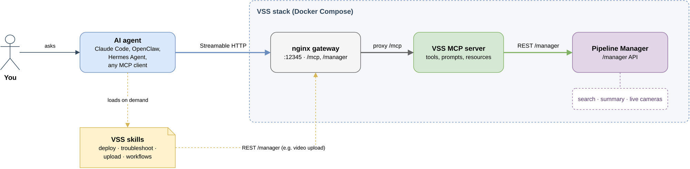

<!--
SPDX-FileCopyrightText: (C) 2026 Intel Corporation
SPDX-License-Identifier: Apache-2.0
-->

# Agentic Video Analytics with VSS

Use a general-purpose AI agent, such as **Claude Code**, **OpenClaw**,
**Hermes Agent**, or any other Model Context Protocol (MCP) client, to work
with your [Video Search and Summarization (VSS)](./index.md) deployment in
plain language. You can review incidents, find a person from a description or
a photo, follow someone across live cameras, and get summaries shaped the way
you need them, without writing code against the VSS API.

This guide walks you through the full setup: start VSS, add footage, connect
your agent, install the VSS skills, and then try the use cases.

## How It Works

VSS provides three agent-facing artifacts. An agent can use any combination of
them:

| Artifact | What it gives the agent | Where it lives |
|---|---|---|
| **VSS MCP server** | Tools the agent calls at run time: list and resolve videos, index them, search by text or image, watch a search live, fetch the matching frame, manage cameras, and summarize videos. | Starts with every VSS deployment at `http://<HOST_IP>:12345/mcp`. See [MCP Server](./mcp-server.md). |
| **VSS skills** | Know-how the agent loads on demand: how to deploy, check, and repair VSS and its MCP server, plus the search and summary workflows written out as REST API calls. | `SKILL.md` folders under `.github/skills/` in the VSS source tree. See [Step 4](#step-4-add-the-vss-skills). |
| **Pipeline Manager REST API** | The HTTP API behind both of them. An agent calls it directly to upload videos and reference images. | `http://<HOST_IP>:12345/manager/...` |

A typical setup connects the agent to the MCP server and adds the skills that
deploy and look after VSS.



*Editable source: [agentic-video-analytics.drawio](./_assets/agentic-video-analytics.drawio).*

The MCP server reads which VSS features are enabled when it starts and
registers only the tools that the deployment can serve. The agent therefore
never sees, for example, summary tools on a search-only deployment.

## Prerequisites

- A host that meets the [system requirements](./get-started/system-requirements.md),
  with the VSS source checked out.
- An AI agent that supports MCP over **Streamable HTTP**. This guide covers
  Claude Code, OpenClaw, and Hermes Agent; any other MCP client works the same
  way.
- Network access from the machine running the agent to `http://<HOST_IP>:12345`.

> **Note:** The VSS MCP server has no authentication of its own. Anyone who
> can reach the VSS gateway can call its tools. Run it only on a trusted
> network.

## Step 1: Start VSS

Choose the deployment mode that matches the use cases you want. All commands
are run from the application root, `sample-applications/video-search-and-summarization`.

| Mode | Command | Use cases enabled in this guide |
|---|---|---|
| Search | `source setup.sh --search` | Incident review by search, person search by description or image, live tracking, live cameras |
| Summary | `source setup.sh --summary` | Video summaries, customized summaries, incident review from a summary |
| Dual UI | `source setup.sh --dual` | **All use cases in this guide** (recommended) |
| Unified UI | `source setup.sh --unified` | Summaries and text search over summary content. No image search and no live cameras |

`setup.sh` must be **sourced**, not executed. See [Get Started](./get-started.md)
for model and hardware options.

When the stack is up, the final output prints the MCP URL. Confirm VSS is
healthy and check which features are on:

```bash
curl -s http://<HOST_IP>:12345/manager/health
curl -s http://<HOST_IP>:12345/manager/app/features
```

## Step 2: Add Footage

### Upload videos

Upload through the VSS UI at `http://<HOST_IP>:12345/`, or with the REST API.
Tags are one comma-separated field. Use them to name the camera or place,
because the agent filters searches by tag:

```bash
curl -s -X POST http://<HOST_IP>:12345/manager/videos \
  -F 'video=@/path/to/loading-dock.mp4' \
  -F 'tags=loading-dock,warehouse'
```

The response is `{"videoId": "..."}`. VSS accepts only streamable MP4 files.
If an upload returns `422`, remux the file and upload it again:

```bash
ffmpeg -i in.mp4 -c copy -movflags +faststart out.mp4
```

Video upload is deliberately **not** an MCP tool: the MCP server does not carry
video bytes. An agent with a shell runs the `curl` command above for you; the
standing instructions in Step 4 give it the endpoint. Otherwise, the agent
gives you the command to run.

In search modes, a video can be found only after it has been indexed. Once your
agent is connected (Step 3), you can hand the whole job to it:

> *"Upload the videos to VSS, tag them, then index them for search."*

The agent uploads each file with `curl`, then calls `vss_index_video` with each
returned `videoId`. Name the videos to index rather than asking it to index
"everything that isn't indexed": the indexed status of older videos can be
unknown, and on a large library that request starts an indexing job for every
video.

### Add live cameras (optional)

Live RTSP cameras need the **Search** or **Dual UI** mode. Add them from the
**Live Streams** page of the VSS UI, or ask your agent once it is connected:

> *"Add the camera `rtsp://<camera-host>:554/stream1` named Lobby, with object
> detection on, and tag it `lobby`."*

The agent calls `vss_add_stream` and then `vss_get_stream` to confirm the camera
is `running`. New footage becomes searchable about 10 to 30 seconds after it is
ingested. With object detection on, detected people, vehicles, animals, and bags
are also embedded as crops, which makes them easier to find and track.

## Step 3: Connect Your Agent to the VSS MCP Server

Every agent uses the same endpoint and transport:

| Setting | Value |
|---|---|
| URL | `http://<HOST_IP>:12345/mcp` |
| Transport | Streamable HTTP |
| Authentication | None |

### Claude Code

```bash
claude mcp add --transport http vss http://<HOST_IP>:12345/mcp
claude mcp list            # vss should show "Connected"
```

Add `--scope user` to use VSS from every project, or `--scope project` to
write it to a shared `.mcp.json`:

```json
{
  "mcpServers": {
    "vss": { "type": "http", "url": "http://<HOST_IP>:12345/mcp" }
  }
}
```

Inside a session, `/mcp` lists the server and its tools.

### OpenClaw

```bash
openclaw mcp add vss --url http://<HOST_IP>:12345/mcp --transport streamable-http
openclaw mcp doctor vss --probe
```

The equivalent entry in `~/.openclaw/openclaw.json` is:

```json5
{
  mcp: {
    servers: {
      vss: {
        url: "http://<HOST_IP>:12345/mcp",
        transport: "streamable-http",
        enabled: true,
        // Searches and summaries can take a while; allow for it.
        requestTimeoutMs: 600000
      }
    }
  }
}
```

### Hermes Agent

Add the server to `~/.hermes/config.yaml`. A `url` entry uses Streamable HTTP
by default:

```yaml
mcp_servers:
  vss:
    url: "http://<HOST_IP>:12345/mcp"
    enabled: true
```

Then verify it:

```bash
hermes mcp test vss
```

In a running session, `/reload-mcp` picks up configuration changes.

### Any other MCP client

Point the client at `http://<HOST_IP>:12345/mcp` with the Streamable HTTP
transport. To check the endpoint without a client, list the tools directly:

```bash
curl -s -X POST http://<HOST_IP>:12345/mcp \
  -H 'Content-Type: application/json' \
  -H 'Accept: application/json, text/event-stream' \
  -d '{"jsonrpc":"2.0","id":1,"method":"tools/list"}'
```

Once connected, ask the agent *"What can VSS do in this deployment?"*. It calls
`vss_get_deployment_info` and reports the enabled features and how much of the
library is indexed.

## Step 4: Add the VSS Skills

Skills give the agent procedures it loads only when a task needs them. VSS ships two kinds.

**Deployment and operations.** These cover what the MCP tools don't: running
VSS itself.

| Skill | Use it to |
|---|---|
| `vss-deploy` | Start, stop, switch modes, and clean up VSS with `setup.sh` |
| `vss-troubleshoot` | Check health, detect the running mode, and diagnose failing services |
| `vss-mcp-integration` | Run, connect to, and debug the VSS MCP server, including missing tools |

**API workflows.** These cover the same search, indexing, camera, and summary work as the MCP tools, written out as REST calls. They suit an agent that works without MCP, or one that scripts  against the API.

| Skill | Use it to |
|---|---|
| `vss-search-index` | Upload videos, generate search embeddings, run searches, and manage live cameras through the REST API |
| `vss-summarize-video` | Start a summary, poll it, and fetch the result through the REST API |

Copy the skill folders from the VSS source tree into your agent's skills
directory. Run the command from the application root:

```bash
SKILLS="vss-deploy vss-troubleshoot vss-mcp-integration"
# For REST-based work without MCP, also add:
# SKILLS="$SKILLS vss-search-index vss-summarize-video"

# Claude Code: personal skills (use .claude/skills/ inside a project to share them)
mkdir -p ~/.claude/skills && for s in $SKILLS; do cp -r .github/skills/$s ~/.claude/skills/; done

# OpenClaw: workspace skills
mkdir -p ~/.openclaw/workspace/skills && for s in $SKILLS; do cp -r .github/skills/$s ~/.openclaw/workspace/skills/; done

# Hermes Agent
mkdir -p ~/.hermes/skills && for s in $SKILLS; do cp -r .github/skills/$s ~/.hermes/skills/; done
```

Then confirm that the agent has loaded the skills:

- **Claude Code:** start a new session; the skills appear in the `/` command menu.
- **OpenClaw:** run `openclaw skills list`. Start a new session with `/new`.
- **Hermes Agent:** start a new session; skills become slash commands such as `/vss-troubleshoot`.

### Recommended: standing instructions for the agent

Most agents accept standing instructions, such as a project instructions file
(`AGENTS.md`, `CLAUDE.md`) or a system prompt. The VSS MCP server sends similar
guidance when a client connects, but not every client passes it on to the
model. Without these lines, smaller models tend to skip the tags, skip frame
checks, and edit clip URLs:

```text
When using VSS:
- Use the `vss` MCP tools (`vss_*`) for every VSS question, starting with
  vss_get_deployment_info. Use the REST API only for what the tools don't
  cover, such as uploading video or image files.
- Upload a video with
  `curl -F video=@<file> -F tags=<tags> http://<HOST_IP>:12345/manager/videos`
  and a reference image with
  `curl -F image=@<file> http://<HOST_IP>:12345/manager/search/images`.
- Describe what to look for as it would appear on camera (clothing, colours,
  objects carried); do not search by names, faces, plate numbers or text.
- Put the camera/place in `tags` and the time range in `start`/`end`, not in
  the query text. Compute UTC times from vss_get_deployment_info.server_time_utc.
- Treat every hit as a possible match. Check it with vss_get_media_frame,
  passing the hit's `frame` object with every field unchanged, before
  reporting it.
- Give each clip `url` exactly as returned, with its start_s/end_s as text;
  never build or edit URLs.
- Ask before removing a camera.
```

## Step 5: Try the Use Cases

Each use case below shows a prompt you can adapt, what the agent does with the
VSS tools, and which mode it needs. Clients that support MCP prompts also
offer ready-made workflows from the server: `search_videos`,
`monitor_camera`, `track_object`, and `summarize_video`.

### 1. Review incidents in a time window

VSS has no built-in incident classifier. The agent assembles an incident list
from what VSS returns. It can do this in two ways, and you can combine them.

**A. Search-based review** (Search or Dual UI mode). This works best across
many videos and cameras:

> *"Review the loading-dock cameras for the last 2 hours. Look for a person
> lying on the floor, people fighting, a spill on the floor, and a person
> climbing over the fence. List each incident with the time, the camera, and
> a link to the clip."*

What the agent does:

1. Calls `vss_list_tags` to map "loading-dock" to a tag, and
   `vss_get_deployment_info` to turn "last 2 hours" into UTC `start` and `end`.
2. Runs one `vss_search_video` per incident type. Each query is a short visual
   description, such as *"person lying on the floor"*, with no negation or
   time words.
3. Checks the strongest hits with `vss_get_media_frame` and drops those that
   don't show the incident.
4. Groups what remains into an incident list in time order.

**B. Summary-based review** (Summary or Dual UI mode). This works best for
reading one long recording end to end:

> *"Summarize `night-shift-cam3.mp4` with a focus on safety incidents, then
> list every incident from the timeline with its start time and a one-line
> description."*

The agent calls `vss_resolve_video`, then `vss_summarize_video` with
`focus="safety incidents"`. It extracts the incidents from the caption timeline
that VSS returns.

### 2. Find a person by description

*Mode: Search or Dual UI.*

> *"Find a person in a dark blue jacket and grey trousers carrying a black
> backpack near the main entrance between 13:00 and 14:00 UTC today."*

The agent puts the place in `tags`, the time in `start`/`end`, and the
appearance in `query`, then calls `vss_search_video`. Results are ranked
best-first. Each hit has a playable `url`, a `start_s`/`end_s` range, and, for
live cameras, `observed_at` (when it happened, UTC). Ask the agent to *"show
me the frame for the top three hits"* to verify them with
`vss_get_media_frame`.

### 3. Find a person by reference image

*Mode: Search or Dual UI. These modes have the frame-embedding index that image
search needs.*

1. Upload the reference photo (JPEG, PNG, or WebP, up to 2 MB):

   ```bash
   curl -s -X POST http://<HOST_IP>:12345/manager/search/images -F 'image=@person.jpg'
   ```

   The response includes `imageId` and `imageUrl`.

2. Give the agent the reference:

   > *"Search all cameras for the person in this image: `<imageUrl>`."*

   The agent passes it as `image` to `vss_search_video`. VSS reads the image
   from its own storage, so no image data passes through the agent. An agent
   that already holds the image, for example as an attachment, can send it as
   a `data:` URL instead.

3. Refine. If a clip shows the person more clearly than the original photo,
   save a still from it, crop it to the person, upload it as in step 1, and
   search again with the new `imageUrl`. To keep following that person on
   live cameras, see use case 4. Tracking can start directly from a hit.

Remove an uploaded reference when you no longer need it:
`curl -X DELETE http://<HOST_IP>:12345/manager/search/images/<imageId>`.
Arbitrary external image URLs are rejected by design.

### 4. Track a person or object across live cameras

*Mode: Search or Dual UI, with at least one live camera running.*

> *"Track the person from hit 1 across all cameras for the next 15 minutes and
> tell me each time they show up."*

What the agent does:

1. Calls `vss_watch_search` with the hit's `frame` as `from_hit`. This searches
   by that hit's detected crop, which is the closest match to that specific
   person. It also sets `window_minutes=5` so each refresh ranks only recent
   footage, and `duration_minutes=15`.
2. Polls `vss_watch_search` with the returned `query_id` and `next_cursor`.
   Each poll waits (30 s by default, `wait_seconds`) until a new sighting
   arrives, and the agent reports only new sightings: camera, time, and clip.
3. Checks sightings with `vss_get_media_frame`, because look-alikes are common.
4. Stops when the duration expires, or when you say *"stop tracking"*
   (`watch=false`). It then summarizes the route in time order.

You can also start from a description (*"track a white van"*) or a reference
image instead of a hit. VSS refreshes the watched search on its own as new
footage arrives. To cut look-alike noise, ask for strong matches only (*"only
report strong matches"*): the agent sets `min_peak_score` (for example `0.3`),
which VSS saves on the search and applies to every refresh. The agent picks up new sightings only while it keeps polling
in the conversation.

### 5. Summarize a video

*Mode: Summary, Dual UI, or Unified UI.*

> *"Summarize the warehouse shift recording."*

The agent resolves the video by name with `vss_resolve_video` and calls
`vss_summarize_video`. It returns the video's final summary, in full; ask for
a timeline (what happens when) to get the chunk captions instead. Long videos can outlast the tool's wait budget. In
that case the result says `completed=false`, and the agent fetches the rest
later with `vss_get_video_summary_timeline`. If the video isn't in VSS yet, upload it
first as described in Step 2. An agent with a shell can do this for you.

### 6. Get a customized summary

*Mode: Summary, Dual UI, or Unified UI.*

You can shape a summary at two levels:

- **What VSS pays attention to.** The `focus` option steers the per-chunk
  captions toward what matters to you.
- **How the agent presents it.** The agent reformats VSS's timeline and summary
  into any report you describe.

> *"Summarize `dock-camera-morning.mp4`, focusing on forklifts and pedestrians.
> Then write a shift handover report: a table of time, event, and risk level
> (low, medium, or high), followed by three recommended actions."*

The agent calls `vss_summarize_video` with `focus="forklifts and pedestrians"`
and builds the report from the timeline. Other options you can ask for in plain
words:

| Ask for | Option the agent sets |
|---|---|
| "Just the timeline, faster" | `final_summary=false` |
| "Finer detail" / "coarser chunks" | `chunk_duration` (seconds per chunk, default 8) |
| "Look at more frames per chunk" | `sampling_frames` (default 8, capped by the deployment) |
| "Ignore the audio" | `audio=false` |
| "Summarize what's said" (speech-heavy videos) | `audio_full_transcript_summary=true` |

## Tips for Good Results

- **Describe the look, not the identity.** Embeddings match appearance:
  clothing, colours, vehicle type, carried objects. They can't read names,
  faces, plate numbers, or on-screen text.
- **One thing per query.** Run separate searches for separate things, and
  avoid negation ("not wearing a hat").
- **Use tags for places.** Tag videos and cameras by location so the agent can
  filter by tag rather than guess from query words. `vss_list_tags` shows the
  real tags.
- **Know what the time window filters.** For live cameras, the time is when the
  footage was observed. For uploaded videos, it is when the footage was added
  to VSS, not the recording time inside the file. Leave out `start` and `end`
  to search uploaded files by content alone.
- **Read scores as rankings.** Results are relative to each other, so a top hit
  is not proof. Verify with the frame.
- **If nothing is found,** change one thing at a time: simpler wording, a wider
  window, or fewer tags. Also check that the videos are indexed.

## Responsible Use

- Search results are visual **similarity**, not identity or face recognition.
  Treat every hit as a possible match until a person has checked it.
- Keep a person in the loop for decisions that affect people.
- `vss_remove_stream` is the only destructive tool. It stops and deregisters a
  camera but keeps its recorded footage and embeddings. Ask the agent to
  confirm before removing a camera, or pause it instead.
- The agent never needs RTSP credentials repeated back. Keep camera URLs with
  credentials out of shared transcripts.
- The MCP endpoint is unauthenticated. Expose the VSS gateway only on a trusted
  network.

## Troubleshooting

| Symptom | What to check |
|---|---|
| The agent can't connect | `curl http://<HOST_IP>:12345/manager/health`, then the `tools/list` call from Step 3. Check `docker logs vss-mcp-server`. |
| Search or summary tools are missing | The deployment mode doesn't enable them. Check `GET /manager/app/features`. The MCP server reads features once at startup, so re-deploy after changing modes. |
| `vss_get_media_frame` returns `404` for a camera hit | The agent dropped `media_path` from the hit's `frame` object, so VSS looked for a frame in an uploaded video. Ask it to pass the `frame` object unchanged. |
| A camera's state is `error` | VSS couldn't read the RTSP source and stopped retrying. Check `last_error` with `vss_get_stream`, fix the source, then ask the agent to restart the camera. |
| Image search returns `400` | Image search needs the Search or Dual UI mode. External image URLs are rejected; upload the image with `POST /manager/search/images`. |
| Searches return nothing | Videos aren't indexed yet (*"which videos aren't indexed?"*), or the time window doesn't match. See [Tips for Good Results](#tips-for-good-results). |
| A summary comes back incomplete | The wait budget ran out (`completed=false`). Ask the agent to fetch the timeline again later. |
| Upload fails with `422` | The file isn't a streamable MP4. Remux it with `ffmpeg` as shown in Step 2. |

The `vss-troubleshoot` and `vss-mcp-integration` skills walk the agent through
deeper diagnosis. For server internals, configuration, and the full tool list,
see [MCP Server](./mcp-server.md) and the [Troubleshooting](./troubleshooting.md)
guide.
