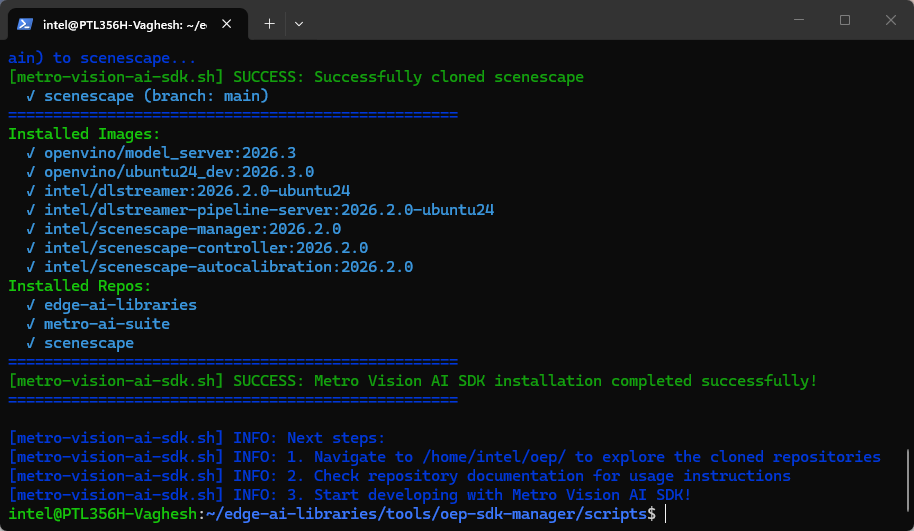
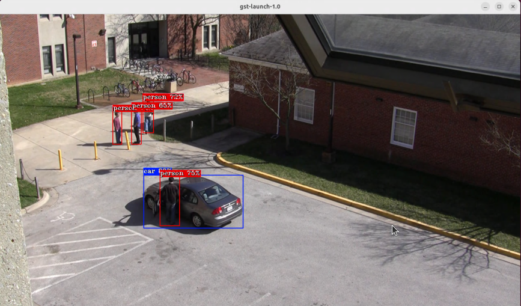

<!--
SPDX-FileCopyrightText: (C) 2026 Intel Corporation
SPDX-License-Identifier: Apache-2.0
-->

# Getting Started Guide - Metro Vision AI SDK

## Overview

The Metro Vision AI SDK provides a comprehensive development environment for computer vision applications using Intel's optimized tools and frameworks. This guide demonstrates the installation process and provides a practical object detection implementation using DL Streamer and OpenVINO.

## Learning Objectives

Upon completion of this guide, you will be able to:

- Install and configure the Metro Vision AI SDK
- Execute object detection inference on video content
- Understand the basic pipeline architecture for computer vision workflows

## System Requirements

Verify that your development environment meets the following specifications:

- Operating System: Ubuntu 24.04 LTS or Ubuntu 26.04 LTS
- Memory: Minimum 8GB RAM
- Storage: 20GB available disk space
- Network: Active internet connection for package downloads

## Installation Process

Execute the automated installation script to configure the complete development environment:

The installer clones [Metro AI Suite](https://github.com/open-edge-platform/metro-ai-suite) into `~/oep/metro-ai-suite`, plus Edge AI Libraries and Scenescape, all from `main`.

```bash
curl -fsS https://raw.githubusercontent.com/open-edge-platform/edge-ai-libraries/refs/heads/main/tools/oep-sdk-manager/scripts/metro-vision-ai-sdk.sh | bash
```




The installation process configures the following components:

- Docker containerization platform
- DL Streamer video analytics framework
- OpenVINO inference optimization toolkit
- Pre-trained model repositories and sample implementations

## Object Detection Implementation

This section demonstrates a complete object detection workflow using the installed components.

### Step 1: Create Working Directory

Create a dedicated working directory for the tutorial:

```bash
mkdir -p ~/oep/metro-vision-get-started-tutorial
cd ~/oep/metro-vision-get-started-tutorial
```

### Step 2: Download Sample Video and Model

Run the Docker commands from your regular non-root host shell, without `sudo`.
The `--user "$(id -u):$(id -g)"` option gives generated files your host UID and primary GID, so you can copy, move, and delete them without root privileges.
Create the working directory before mounting it; these commands do not repair files created by earlier root-run containers.
The download container uses the mounted workspace as its writable home for model preparation environments and caches.

Download the Intel-hosted sample video, which shows pedestrians and a vehicle from a street-side perspective:

```bash
wget -O sample.mp4 https://raw.githubusercontent.com/open-edge-platform/edge-ai-resources/main/videos/VIRAT_S_000101.mp4
```

Download and convert the COCO-trained YOLO11s detector using the DL Streamer container:

```bash
# Download YOLO11s model using DL Streamer
docker run --rm --user "$(id -u):$(id -g)" \
  -e HOME=/home/dlstreamer \
  -e http_proxy -e https_proxy -e no_proxy \
  -v "${PWD}:/home/dlstreamer/" \
  intel/dlstreamer:2026.2.0-ubuntu24 \
  bash -c "export MODELS_PATH=/home/dlstreamer && /opt/intel/dlstreamer/samples/download_public_models.sh yolo11s"
```

The downloader creates `public/yolo11s/FP16/yolo11s.xml` and `yolo11s.bin` in the working directory. YOLO11s detects COCO classes including `person`, `car`, `bus`, and `truck`; DL Streamer reads its class labels and preprocessing metadata directly from the exported model, so no model-proc file is needed.

### Step 3: Pipeline Execution

Execute the object detection pipeline using the configured assets.

```bash
# Allow the invoking user to access the local X11 display
xhost +si:localuser:"$(id -un)"

# Start the container
docker run --rm -it --name dlstreamer \
  --user "$(id -u):$(id -g)" \
  -e HOME=/data \
  -w /data \
  -v "${PWD}:/data" \
  --ipc=host \
  --net=host \
  -e DISPLAY=$DISPLAY \
  -v /tmp/.X11-unix:/tmp/.X11-unix \
  intel/dlstreamer:2026.2.0-ubuntu24
```

```bash
# Run the GStreamer pipeline inside the running container
gst-launch-1.0 filesrc location=/data/sample.mp4 ! \
  decodebin3 caps="video/x-raw(ANY)" ! videoconvert ! \
  gvadetect model=/data/public/yolo11s/FP16/yolo11s.xml device=CPU ! queue ! \
  gvawatermark ! videoconvert ! autovideosink
```

The video begins with pedestrians; a vehicle enters the scene later (around the one-minute mark). Let the pipeline play until then to see both detection classes.



```bash
# To exit the container
exit
```

Revoke the display permission from the host shell when finished:

```bash
xhost -si:localuser:"$(id -un)"
```

### Pipeline Architecture Analysis

The executed command implements a processing pipeline with the following stages:

1. **File Input**: Reads the specified video file from the filesystem
2. **Video Decoding**: Converts encoded video stream to raw frame data
3. **Object Detection**: Applies the pre-trained model to identify pedestrians and vehicles
4. **Visualization**: Renders bounding boxes and classification labels on detected objects
5. **Display Output**: Presents the annotated video stream through the system display

The resulting output displays the original video content with overlaid detection annotations indicating identified objects and their classification confidence levels.

## Technology Framework Overview

### DL Streamer Framework

DL Streamer provides a comprehensive video analytics framework built on GStreamer technology. Key capabilities include:

- Multi-format video input support (files, network streams, camera devices)
- Real-time inference execution on video frame sequences
- Flexible output rendering and storage options
- Modular pipeline architecture for custom workflow development

### OpenVINO Optimization Toolkit

OpenVINO delivers cross-platform inference optimization for Intel hardware architectures. Core features include:

- Model format standardization through Intermediate Representation (IR)
- Hardware-specific performance optimization
- Extensive pre-trained model repository
- Development tools for model conversion and validation

## Next Steps

Continue your learning journey with these hands-on tutorials:

### [Tutorial 1: OpenVINO Model Benchmark](./tutorial-1.md)

Learn to benchmark AI model performance across different Intel hardware (CPU, GPU, NPU) and understand optimization techniques for production deployments.

### [Tutorial 2: Multi-Stream Video Processing](./tutorial-2.md)

Build scalable video analytics solutions by processing multiple video streams simultaneously with hardware acceleration.

### [Tutorial 3: Real-Time Object Detection](./tutorial-3.md)

Develop a complete object detection application with interactive controls, performance monitoring, and production-ready features.

### [Tutorial 4: Advanced Video Analytics Pipelines](./tutorial-4.md)

Create sophisticated video analytics using Intel® DL Streamer framework, including human pose estimation and multi-model integration.

### [Tutorial 5: Profiling](./tutorial-5.md)

Profiling and monitoring performance of Metro Vision AI workloads using command-line tools.

## Additional Resources

### Technical Documentation

- [DL Streamer](https://docs.openedgeplatform.intel.com/dev/edge-ai-libraries/dlstreamer/index.html)
  \- Comprehensive documentation for Intel's GStreamer-based video analytics framework
- [DL Streamer Pipeline Server](https://docs.openedgeplatform.intel.com/dev/edge-ai-libraries/dlstreamer-pipeline-server/index.html)
  \- RESTful microservice architecture documentation for scalable video analytics deployment
- [OpenVINO](https://docs.openvino.ai/2026/get-started.html)
  \- Complete reference for Intel's cross-platform inference optimization toolkit
- [OpenVINO Model Server](https://docs.openvino.ai/2026/model-server/ovms_what_is_openvino_model_server.html)
  \- Model serving infrastructure documentation for production deployments
- [Edge AI Libraries](https://docs.openedgeplatform.intel.com/dev/ai-libraries.html)
  \- Comprehensive development toolkit documentation and API references
- [Metro AI Suite](https://docs.openedgeplatform.intel.com/dev/ai-suite-metro.html)
  \- Complete application suite documentation with implementation examples

### Support Channels

- [GitHub Issues](https://github.com/open-edge-platform/edge-ai-libraries/issues)
  \- Technical issue tracking and community support

<!--hide_directive
:::{toctree}
:hidden:

tutorial-1
tutorial-2
tutorial-3
tutorial-4
tutorial-5
tutorial-6
:::
hide_directive-->
