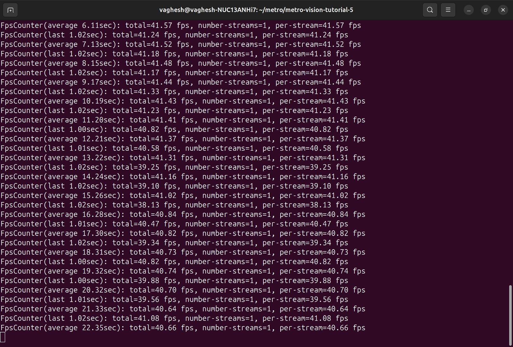
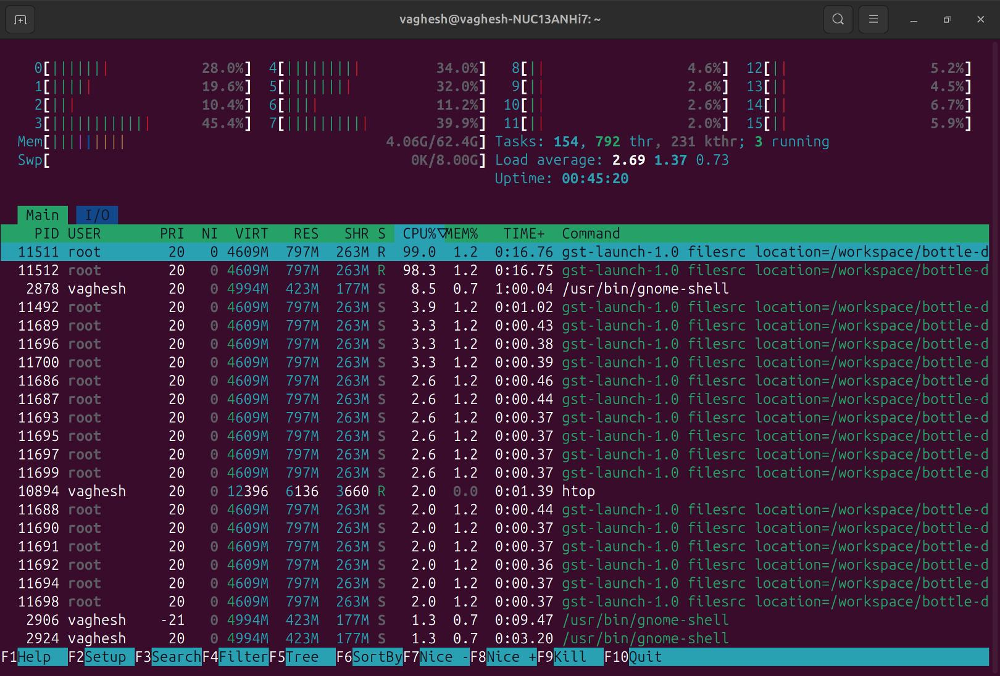
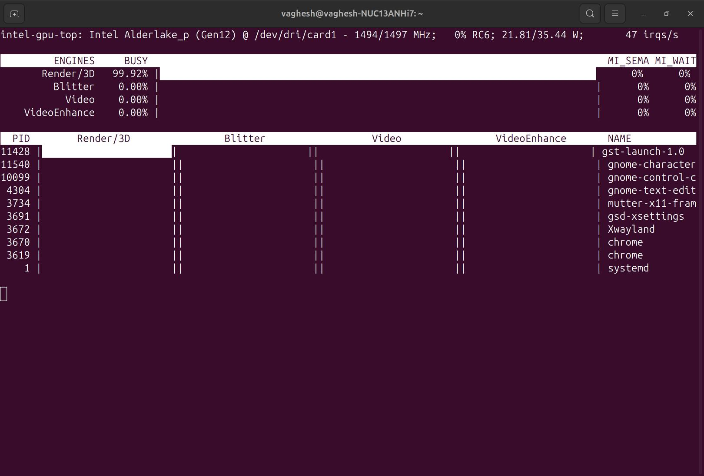
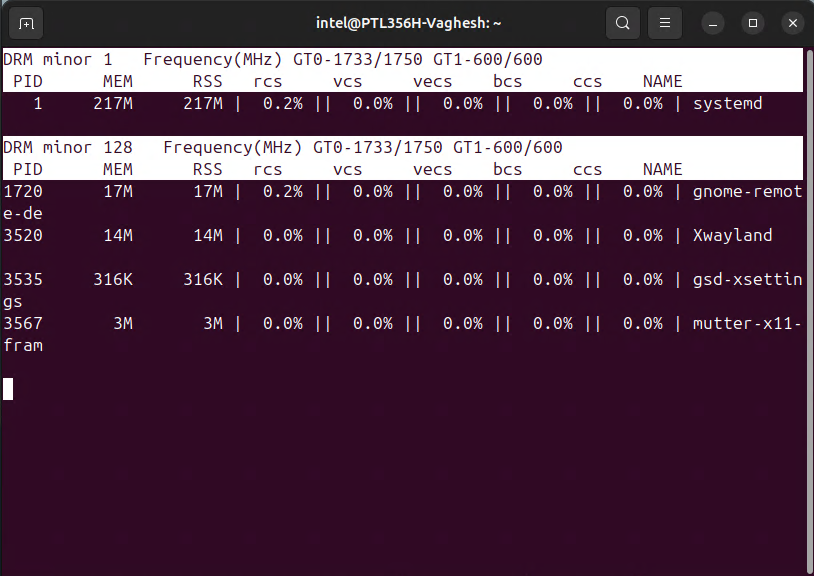

<!--
SPDX-FileCopyrightText: (C) 2026 Intel Corporation
SPDX-License-Identifier: Apache-2.0
-->

# Metro Vision AI SDK - Tutorial 5

This tutorial will guide you through profiling and monitoring performance of Metro Vision AI workloads using command-line tools.
You'll learn to use `htop` and a GPU monitor selected for your kernel driver to analyze system performance while running DL Streamer Pipeline Server or OpenVINO applications.

## Prerequisites

- Ubuntu 24.04 LTS or Ubuntu 26.04 LTS
- Docker installed and configured
- Intel® Core™, Intel® Core™ Ultra and Intel integrated graphics card
- Administrative privileges for performance monitoring
- Internet connection for downloading model and video files

## Step 1: Install Performance Monitoring Tools

Install the required command-line performance monitoring tools:

```bash
# Update system packages
sudo apt update

# Install performance monitoring tools
sudo apt install -y htop intel-gpu-tools

```

Select the GPU monitoring tool by the active kernel driver, not the processor name:

```bash
lspci -k | grep -A3 -Ei "vga|display" | grep "Kernel driver"
```

| Kernel driver | GPU monitor | Setup |
|---------------|-------------|-------|
| `i915` | `intel_gpu_top` | Included in the package installed above |
| `xe` | `gputop` | Use an installed recent IGT `gputop`, or build it with the commands below |

Check whether the selected monitor is available with `command -v intel_gpu_top` or `command -v gputop`.
The Ubuntu 24.04 `intel-gpu-tools` package (1.28) does not provide the required `xe` monitoring support.
If `gputop` is needed but unavailable, build the pinned IGT GPU Tools release below.
Otherwise, continue to Step 2.

```bash
sudo apt install -y git meson ninja-build pkg-config build-essential flex bison \
  libdrm-dev libkmod-dev libproc2-dev libdw-dev libpciaccess-dev libpci-dev libudev-dev \
  libcairo2-dev libpixman-1-dev libssl-dev libjson-c-dev libunwind-dev \
  libxmlrpc-core-c3-dev liblzma-dev libgsl-dev libasound2-dev python3-docutils

git clone --depth 1 --branch v2.6 https://gitlab.freedesktop.org/drm/igt-gpu-tools.git ~/igt-gpu-tools
cd ~/igt-gpu-tools
meson setup build -Dtests=disabled -Dman=disabled -Ddocs=disabled -Drunner=disabled
ninja -C build
sudo ninja -C build install
sudo ldconfig

# Verify that the monitor is installed
gputop -h
```

## Step 2: Verify System Hardware

Check your system hardware for monitoring:

```bash
# Check CPU information
lscpu | grep -E "Model name|CPU\(s\)"

# Check GPU availability
lspci | grep -i vga

# Check Intel GPU device files
ls -la /dev/dri/
```

## Step 3: Start Your Metro Vision AI Workload

Create and start a DL Streamer pipeline that continuously runs in the background for profiling:

Run this section from your regular non-root host shell, without `sudo`.
The containers use your host UID:GID so model files remain editable on the host, and the mounted workspace provides a writable home for model preparation.
These commands do not repair ownership of existing files created by root-run containers.
Only the host performance-monitoring tools in later steps need administrative privileges.

```bash
mkdir -p ~/oep/metro-vision-tutorial-5
cd ~/oep/metro-vision-tutorial-5

# Download sample video for object detection
wget -O bottle-detection.mp4 https://storage.openvinotoolkit.org/test_data/videos/bottle-detection.mp4

# Download YOLOv10s model using DL Streamer container
docker run --rm --user "$(id -u):$(id -g)" \
  -e HOME=/home/dlstreamer \
  -e http_proxy -e https_proxy -e no_proxy \
  -v "${PWD}:/home/dlstreamer/" \
  intel/dlstreamer:2026.2.0-ubuntu24 \
  bash -c "export MODELS_PATH=/home/dlstreamer && /opt/intel/dlstreamer/samples/download_public_models.sh yolov10s"

# Create a continuous DL Streamer pipeline script
cat > metro_vision_pipeline.sh << 'EOF'
#!/bin/bash
set -euo pipefail

if [[ "$(id -u)" -eq 0 ]]; then
    echo "Error: Run this script as your regular non-root user, without sudo." >&2
    exit 1
fi

# Metro Vision AI DL Streamer Pipeline for Performance Testing using Docker
CURRENT_DIR=$(pwd)
MODEL_PATH="$CURRENT_DIR/public/yolov10s/FP32/yolov10s.xml"
VIDEO_PATH="$CURRENT_DIR/bottle-detection.mp4"
DEVICE=GPU
RENDER_GROUP_ID=$(stat -c '%g' /dev/dri/renderD128)
CONTAINER_NAME="metro-vision-profile-$$"


echo "Starting Metro Vision AI Pipeline with Docker DL Streamer..."
echo "Model: $MODEL_PATH"
echo "Video: $VIDEO_PATH"
echo "Device: $DEVICE"

# Check if model and video exist
if [[ ! -f "$MODEL_PATH" ]]; then
    echo "Error: Model file not found at $MODEL_PATH"
    exit 1
fi

if [[ ! -f "$VIDEO_PATH" ]]; then
    echo "Error: Video file not found at $VIDEO_PATH"
    exit 1
fi


# Continuous loop to keep pipeline running
while true; do
    echo "$(date): Starting pipeline iteration..."

    # Run DL Streamer pipeline in Docker container with object detection
    docker run --rm \
        --name "$CONTAINER_NAME" \
        --user "$(id -u):$(id -g)" \
        --env HOME=/workspace \
        --device /dev/dri:/dev/dri \
        --group-add "$RENDER_GROUP_ID" \
        -v "$CURRENT_DIR:/workspace" \
        --env http_proxy \
        --env https_proxy \
        --env no_proxy \
        -w /workspace \
        intel/dlstreamer:2026.2.0-ubuntu24  \
        gst-launch-1.0 \
            filesrc location=/workspace/bottle-detection.mp4 ! \
            qtdemux ! h264parse ! avdec_h264 ! \
            videoconvert ! \
            gvadetect model=/workspace/public/yolov10s/FP32/yolov10s.xml device="$DEVICE" ! \
            gvafpscounter ! \
            fakesink sync=false

    echo "$(date): Pipeline ended, restarting in 2 seconds..."
    sleep 2
done
EOF

chmod +x metro_vision_pipeline.sh

# Start the pipeline in background
./metro_vision_pipeline.sh &
PIPELINE_PID=$!

echo "Metro Vision AI pipeline started with PID: $PIPELINE_PID"
echo "To stop: kill $PIPELINE_PID; docker stop metro-vision-profile-$PIPELINE_PID"
```

> [!NOTE]
> This creates a continuously running Docker-based DL Streamer pipeline that processes real video using the YOLOv10s object detection model, providing a realistic AI workload for performance profiling. The pipeline runs in a Docker container with access to Intel GPU hardware.

**Expected Console Output:**



## Step 4: Monitor Overall System Performance with htop

Launch htop to monitor real-time system performance:

```bash
# Start htop for real-time monitoring
htop
```

**What to observe:**

- CPU usage per core (bars at the top)
- Memory usage and available memory
- Running processes sorted by CPU usage
- Look for your Metro Vision AI processes

**Key shortcuts in htop:**

- `F6` - Sort by different columns (CPU%, MEM%)
- `F4` - Filter processes by name
- `q` - Quit htop

**Expected Console Output:**



## Step 5: Monitor Intel GPU Performance

In another host terminal, launch the monitor selected in Step 1 while the same workload runs:

| Kernel driver | Command |
|---------------|---------|
| `i915` | `sudo intel_gpu_top` |
| `xe` | `sudo gputop` |

Press `q` to exit the monitor.

**What to observe:**

- Compute (`ccs`) or render/3D (`rcs`) engine activity during inference, depending on the GPU
- Video (`vcs`) and video enhancement (`vecs`) engine activity
- Per-process GPU memory and engine utilization where reported
- GPU frequency, power consumption, and bandwidth where supported by the selected monitor

This workload uses `avdec_h264` for CPU decoding, so it does not generate GPU video-decode activity.
On `xe` platforms, look for compute (`ccs`) activity from `gst-launch-1.0`.

**Example `intel_gpu_top` output:**



**Example `gputop` output for the same workload:**




The columns identify compute (`ccs`), render/3D (`rcs`), video (`vcs`), video enhancement (`vecs`), and copy (`bcs`) engines.

## Step 6: Stop the Running Pipeline

When you are done profiling, stop the background pipeline:

```bash
# Stop the wrapper and its container from the same host shell
kill "$PIPELINE_PID"
docker stop "metro-vision-profile-$PIPELINE_PID"
```

## Next Steps: Visual Pipeline and Platform Evaluation Tool (ViPPET)

Now that you have learned to monitor AI workloads with command-line tools, take your performance analysis to the next level with **ViPPET** - a visual tool for evaluating and optimizing AI pipelines.

### What is ViPPET?

ViPPET (Visual Pipeline and Platform Evaluation Tool) is an interactive web-based application that helps you:

- **Visualize Pipeline Performance**: See real-time metrics and graphs of your AI pipeline performance
- **Compare Configurations**: Test different hardware devices (CPU, GPU, NPU) and model configurations
- **Benchmark Workloads**: Measure throughput, latency, and resource utilization
- **Optimize Pipelines**: Identify bottlenecks and tune parameters for better performance
- **Generate Reports**: Create detailed performance reports for analysis and documentation

### Getting Started with ViPPET

To learn more and get started with ViPPET, visit the official documentation:

**[ViPPET Documentation](https://docs.openedgeplatform.intel.com/dev/edge-ai-libraries/visual-pipeline-and-platform-evaluation-tool/index.html)**

The documentation includes:

- Installation instructions
- Quick start guides
- Tutorial videos
- Pipeline configuration examples
- Performance tuning best practices

### Why Use ViPPET After This Tutorial?

After using `htop` and your selected GPU monitor for basic monitoring, ViPPET provides:

1. **Visual Analysis**: Interactive charts instead of terminal output
2. **Automated Testing**: Run multiple benchmark scenarios automatically
3. **Comparative Analysis**: Side-by-side comparison of different configurations
4. **Historical Data**: Track performance trends over time
5. **Export Capabilities**: Generate professional reports for stakeholders

ViPPET complements the command-line monitoring skills you have learned in this tutorial by providing a comprehensive visual interface for deeper performance analysis and optimization.

## Summary

This tutorial provides a practical approach to profiling Metro Vision AI workloads using command-line tools:

### **What You have Learned:**

1. **Installing Tools**: Set up `htop` and the GPU monitor appropriate for your kernel driver
2. **System Monitoring**: Use `htop` for real-time CPU and memory monitoring
3. **GPU Profiling**: Monitor Intel GPU performance with `intel_gpu_top` (`i915`) or `gputop` (`xe`)
4. **Performance Analysis**: Understand resource utilization patterns

### **Key Monitoring Points:**

- **CPU Usage**: Monitor core utilization and identify bottlenecks
- **Memory Usage**: Track memory consumption and avoid swapping
- **GPU Utilization**: Monitor Intel GPU compute and render engine usage
- **Process Performance**: Track specific AI application performance
