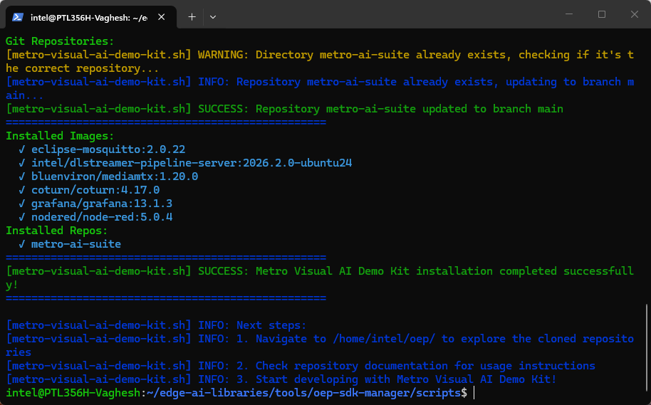

<!--
SPDX-FileCopyrightText: (C) 2026 Intel Corporation
SPDX-License-Identifier: Apache-2.0
-->

# Getting Started Guide - Metro Visual AI Demo Kit

## Overview

The Metro Visual AI Demo Kit provides a comprehensive demonstration environment for computer vision applications using Intel's optimized tools and frameworks. This guide demonstrates the installation process and provides practical AI application implementations including smart parking, smart intersection, and other visual AI use cases using DL Streamer and OpenVINO.

## Learning Objectives

Upon completion of this guide, you will be able to:

- Install and configure the Metro Visual AI Demo Kit
- Run pre-configured AI applications with real-time dashboards
- Execute visual AI inference pipelines on video content
- Access Grafana dashboards for monitoring AI application metrics
- Understand the microservice architecture for visual AI workflows

## System Requirements

Verify that your development environment meets the following specifications:

- Operating System: Ubuntu 24.04 LTS or Ubuntu 26.04 LTS
- Memory: Minimum 8GB RAM
- Storage: 20GB available disk space
- Network: Active internet connection for package downloads

## Installation Process

Execute the automated installation script to configure the complete development environment:

The installer clones [Metro AI Suite](https://github.com/open-edge-platform/metro-ai-suite) from `main` into `~/oep/metro-ai-suite`.

```bash
curl -fsS https://raw.githubusercontent.com/open-edge-platform/edge-ai-libraries/refs/heads/main/tools/oep-sdk-manager/scripts/metro-visual-ai-demo-kit.sh | bash
```



The installation process configures the following components:

- Docker containerization platform
- DL Streamer video analytics framework
- OpenVINO inference optimization toolkit
- Grafana dashboard for monitoring
- MQTT Broker for messaging
- Node-RED for workflow automation
- MediaMTX for media streaming
- Pre-trained model repositories and sample implementations

## Metro Visual AI Demo Kit Application Setup

This section demonstrates how to run pre-configured visual AI applications using the installed components.

### Step 1: Navigate to Application Directory

Navigate to the metro-vision-ai-app-recipe directory:

```bash
cd ~/oep/metro-ai-suite/metro-vision-ai-app-recipe/
```

### Step 2: Setup Application and Download Assets

Use the installation script to configure the application and download required models. Available applications include smart-parking, smart-intersection, and other visual AI use cases:

```bash
./install.sh smart-parking
```

### Step 3: Start the Application

Download container images with application microservices and run with Docker Compose:

```bash
docker compose up -d
```

<details>
<summary>Check Status of Microservices</summary>

The application starts the following microservices. To check if all microservices are in Running state:

```bash
docker ps
```

**Expected Services:**

- Grafana Dashboard
- DL Streamer Pipeline Server
- MQTT Broker
- Node-RED (for applications without Scenescape)
- Scenescape services (for Smart Intersection only)

</details>

### Step 4: Run Predefined Pipelines

Start video streams to run video inference pipelines:

```bash
./sample_start.sh
```

### Step 5: View the Application Output

1. Open a browser and go to `https://localhost/grafana` to access the Grafana dashboard
   - Change localhost to your host IP if accessing remotely
2. Log in with the following credentials:
   - **Username**: `admin`
   - **Password**: `admin`
3. Check under the Dashboards section for the application-specific preloaded dashboard
4. **Expected Results**: The dashboard displays real-time video streams with AI overlays and detection metrics

### Step 6: Stop the Application

To stop the application microservices:

```bash
docker compose down
```

### Application Architecture Analysis

The Metro Visual AI Demo Kit implements a microservice architecture with the following components:

1. **DL Streamer Pipeline Server**: Handles video analytics and AI inference processing
2. **Grafana Dashboard**: Provides real-time visualization and monitoring
3. **MQTT Broker**: Manages message communication between services
4. **Node-RED**: Orchestrates workflow automation and data processing
5. **MediaMTX**: Handles media streaming and distribution

The resulting application provides a complete visual AI solution with real-time dashboards, AI inference overlays, and comprehensive monitoring capabilities.

## Technology Framework Overview

### Metro Visual AI Demo Kit Components

The Metro Visual AI Demo Kit integrates multiple technologies to provide a comprehensive demonstration environment:

- DL Streamer Pipeline Server
- Grafana Dashboard
- MQTT Broker
- Node-RED
- MediaMTX

## Next Steps

Expand your visual AI expertise with these comprehensive tutorials that demonstrate advanced customization and real-world application development:

### Tutorial Series: Advanced Visual AI Applications

#### [Tutorial 1: AI Tolling System Tutorial](tutorial-1.md)

Transform the Smart Parking application into a comprehensive AI-based tolling system. This tutorial covers:

- Converting parking detection algorithms to vehicle toll processing
- Implementing license plate recognition and vehicle classification
- Setting up automated toll calculation and payment processing workflows

#### [Tutorial 2: Customizing Node-RED Flows for Metro Vision AI Applications](./tutorial-2.md)

Master the art of workflow automation and data processing customization. Learn to:

- Design custom Node-RED flows for visual AI applications
- Integrate data sources and external APIs
- Build sophisticated data processing pipelines for real-time analytics

#### [Tutorial 3: Customize Grafana Dashboard for Real-Time Object Detection](./tutorial-3.md)

Create compelling visualization experiences for your AI applications. This tutorial demonstrates:

- Building custom Grafana panels and widgets for object detection metrics
- Implementing real-time data visualization with dynamic updates
- Designing professional dashboards for monitoring and reporting

## Additional Resources

### Technical Documentation

- [DL Streamer](http://docs.openedgeplatform.intel.com/dev/edge-ai-libraries/dl-streamer/index.html)
  \- Comprehensive documentation for Intel's GStreamer-based video analytics framework
- [DL Streamer Pipeline Server](https://docs.openedgeplatform.intel.com/dev/edge-ai-libraries/dlstreamer-pipeline-server/index.html)
  \- RESTful microservice architecture documentation for scalable video analytics deployment
- [OpenVINO](https://docs.openvino.ai/2026/get-started.html)
  \- Complete reference for Intel's cross-platform inference optimization toolkit
- [OpenVINO Model Server](https://docs.openvino.ai/2026/model-server/ovms_what_is_openvino_model_server.html)
  \- Model serving infrastructure documentation for production deployments
- [Edge AI Libraries](https://docs.openedgeplatform.intel.com/dev/ai-libraries.html)
  \- Comprehensive development toolkit documentation and API references
- [Metro AI Suite](https://docs.openedgeplatform.intel.com/dev/ai-suite-metro.html)
  \- Complete application suite documentation with implementation examples

### Support Channels

- [GitHub Issues](https://github.com/open-edge-platform/edge-ai-libraries/issues)
  \- Technical issue tracking and community support

<!--hide_directive
:::{toctree}
:hidden:

tutorial-1
tutorial-2
tutorial-3
:::
hide_directive-->
