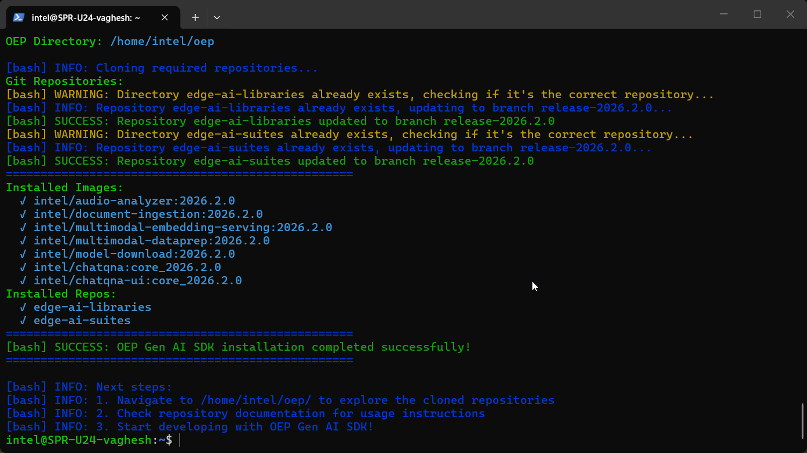

# Getting Started Guide - OEP Gen AI SDK

## Overview

The OEP Gen AI SDK provides a comprehensive development environment for generative AI applications using Intel's optimized tools and microservices. This guide demonstrates the installation process and provides a practical question-answering implementation using retrieval-augmented generation (RAG) capabilities.

## Learning Objectives

Upon completion of this guide, you will be able to:

- Install and configure the OEP Gen AI SDK
- Deploy generative AI microservices for document processing and question-answering
- Understand the architecture of RAG-based applications using Intel's AI frameworks

## System Requirements

Verify that your development environment meets the following specifications:

- Operating System: Ubuntu 24.04 LTS or Ubuntu 22.04 LTS
- Memory: Minimum 64GB RAM (recommended for LLM operations)
- Storage: 100GB available disk space for models and data
- Network: Active internet connection for package downloads

## Installation Process

Execute the automated installation script to configure the complete development environment:

```bash
curl -fsS https://raw.githubusercontent.com/open-edge-platform/edge-ai-libraries/refs/heads/main/tools/oep-sdk-manager/scripts/oep-gen-ai-sdk.sh | bash
```



## Question-Answering Application Implementation

This section demonstrates a complete RAG (Retrieval-Augmented Generation) application workflow using the installed Gen AI components.

### Step 1: Configure Environment and Dependencies

Set up the Python virtual environment and install required dependencies:

```bash
cd $HOME/oep/edge-ai-libraries/sample-applications/chat-question-and-answer-core
# Configure application environment variables
export HUGGINGFACEHUB_API_TOKEN=<your-huggingface-token>
export REGISTRY="intel/"
export UI_TAG=core_2026.2.0
export BACKEND_TAG=core_2026.2.0
source scripts/setup_env.sh
```

### Step 2: Deploy the Application

Start the complete Gen AI application stack using Docker Compose:

```bash
docker compose -f docker/compose.yaml up
```


### Step 3: Access the Application Interface

Open a web browser and navigate to the application dashboard:

```bash
http://localhost:8102
```

## Additional Resources

### Technical Documentation

- [Chat Q&A Core](https://docs.openedgeplatform.intel.com/dev/edge-ai-libraries/chat-question-and-answer-core/index.html)
  \- Lightweight, single-container conversational Q&A (RAG) application
- [Audio Analyzer](https://docs.openedgeplatform.intel.com/dev/edge-ai-libraries/audio-analyzer/get-started.html)
  \- Comprehensive documentation for multimodal audio processing capabilities
- [Document Ingestion - pgvector](https://docs.openedgeplatform.intel.com/dev/edge-ai-libraries/pgvector/get-started.html)
  \- Vector database integration and document processing workflows
- [Multimodal Embedding Serving](https://docs.openedgeplatform.intel.com/dev/edge-ai-libraries/multimodal-embedding-serving/index.html)
  \- Embedding generation service architecture and API documentation
- [Multimodal Data Preparation](https://docs.openedgeplatform.intel.com/dev/edge-ai-libraries/multimodal-data-preparation/index.html)
  \- Multimodal data ingestion and preparation workflows for retrieval
- [Edge AI Libraries](https://docs.openedgeplatform.intel.com/dev/ai-libraries.html)
  \- Complete development toolkit documentation and microservice API references
- [Metro AI Suite](https://docs.openedgeplatform.intel.com/dev/ai-suite-metro.html)
  \- Comprehensive application suite documentation with Gen AI implementation examples

### Support Channels

- [GitHub Issues](https://github.com/open-edge-platform/edge-ai-libraries/issues)
  \- Technical issue tracking and community support for Gen AI applications