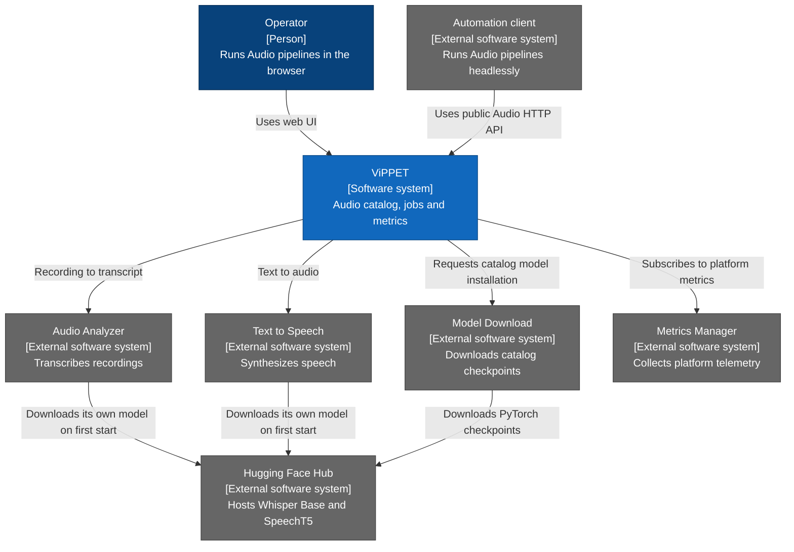
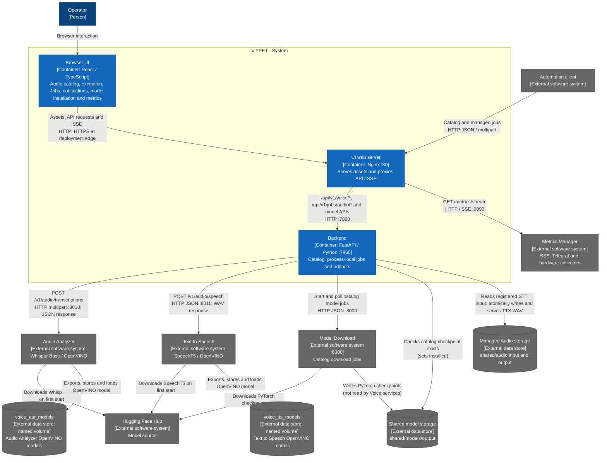
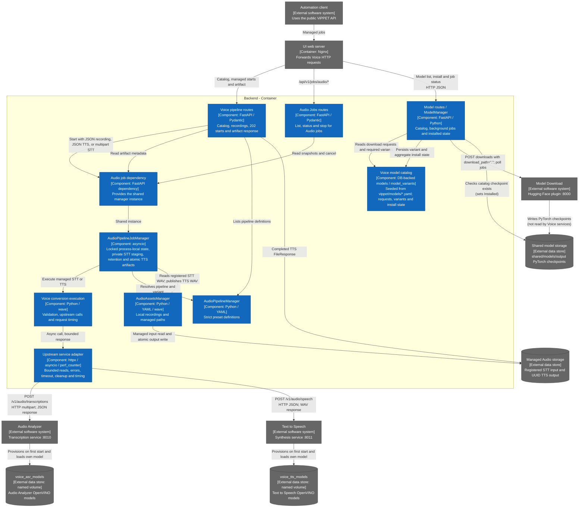
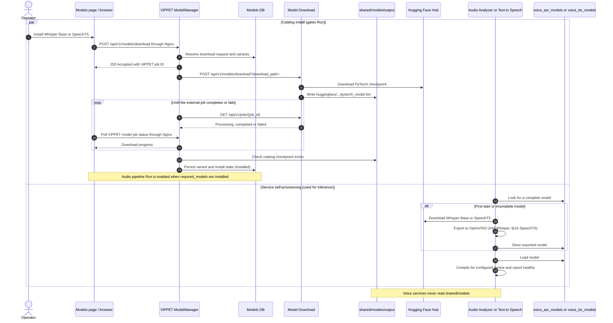
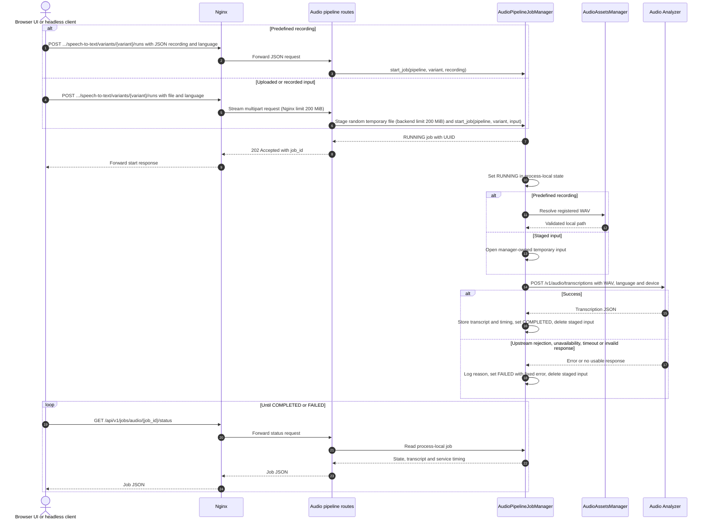
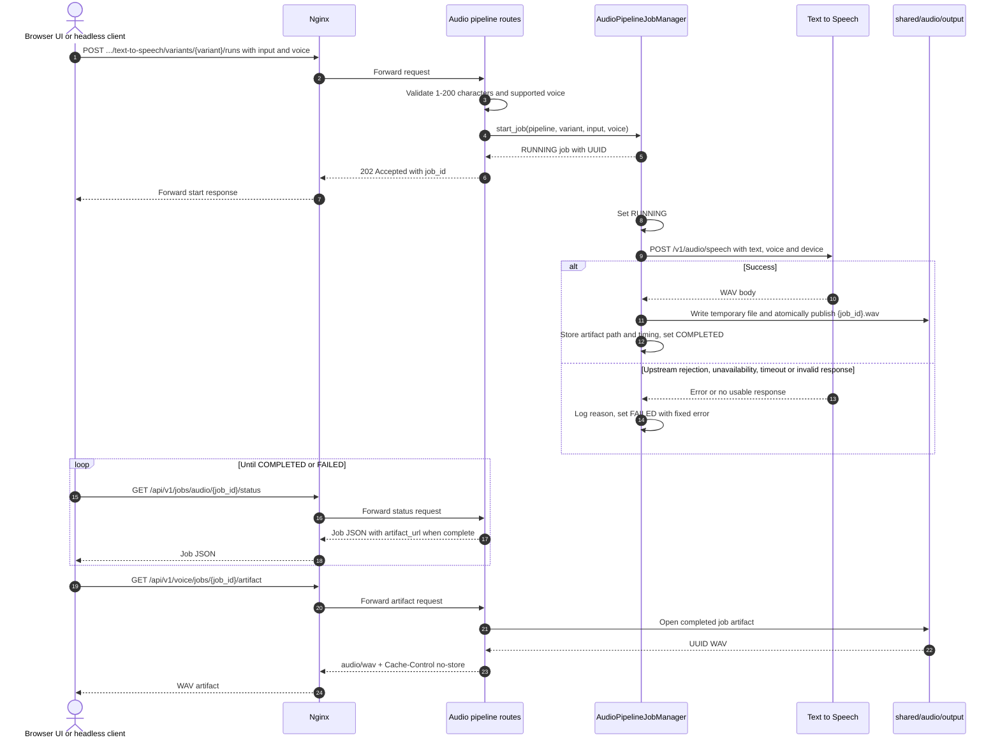
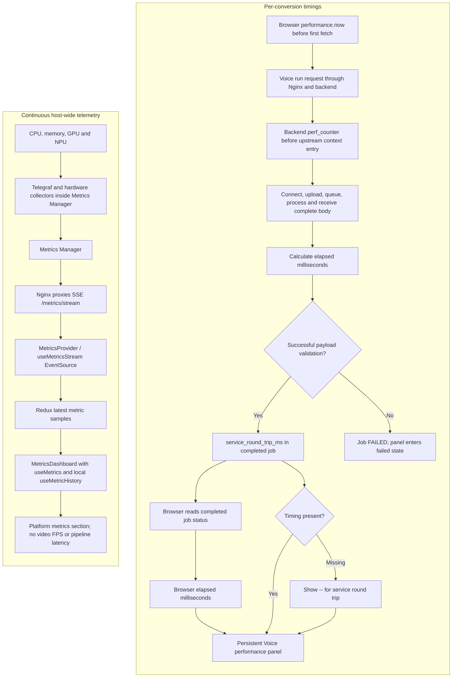
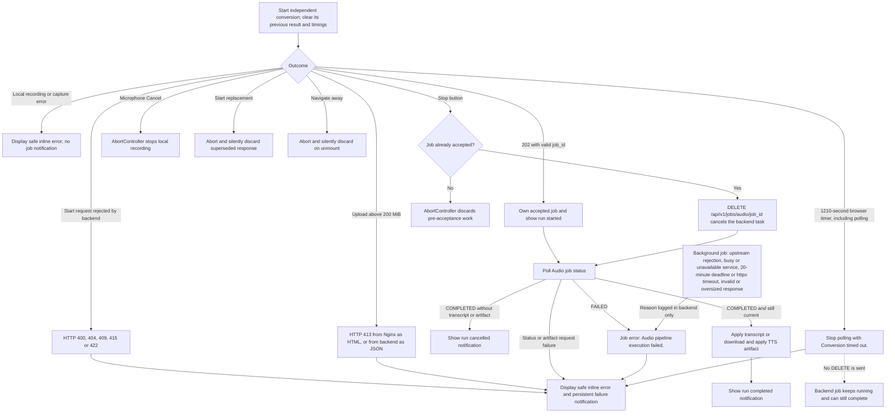

<!-- SPDX-FileCopyrightText: (C) 2026 Intel Corporation -->
<!-- SPDX-License-Identifier: Apache-2.0 -->

# Audio Pipeline Architecture: STT, TTS and Metrics

These diagrams describe the implemented Audio integration as of 2026-11-19.
They follow the [C4 model](https://c4model.com/diagrams) at System Context,
Container and Component levels only. Flow diagrams describe runtime behavior;
there is no Code-level diagram.

## Scope and Notation

- The system of interest is ViPPET. Browser operators and headless automation
  use its public API. Audio Analyzer, Text to Speech, Model
  Download and Metrics Manager are independently deployable supporting software
  systems, even when installed in the same Docker Compose stack.
- A C4 container is an application or data store, not necessarily a Docker
  container. The browser SPA and its Nginx web server are separate C4 containers;
  Nginx serves the SPA from the `vippet-ui` Docker image.
- Each Component view zooms into one ViPPET container. Components describe
  existing responsibilities, not proposed services or new source files.
- Relationships in C4 diagrams describe dependencies/calls; response data is
  summarized in their labels. Flow diagrams show response direction explicitly.
- C4 notation is rendered using Mermaid `flowchart`: every box identifies its
  type, technology where relevant, and responsibility. Blue boxes belong to
  ViPPET; gray boxes are dependencies outside the view's system/container boundary.
  Runtime diagrams use `sequenceDiagram` and `flowchart`. This avoids the
  overlapping labels of Mermaid's experimental native C4 layout.
- Unrelated video pipelines, LLMs, chat history and kiosk-core are out of scope.
  STT and TTS are independent conversions, not an automatic chained conversation.

## C4 Level 1: System Context

The operator uses the ViPPET UI, while automation uses the same ViPPET Audio API
without a browser. Direct upstream API access is possible through published
service ports, but bypasses the ViPPET proxy and its controls. Audio Analyzer
and Text to Speech provision their own models; the Model Download path only
fills the ViPPET catalog (see [Flow: Voice Model Provisioning](#flow-voice-model-provisioning)).

## C4 Level 2: Containers

Nginx streams Voice request bodies and disables response caching. The backend
stages each upload to a private temporary file, and the background job then
streams that file to Audio Analyzer, which owns input validation. Upload limits
are described in [Flow: Managed Speech to Text](#flow-managed-speech-to-text).
The backend retains response-size and deadline limits. Upstream failures end the
job as `FAILED` with a fixed error text; upstream details are only logged.
Environment HTTP proxy settings are not used for these calls.

### Deployment and Storage Boundaries

- The current Compose file publishes `8010:8010` and `8011:8011` without a
  loopback host address. Network reachability depends on the host/firewall;
  these bindings are not restricted to localhost by this configuration.
  Protect direct access with deployment-level access control and TLS.
- Audio Analyzer and Text to Speech provision their own models. On first
  start, each downloads its configured model from Hugging Face, exports it to
  OpenVINO (Whisper Base with `int8` weights, SpeechT5 with `fp16`) and stores
  it in its own named volume, `voice_asr_models` or `voice_tts_models`. Later
  starts reuse the volume. Each service compiles the model for the configured
  or per-request device when it loads it. Neither service mounts
  `shared/models`. A first start needs Hugging Face access from the service
  container; until provisioning completes, the service is not healthy (the
  Compose health checks allow a 15-minute start period).
- The Models page starts ViPPET background jobs for the `voice-whisper-base`
  and `voice-speecht5` catalog entries. `ModelManager` forwards their Hugging
  Face requests to Model Download with `download_path="."`, polls the returned
  job, and marks a model Installed when its PyTorch checkpoint exists under
  `shared/models/output/huggingface`. The Audio pipeline `required_models`
  gate uses this state. The Voice services never read these checkpoints; see
  [Known limitations](../user-guide/voice-conversion.md#known-limitations).
- ASR keeps runtime cache, chunks and storage in `voice_asr_cache`,
  `voice_asr_chunks` and `voice_asr_storage`. Recordings/transcripts can persist
  in its storage volume; clear-on-startup is enabled, not a per-request retention
  guarantee. Exit-time chunk cleanup is disabled because the chunks path is a
  volume mount; failed or interrupted runs can therefore leave chunks behind.
  TTS keeps runtime cache and storage in `voice_tts_cache` and
  `voice_tts_storage`, but `PERSIST_OUTPUTS=false` disables output persistence.
- ViPPET stores the registered STT recordings and every completed managed TTS
  job artifact in the mounted `shared/audio` tree. TTS runs use UUID-named files
  under `shared/audio/output`. Audio job metadata
  and STT transcripts are process-local. Uploaded or recorded managed STT input
  is copied to a UUID-named file in a private manager-owned temporary directory
  and removed after success, failure, cancellation, registration failure, or
  shutdown. `make clean` removes generated TTS artifacts and the whole
  `shared/audio/input` tree, but not named volumes; see the
  [user guide](../user-guide/voice-conversion.md#deployment) for everything it
  removes. Browser results and per-conversion timings remain
  in React state; blob URLs are revoked during cleanup.
- Clients use the ViPPET API through Nginx. Run requests return `202`, then
  clients poll process-local job state.
- Hardware overrides determine the default service devices and which device
  nodes are mounted. Each Audio variant selects among compatible,
  visible devices. Telemetry reflects the whole host and can include unrelated
  workloads on those devices.

## C4 Level 3: Browser UI Components

```mermaid
flowchart TB
  web["UI web server<br/>[Container: Nginx]<br/>Voice API and SSE proxy"]:::external
  subgraph spa[Browser UI - Container]
    direction TB
    catalog["PipelineCards<br/>[Component: React]<br/>Shared cards in the Audio tab of Pipelines"]:::internal
    voice["VoiceConversion<br/>[Component: React]<br/>Route-selected STT or TTS workflow"]:::internal
    variant["PipelineVariantSelect<br/>[Component: React]<br/>Route-backed Audio device variant selection"]:::internal
    recorder["Recording adapter<br/>[Component: Web Audio]<br/>captureWav prepares local PCM WAV"]:::internal
    audio["VoiceAudio<br/>[Component: Web Audio / Recharts]<br/>Waveform and native audio playback"]:::internal
    timings["VoiceMetrics<br/>[Component: React]<br/>Request and service round-trip timings"]:::internal
    jobs["Jobs / Audio tab<br/>[Component: React / RTK Query]<br/>Oldest-first Audio job list polled every 2 seconds"]:::internal
    detail["AudioJobDetail<br/>[Component: React / RTK Query]<br/>Polls status and displays transcript or WAV link"]:::internal
    notifications["Toaster / shared toast<br/>[Component: Sonner]<br/>Audio run lifecycle notifications"]:::internal
    stream["MetricsProvider / useMetricsStream<br/>[Component: EventSource]<br/>Shared SSE subscription and reconnect"]:::internal
    store["Metrics state<br/>[Component: Redux Toolkit]<br/>Current samples and connection state"]:::internal
    dashboard["MetricsDashboard<br/>[Component: React / Recharts]<br/>useMetrics and useMetricHistory"]:::internal
    cards["MetricCard<br/>[Component: React]<br/>Shared numeric presentation"]:::internal
    voice -->|"Uploaded or recorded STT<br/>Async capture and AbortSignal"| recorder
    voice -->|Renders selected route variant| variant
    variant -->|Updates route parameters| voice
    voice -->|Blob URL props| audio
    voice -->|Timing props| timings
    voice -->|Lifecycle events| notifications
    voice -->|Always mounts below VoiceMetrics in right rail; no video metrics| dashboard
    jobs -->|Opens selected Audio job| detail
    stream -->|Dispatches Redux actions| store
    dashboard -->|Reads Redux selectors| store
    dashboard -->|Renders platform values| cards
  end
  catalog -->|"GET /api/v1/voice/pipelines"| web
  catalog -->|"Opens first variant"| voice
  voice -->|"All STT: start and poll managed job; JSON recording or multipart file"| web
  voice -->|"All TTS: start job with input/voice, poll and fetch artifact"| web
  jobs -->|"GET /api/v1/jobs/audio/status"| web
  detail -->|"GET /api/v1/jobs/audio/{job_id}/status until terminal"| web
  stream -->|"SSE subscription"| web
  classDef internal fill:#1168bd,color:#fff,stroke:#0b4884
  classDef external fill:#666,color:#fff,stroke:#444
```

The route selects one STT or TTS pipeline view; there are no operation tabs.
STT sends a selected predefined recording as JSON, or an uploaded or recorded
file as multipart, to the managed run endpoint. Every UI STT and TTS
conversion uses a managed job polled through
`GET /api/v1/jobs/audio/{job_id}/status`; TTS retrieves its persisted artifact
after completion.

The Audio tab on the shared Jobs page polls oldest-first operational summaries.
Its detail view polls until `COMPLETED` or `FAILED`, then displays
the transcript or managed WAV link when available. `VoiceConversion` publishes
lifecycle notifications through the application-level Sonner toaster. These
notifications complement, rather than replace, inline errors and result panels.

`VoiceMetrics` does not read global service `/v1/performance` values. On desktop,
it and the always-visible platform `MetricsDashboard` share the right-hand rail;
on smaller viewports, that rail stacks below the active Voice workflow.
`MetricsProvider` is mounted at application level, so the dashboard does not
create another SSE subscription. The dashboard's local history is created on
mount and discarded on unmount; its hook keeps a 60-second window with updates
no more often than once per second.

## C4 Level 3: Backend Components

The Voice routes, conversion execution and upstream adapter reside in the Voice
router module. The Jobs router lists, reads and stops jobs through the same
`AudioPipelineJobManager` provided by dependency injection; neither router
imports the other.
`AudioPipelineJobManager`, `AudioPipelineManager` and `AudioAssetsManager` are
separate Python components in the same backend process.

The job manager guards its job and task maps with an `asyncio.Lock`. It returns
list snapshots oldest first by creation time and retains every active job plus
at most 500 terminal jobs. Evicting an older terminal TTS job removes its
managed artifact. Uploaded audio is first copied to a UUID-named file in a
manager-owned temporary directory and deleted on every exit path, then opened
for the validated conversion path. Predefined-recording STT opens the
registered WAV; TTS atomically publishes a UUID-named artifact.
Jobs expose service timing in `service_round_trip_ms`.
Model routes and `ModelManager` remain separate from the Voice router but run
in the same backend container.

## Flow: Voice Model Provisioning

Two independent paths provision Voice models. The catalog path decides whether
the UI enables Run; the service path provides the models that actually run.
Nothing orders or connects them.

The two paths share no state: starting the services before or after a catalog
install makes no difference to them, and a service that fails to provision its
model makes Audio jobs end as `FAILED` even when the catalog shows Installed.
Health and network requirements are listed in
[Deployment and Storage Boundaries](#deployment-and-storage-boundaries); the
resulting duplicate download is described in
[Known limitations](../user-guide/voice-conversion.md#known-limitations).

## Flow: Managed Speech to Text

Managed STT accepts either a JSON body with a registered `recording` and a
two-letter `language`, or multipart `file` and `language` fields for uploaded
and recorded audio. The route stages multipart input before returning `202`; the
job owns and deletes that temporary input on every terminal path and shutdown.
Uploads are limited to 200 MiB in both places: Nginx applies
`client_max_body_size 200m` to the whole multipart request and usually rejects
an oversized upload first with its own HTML `413`; the backend applies
`MAX_STT_UPLOAD_BYTES` to the file content while staging and returns a JSON
`413`. Upstream errors occur after the `202` response, so the client sees them
only as a `FAILED` job with the fixed error text
`Audio pipeline execution failed.`.
The completed transcript and job metadata are process-local and disappear when
the backend restarts; no STT artifact is created.

## Flow: Managed Text to Speech

Every TTS conversion started by the Audio pipeline UI follows this managed
path. The browser creates a blob URL only after downloading the persisted
artifact, then uses it for playback and download. Artifact retrieval, waveform
decoding and playback are excluded from the displayed managed request duration.
The proxy buffers the complete upstream body; TTS is not streaming playback or
a time-to-first-byte measurement.

## Flow: Conversion Timings and Telemetry

- **Request duration:** browser first-fetch start through the completed managed
  job status, including polling. TTS artifact retrieval occurs after this
  interval. The value remains browser-local.
- **Service round trip:** backend adapter start through complete upstream body
  reception and local response construction; excludes browser transfer and
  subsequent route payload validation/context cleanup. Includes transport,
  queueing and service processing, not only model inference.
- The intervals use independent monotonic clocks. No cross-machine timestamp
  subtraction or global last-request variable is needed.
- The Voice performance panel shows only the request-scoped timings returned in
  the completed job.
- Platform charts are live system-wide telemetry, not a frozen snapshot of a
  conversion and not resource attribution to a particular STT/TTS request.
- Voice does not query the services' global `last_ms` or `/v1/model-info` and does
  not report model inference time, chunk or segment counts, effective device,
  end-to-end conversational latency or time to first audio.

## Flow: Errors and Cancellation

Run requests return `202` as soon as the job is accepted. Only request
validation, unknown pipelines, variants or recordings, an unavailable
pipeline, and oversized uploads produce HTTP errors. Everything that happens
while calling Audio Analyzer or Text to Speech happens inside the background
job: the job manager logs the exception type and sanitized reason and sets the
job to `FAILED` with the fixed error text `Audio pipeline execution failed.`.
The adapter's internal status mapping (`400`, `502`, `503`, `504`) is not
returned to clients.

Stop on an accepted job cancels the managed backend task through
`AudioPipelineJobManager.cancel_job`: the job moves to `COMPLETED` without a
result (or to `FAILED` when cancelling raises an error), the in-flight
request to the upstream service is cancelled, and staged input and any
uncommitted artifact are removed. It cannot guarantee that an already-started
upstream inference stops. Navigating away does not cancel a managed job, which
can still finish and persist its WAV. Backend contexts
close resources on return or exceptions; their total upstream deadline is 20
minutes, with a 5-second connection timeout.

The browser keeps a 1210-second timer for the whole run, including polling.
When it fires, the UI stops polling and shows `Conversion timed out.`, but it
does not send `DELETE`, so the backend job keeps running and can still
complete. The Nginx Voice read and send timeouts are also 1210 seconds; they
apply only to the individual start, status and artifact requests, none of which
wait for the conversion. Proxy-generated failures, such as the Nginx `413`
described in [Flow: Managed Speech to Text](#flow-managed-speech-to-text), use
Nginx's own response format.

## Implementation References

- [Voice workflow](../../../ui/src/features/voice/VoiceConversion.tsx),
  [pipeline variant selector](../../../ui/src/features/pipelines/PipelineVariantSelect.tsx),
  [recording adapter](../../../ui/src/features/voice/recording.ts),
  [audio preview](../../../ui/src/features/voice/VoiceAudio.tsx) and
  [performance panel](../../../ui/src/features/voice/VoiceMetrics.tsx).
- [Jobs page](../../../ui/src/pages/Jobs.tsx),
  [Audio job detail](../../../ui/src/pages/AudioJobDetail.tsx),
  [application layout and toaster](../../../ui/src/components/Layout.tsx),
  [Voice API and upstream adapter](../../../vippet/api/routes/voice.py),
  [Jobs API adapter](../../../vippet/api/routes/jobs.py) and
  [Audio job dependency](../../../vippet/api/dependencies/audio_jobs.py).
- [Audio pipeline manager](../../../vippet/managers/audio_pipeline_manager.py),
  [job manager](../../../vippet/managers/audio_pipeline_job_manager.py) and
  [managed Audio assets](../../../vippet/audio_assets.py).
- [Models page](../../../ui/src/pages/Models.tsx),
  [model installation hook](../../../ui/src/features/models/useModelInstall.ts),
  [model routes](../../../vippet/api/routes/models.py),
  [model manager](../../../vippet/managers/model_manager.py),
  [Whisper catalog entry](../../../vippet/models/voice-whisper-base.yaml),
  [SpeechT5 catalog entry](../../../vippet/models/voice-speecht5.yaml),
  [Speech to Text](../../../vippet/pipelines/speech-to-text.yaml) and
  [Text to Speech](../../../vippet/pipelines/text-to-speech.yaml) pipeline
  definitions with `required_models`, and
  [catalog DB seeding](../../../vippet/db_seed.py).
- Voice service model provisioning:
  [Audio Analyzer](../../../../../microservices/audio-analyzer/utils/provision_models.py),
  [Text to Speech](../../../../../microservices/text-to-speech/utils/ensure_model.py) and
  [SpeechT5 preparation](../../../../../microservices/text-to-speech/utils/ensure_speecht5.py).
- [Metrics stream](../../../ui/src/hooks/useMetricsStream.ts),
  [local chart history](../../../ui/src/hooks/useMetricHistory.ts) and
  [shared dashboard](../../../ui/src/features/metrics/MetricsDashboard.tsx).
- [Nginx routing](../../../ui/nginx.conf),
  [Compose configuration](../../../compose.yml) with the
  [GPU](../../../compose.gpu.yml), [NPU](../../../compose.npu.yml) and
  [WSL GPU](../../../compose.gpu-wsl.yml) overrides,
  [Make targets](../../../Makefile) and
  [system telemetry architecture](./metrics/system-performance.md).
- [Voice user guide](../user-guide/voice-conversion.md),
  [backend regression tests](../../../vippet/tests/unit/api_tests/voice_test.py).
