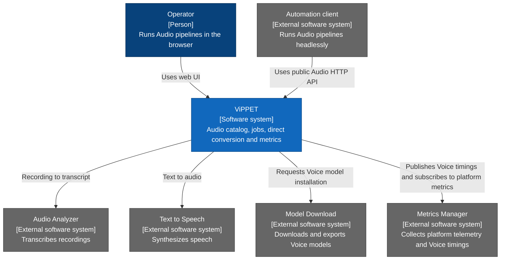
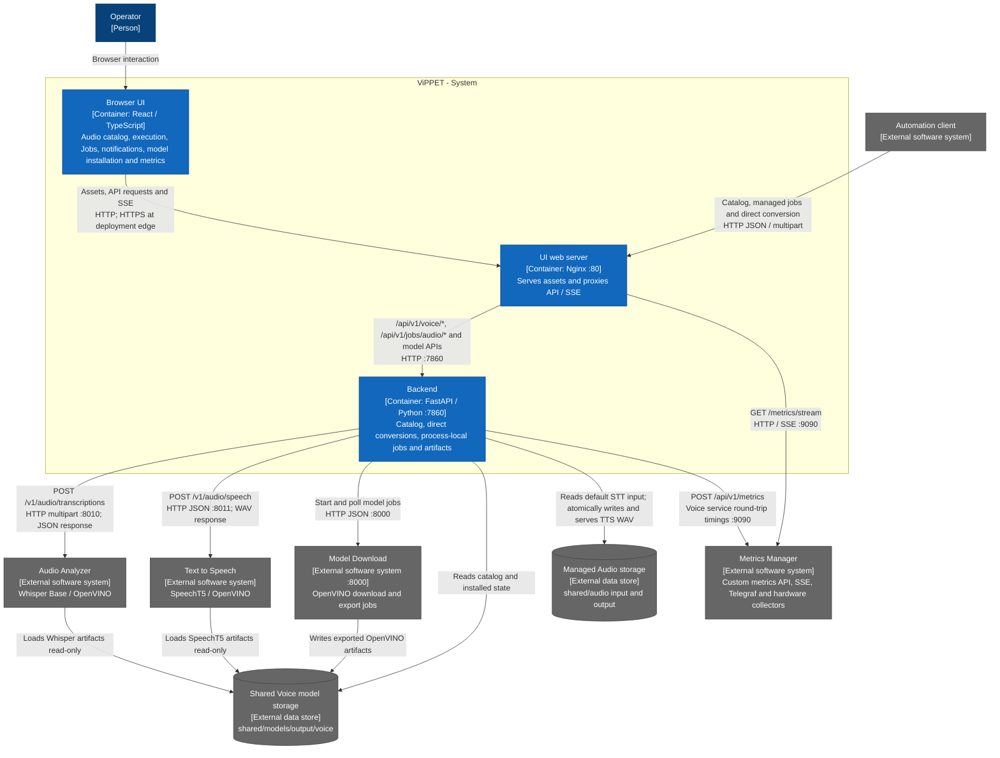
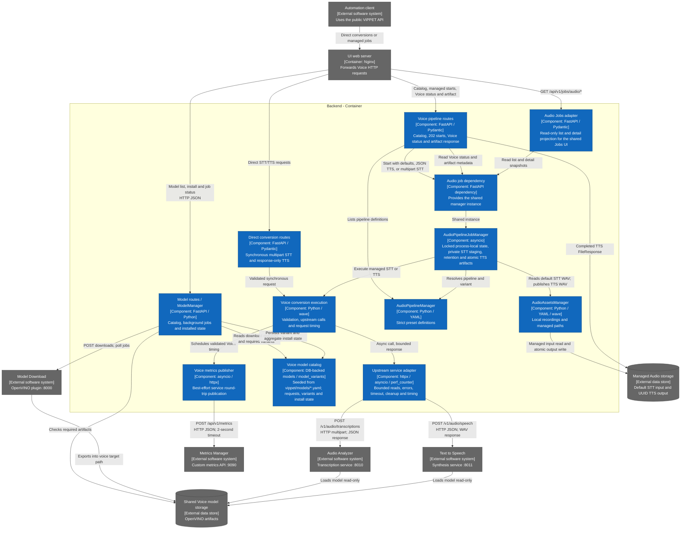
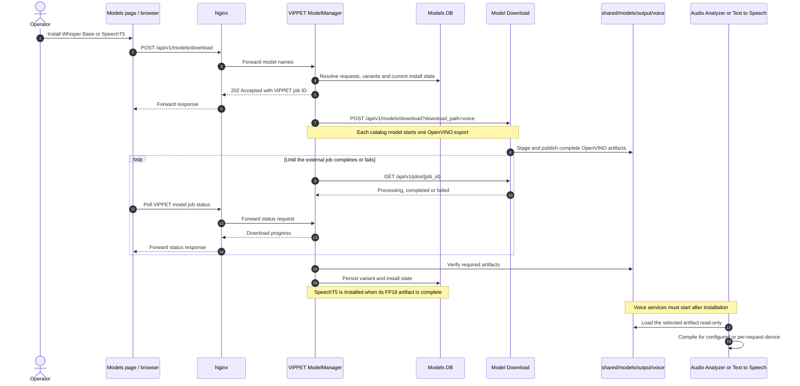
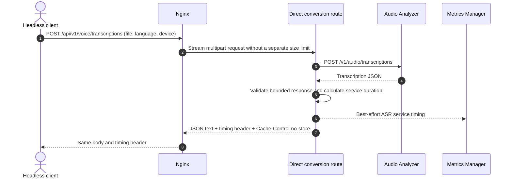
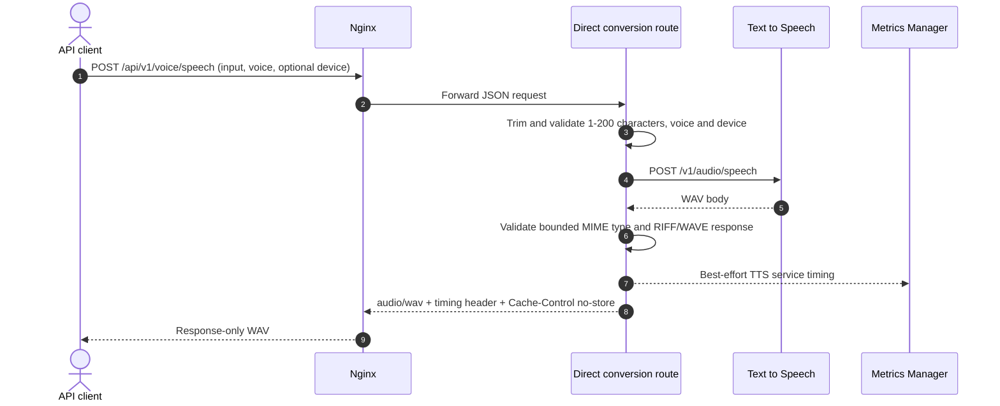
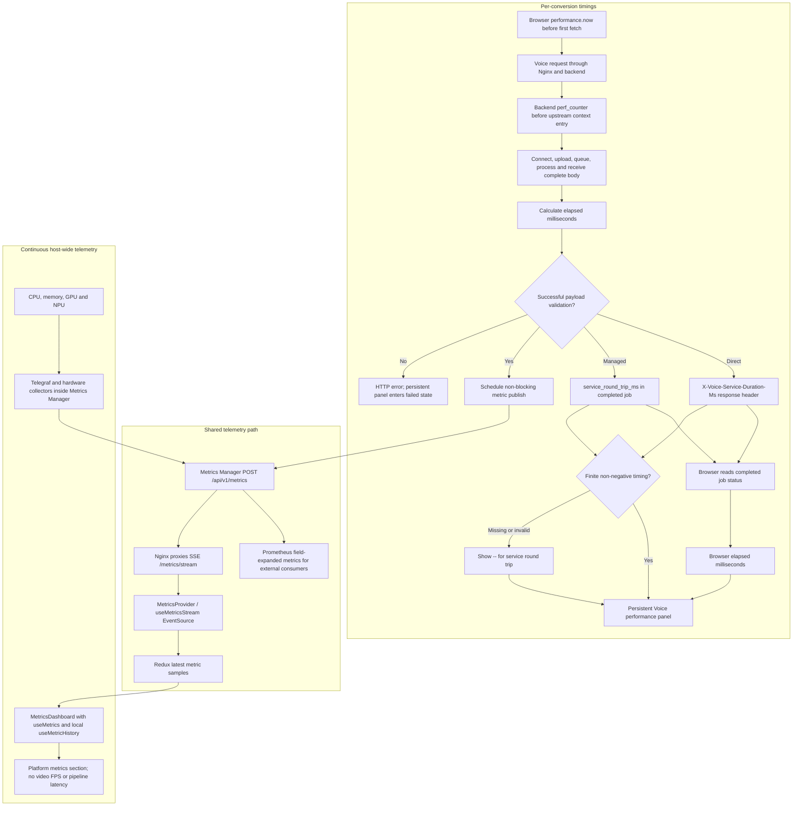
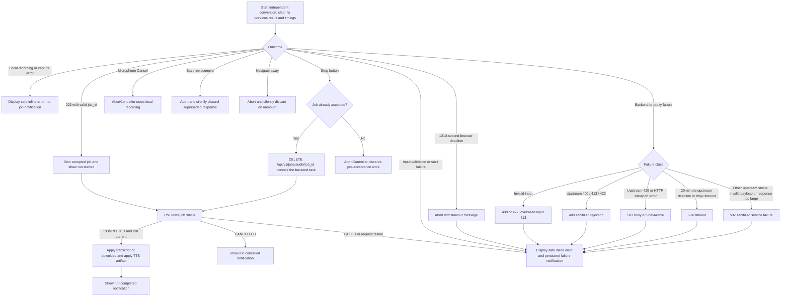

<!-- SPDX-FileCopyrightText: (C) 2026 Intel Corporation -->
<!-- SPDX-License-Identifier: Apache-2.0 -->

# Audio Pipeline Architecture: STT, TTS and Metrics

These diagrams describe the implemented Audio integration as of 2026-10-14.
They follow the [C4 model](https://c4model.com/diagrams) at System Context,
Container and Component levels only. Flow diagrams describe runtime behavior;
there is no Code-level diagram.

## Scope and Notation

- The system of interest is ViPPET. Browser operators and headless automation
  use its public API. Audio Analyzer, Text to Speech, Model
  Download and Metrics Manager are independently deployable supporting software
  systems, even when installed in the same Docker Compose stack.
- A C4 container is an application or data store, not necessarily a Docker
  container. The browser SPA and its Nginx web server are separate C4 containers;
  Nginx serves the SPA from the `vippet-ui` Docker image.
- Each Component view zooms into one ViPPET container. Components describe
  existing responsibilities, not proposed services or new source files.
- Relationships in C4 diagrams describe dependencies/calls; response data is
  summarized in their labels. Flow diagrams show response direction explicitly.
- C4 notation is rendered using Mermaid `flowchart`: every box identifies its
  type, technology where relevant, and responsibility. Blue boxes belong to
  ViPPET; gray boxes are dependencies outside the view's system/container boundary.
  Runtime diagrams use `sequenceDiagram` and `flowchart`. This avoids the
  overlapping labels of Mermaid's experimental native C4 layout.
- Unrelated video pipelines, LLMs, chat history and kiosk-core are out of scope.
  STT and TTS are independent conversions, not an automatic chained conversation.

## C4 Level 1: System Context



The operator uses the ViPPET UI, while automation uses the same ViPPET Audio API
without a browser. Direct upstream API access is possible through published
service ports, but bypasses the ViPPET proxy and its controls.

## C4 Level 2: Containers



Nginx streams Voice request bodies without imposing a separate upload-size
limit and disables response caching. The backend preserves upload metadata and
streams the spooled file to Audio Analyzer, which owns input validation. The
backend retains response-size and deadline limits. It forwards only known
file-validation messages from bounded Audio Analyzer error responses; all other
upstream details remain hidden. Environment HTTP proxy settings are not used for
these calls.

### Deployment and Storage Boundaries

- The current Compose file publishes `8010:8010` and `8011:8011` without a
  loopback host address. Network reachability depends on the host/firewall;
  these bindings are not restricted to localhost by this configuration.
  Protect direct access with deployment-level access control and TLS.
- The Models page starts ViPPET background jobs for Whisper Base and SpeechT5.
  `ModelManager` forwards their OpenVINO requests to Model Download, polls the
  returned job and tracks installed state. SpeechT5 installs one FP16 artifact.
- Model Download exports device-neutral OpenVINO artifacts on CPU under
  `shared/models/output/voice`. Audio Analyzer and Text to Speech mount the
  shared model tree read-only and compile the selected artifact for the runtime
  device when they load it.
- ASR keeps runtime cache, chunks and storage in `voice_asr_cache`,
  `voice_asr_chunks` and `voice_asr_storage`. Recordings/transcripts can persist
  in its storage volume; clear-on-startup is enabled, not a per-request retention
  guarantee. Exit-time chunk cleanup is disabled because the chunks path is a
  volume mount; failed or interrupted runs can therefore leave chunks behind.
  TTS keeps runtime cache and storage in `voice_tts_cache` and
  `voice_tts_storage`, but `PERSIST_OUTPUTS=false` disables output persistence.
- ViPPET stores the managed default WAV and every completed managed TTS job
  artifact in the mounted `shared/audio` tree. Default and custom text or voice
  runs use UUID-named files under `shared/audio/output`; direct
  `POST /api/v1/voice/speech` responses are not persisted. Audio job metadata
  and STT transcripts are process-local. Uploaded or recorded managed STT input
  is copied to a UUID-named file in a private manager-owned temporary directory
  and removed after success, failure, cancellation, registration failure, or
  shutdown. `make clean` removes generated TTS artifacts but preserves only the
  managed default STT input. Browser results and per-conversion timings remain
  in React state; blob URLs are revoked during cleanup. Backend service timings
  are also published to Metrics Manager's runtime store, not to a durable
  request log.
- Managed and direct clients use the ViPPET API through Nginx. Managed run
  requests return `202`, then clients poll process-local job state. Direct
  conversion requests wait for one synchronous JSON or WAV response.
- Hardware overrides determine the default service devices and which device
  nodes are mounted. Per-request Voice overrides select among compatible,
  visible devices. Telemetry reflects the whole host and can include unrelated
  workloads on those devices.

## C4 Level 3: Browser UI Components

```mermaid
flowchart TB
  web["UI web server<br/>[Container: Nginx]<br/>Voice API and SSE proxy"]:::external
  subgraph spa[Browser UI - Container]
    direction TB
    catalog["PipelineCards<br/>[Component: React]<br/>Shared cards in the Audio tab of Pipelines"]:::internal
    voice["VoiceConversion<br/>[Component: React]<br/>Route-selected STT or TTS workflow"]:::internal
    variant["PipelineVariantSelect<br/>[Component: React]<br/>Route-backed Audio device variant selection"]:::internal
    recorder["Recording adapter<br/>[Component: Web Audio]<br/>captureWav prepares local PCM WAV"]:::internal
    audio["VoiceAudio<br/>[Component: Web Audio / Recharts]<br/>Waveform and native audio playback"]:::internal
    timings["VoiceMetrics<br/>[Component: React]<br/>Request and service round-trip timings"]:::internal
    jobs["Jobs / Audio tab<br/>[Component: React / RTK Query]<br/>Oldest-first Audio job list polled every 2 seconds"]:::internal
    detail["AudioJobDetail<br/>[Component: React / RTK Query]<br/>Polls status and displays transcript or WAV link"]:::internal
    notifications["Toaster / shared toast<br/>[Component: Sonner]<br/>Audio run lifecycle notifications"]:::internal
    stream["MetricsProvider / useMetricsStream<br/>[Component: EventSource]<br/>Shared SSE subscription and reconnect"]:::internal
    store["Metrics state<br/>[Component: Redux Toolkit]<br/>Current samples and connection state"]:::internal
    dashboard["MetricsDashboard<br/>[Component: React / Recharts]<br/>useMetrics and useMetricHistory"]:::internal
    cards["MetricCard<br/>[Component: React]<br/>Shared numeric presentation"]:::internal
    voice -->|"Uploaded or recorded STT<br/>Async capture and AbortSignal"| recorder
    voice -->|Renders selected route variant| variant
    variant -->|Updates route parameters| voice
    voice -->|Blob URL props| audio
    voice -->|Timing props| timings
    voice -->|Lifecycle events| notifications
    voice -->|Always mounts below VoiceMetrics in right rail; no video metrics| dashboard
    jobs -->|Opens selected Audio job| detail
    stream -->|Dispatches Redux actions| store
    dashboard -->|Reads Redux selectors| store
    dashboard -->|Renders platform values| cards
  end
  catalog -->|"GET /api/v1/voice/pipelines"| web
  catalog -->|"Opens first variant"| voice
  voice -->|"All STT: start and poll managed job; multipart for a selected file"| web
  voice -->|"All TTS: start job with input/voice, poll and fetch artifact"| web
  jobs -->|"GET /api/v1/jobs/audio/status"| web
  detail -->|"GET /api/v1/jobs/audio/{job_id}/status until terminal"| web
  stream -->|"SSE subscription"| web
  classDef internal fill:#1168bd,color:#fff,stroke:#0b4884
  classDef external fill:#666,color:#fff,stroke:#444
```



The route selects one STT or TTS pipeline view; there are no operation tabs.
Default STT uses the managed YAML input. Selecting or recording a file sends
multipart input to the same managed run endpoint. Every UI STT and TTS
conversion uses a managed job; TTS retrieves its persisted artifact after
completion.

The Audio tab on the shared Jobs page polls oldest-first operational summaries.
Its detail view polls until `COMPLETED`, `FAILED`, or `CANCELLED`, then displays
the transcript or managed WAV link when available. `VoiceConversion` publishes
lifecycle notifications through the application-level Sonner toaster. These
notifications complement, rather than replace, inline errors and result panels.

`VoiceMetrics` does not read global service `/v1/performance` values. On desktop,
it and the always-visible platform `MetricsDashboard` share the right-hand rail;
on smaller viewports, that rail stacks below the active Voice workflow.
`MetricsProvider` is mounted at application level, so the dashboard does not
create another SSE subscription. The dashboard's local history is created on
mount and discarded on unmount; its hook keeps a 60-second window with updates
no more often than once per second.

## C4 Level 3: Backend Components



The direct and managed Voice routes, conversion execution, upstream adapter and
metrics publisher currently reside in the Voice router module. The separate
Jobs router is a read-only adapter over the same `AudioPipelineJobManager`
provided by dependency injection; neither router imports the other.
`AudioPipelineJobManager`, `AudioPipelineManager` and `AudioAssetsManager` are
separate Python components in the same backend process.

The job manager guards its job and task maps with an `asyncio.Lock`. It returns
list snapshots oldest first by creation time and retains every active job plus
at most 500 terminal jobs. Evicting an older terminal TTS job removes its
managed artifact. Direct uploaded audio is streamed to Audio Analyzer for
validation. Managed uploaded audio is first copied to a UUID-named file in a
manager-owned temporary directory and deleted on every exit path, then opened
for the same validated conversion path. Default managed STT opens the
registered WAV; managed TTS atomically publishes a UUID-named artifact.
Successful direct responses expose service timing in
`X-Voice-Service-Duration-Ms`; managed jobs expose the same timing in job
status. Publication failures do not fail a direct conversion or managed job.
Model routes and `ModelManager` remain separate from the Voice router but run
in the same backend container.

## Flow: Install Voice Models



Voice services do not download models during startup. They preload models, so
starting them before installation makes their health checks fail until the
required artifacts exist and the services restart. Model Download stages
exports before publishing complete artifacts; subsequent starts reuse them.

## Flow: Managed Speech to Text

```mermaid
sequenceDiagram
  autonumber
  actor Client as Browser UI or headless client
  participant Web as Nginx
  participant API as Audio pipeline routes
  participant Jobs as AudioPipelineJobManager
  participant Assets as AudioAssetsManager
  participant ASR as Audio Analyzer
  participant Metrics as Metrics Manager
  alt Managed default input
    Client->>Web: POST .../speech-to-text/variants/{variant}/runs without body
    Web->>API: Forward bodyless request
    API->>Jobs: start_job(pipeline, variant)
  else Uploaded or recorded input
    Client->>Web: POST .../speech-to-text/variants/{variant}/runs with file and language
    Web->>API: Stream multipart request without a separate size limit
    API->>Jobs: Stage random temporary file and start_job(pipeline, variant, input)
  end
  Jobs-->>API: QUEUED job with UUID
  API-->>Web: 202 Accepted with job_id
  Web-->>Client: Forward start response
  Jobs->>Jobs: Set RUNNING in process-local state
  alt Managed default input
    Jobs->>Assets: Resolve registered managed WAV
    Assets-->>Jobs: Validated local path
  else Staged input
    Jobs->>Jobs: Open manager-owned temporary input
  end
  Jobs->>ASR: POST /v1/audio/transcriptions with WAV, language and device
  ASR-->>Jobs: Transcription JSON
  Jobs-->>Metrics: Best-effort ASR service timing
  Jobs->>Jobs: Store transcript and timing; set COMPLETED; delete staged input
  loop Until COMPLETED, FAILED, or CANCELLED
    Client->>Web: GET /api/v1/voice/jobs/{job_id}
    Web->>API: Forward status request
    API->>Jobs: Read process-local job
    Jobs-->>API: Status, transcript and service timing
    API-->>Web: Job JSON
    Web-->>Client: Job JSON
  end
```

Managed STT accepts either no body for the YAML-defined recording and language,
or multipart `file` and two-letter `language` fields for uploaded and recorded
audio. The route stages multipart input before returning `202`; the job owns and
deletes that temporary input on every terminal path and shutdown. The completed
transcript and job metadata are process-local and disappear when the backend
restarts; no STT artifact is created.

## Flow: Direct Speech to Text



The direct endpoint remains available to headless clients that need one
synchronous response without a managed job. The Audio pipeline UI does not use
this route. The adapter closes upstream resources before the route returns the
validated response.

## Flow: Managed Text to Speech

```mermaid
sequenceDiagram
  autonumber
  actor Client as Browser UI or headless client
  participant Web as Nginx
  participant API as Audio pipeline routes
  participant Jobs as AudioPipelineJobManager
  participant TTS as Text to Speech
  participant Store as shared/audio/output
  participant Metrics as Metrics Manager
  Client->>Web: POST .../text-to-speech/variants/{variant}/runs with optional input and voice
  Web->>API: Forward request
  API->>API: Validate 1-200 characters and supported voice when body is present
  API->>Jobs: start_job(pipeline, variant, optional overrides)
  Jobs-->>API: QUEUED job with UUID
  API-->>Web: 202 Accepted with job_id
  Web-->>Client: Forward start response
  Jobs->>Jobs: Set RUNNING; use overrides or YAML defaults
  Jobs->>TTS: POST /v1/audio/speech with text, voice and device
  TTS-->>Jobs: WAV body
  Jobs-->>Metrics: Best-effort TTS service timing
  Jobs->>Store: Write temporary file and atomically publish {job_id}.wav
  Jobs->>Jobs: Store artifact path and timing; set COMPLETED
  loop Until COMPLETED, FAILED, or CANCELLED
    Client->>Web: GET /api/v1/voice/jobs/{job_id}
    Web->>API: Forward status request
    API-->>Web: Job JSON with artifact_url when complete
    Web-->>Client: Job JSON
  end
  Client->>Web: GET /api/v1/voice/jobs/{job_id}/artifact
  Web->>API: Forward artifact request
  API->>Store: Open completed job artifact
  Store-->>API: UUID WAV
  API-->>Web: audio/wav + Cache-Control no-store
  Web-->>Client: WAV artifact
```

Every TTS conversion started by the Audio pipeline UI follows this managed
path. The browser creates a blob URL only after downloading the persisted
artifact, then uses it for playback and download. Artifact retrieval, waveform
decoding and playback are excluded from the displayed managed request duration.

## Flow: Direct Text to Speech



The direct endpoint does not create a job or persist its response under managed
Audio output. The proxy buffers the complete upstream body; neither TTS path is
streaming playback or a time-to-first-byte measurement.

## Flow: Conversion Timings and Telemetry



After a successful upstream response is validated, the backend schedules a
best-effort publish to Metrics Manager. Publishing has a separate 2-second
timeout and does not delay or fail a direct response or managed job. ASR
publishes metric `voice_asr` with field `service_round_trip_ms` and tags for
requested `device` and `language`. TTS publishes metric `voice_tts` with the
same field and tags for requested `device` and `voice`. A missing device is
tagged `service-default` and must not be read as confirmation of the device the
service actually used.

- **Request duration:** browser first-fetch start through a direct response or
  completed managed job status, including polling for managed runs. Managed TTS
  artifact retrieval occurs after this interval. The value remains
  browser-local and is not published to Metrics Manager.
- **Service round trip:** backend adapter start through complete upstream body
  reception and local response construction; excludes browser transfer and
  subsequent route payload validation/context cleanup. Includes transport,
  queueing and service processing, not only model inference. This is the only
  Voice duration published to Metrics Manager.
- The intervals use independent monotonic clocks. No cross-machine timestamp
  subtraction or global last-request variable is needed.
- Published Voice metrics remain available through Metrics Manager's Prometheus
  and SSE interfaces, but the Voice performance panel shows only the current
  request-scoped timings returned in the direct response or completed job.
- Platform charts are live system-wide telemetry, not a frozen snapshot of a
  conversion and not resource attribution to a particular STT/TTS request.
- Voice does not query the services' global `last_ms` or `/v1/model-info` and does
  not report model inference time, chunk or segment counts, effective device,
  end-to-end conversational latency or time to first audio.

## Flow: Errors and Cancellation



Stop on an accepted job cancels the managed backend task through
`AudioPipelineJobManager.cancel_job`: the job moves to `CANCELLED`, the in-flight
request to the upstream service is cancelled, and staged input and any
uncommitted artifact are removed. It cannot guarantee that an already-started
upstream inference stops. Navigating away does not cancel a managed job, which
can still finish and persist its WAV. Backend contexts
close resources on return or exceptions; their total upstream deadline is 20
minutes, with a 5-second connection timeout. The browser and Nginx Voice
read/send timeouts are 1210 seconds, allowing ten seconds beyond the backend
deadline. Proxy-generated failures may differ from the backend's status mapping
above.

## Implementation References

- [Voice workflow](../../../ui/src/features/voice/VoiceConversion.tsx),
  [pipeline variant selector](../../../ui/src/features/pipelines/PipelineVariantSelect.tsx),
  [recording adapter](../../../ui/src/features/voice/recording.ts),
  [audio preview](../../../ui/src/features/voice/VoiceAudio.tsx) and
  [performance panel](../../../ui/src/features/voice/VoiceMetrics.tsx).
- [Jobs page](../../../ui/src/pages/Jobs.tsx),
  [Audio job detail](../../../ui/src/pages/AudioJobDetail.tsx),
  [application layout and toaster](../../../ui/src/components/Layout.tsx),
  [Voice API and upstream adapter](../../../vippet/api/routes/voice.py),
  [Jobs API adapter](../../../vippet/api/routes/jobs.py) and
  [Audio job dependency](../../../vippet/api/dependencies/audio_jobs.py).
- [Audio pipeline manager](../../../vippet/managers/audio_pipeline_manager.py),
  [job manager](../../../vippet/managers/audio_pipeline_job_manager.py) and
  [managed Audio assets](../../../vippet/audio_assets.py).
- [Models page](../../../ui/src/pages/Models.tsx),
  [model installation hook](../../../ui/src/features/models/useModelInstall.ts),
  [model routes](../../../vippet/api/routes/models.py),
  [model manager](../../../vippet/managers/model_manager.py),
  [Whisper catalog entry](../../../vippet/models/voice-whisper-base.yaml),
  [SpeechT5 catalog entry](../../../vippet/models/voice-speecht5.yaml) and
  [catalog DB seeding](../../../vippet/db_seed.py).
- [Metrics stream](../../../ui/src/hooks/useMetricsStream.ts),
  [local chart history](../../../ui/src/hooks/useMetricHistory.ts) and
  [shared dashboard](../../../ui/src/features/metrics/MetricsDashboard.tsx).
- [Nginx routing](../../../ui/nginx.conf),
  [Compose configuration](../../../compose.yml) and
  [system telemetry architecture](./metrics/system-performance.md).
- [Voice user guide](../user-guide/voice-conversion.md),
  [backend regression tests](../../../vippet/tests/unit/api_tests/voice_test.py) and
  [Voice browser regression tests](../../../ui/tests/voice.spec.ts) and
  [Audio Jobs browser regression tests](../../../ui/tests/audio-jobs.spec.ts).
