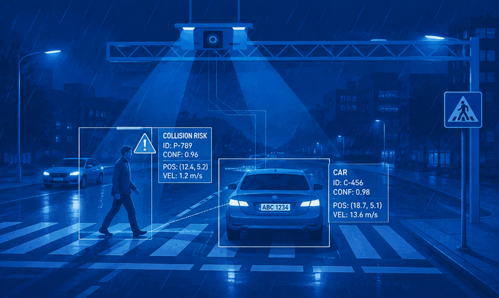
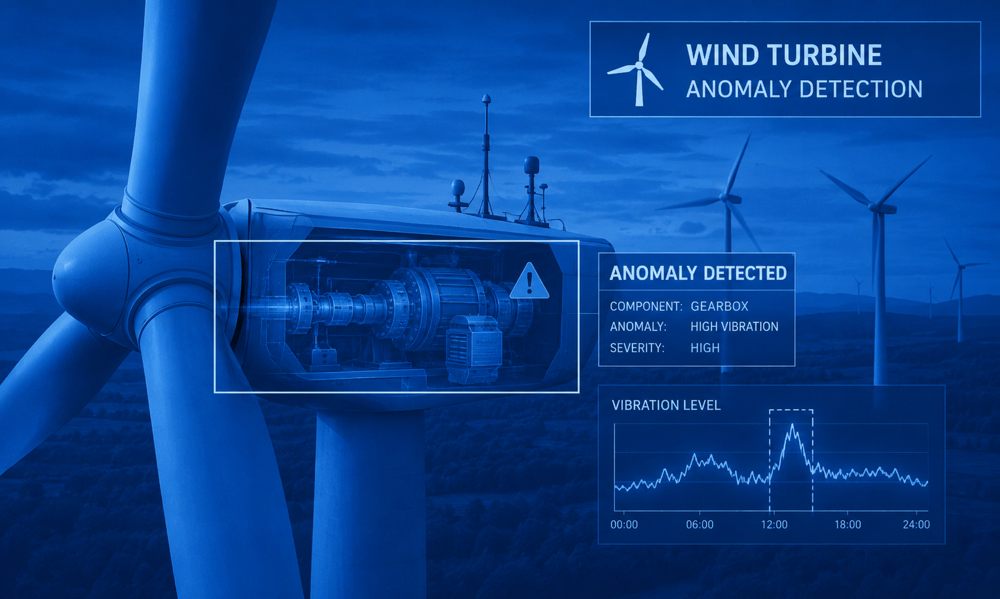
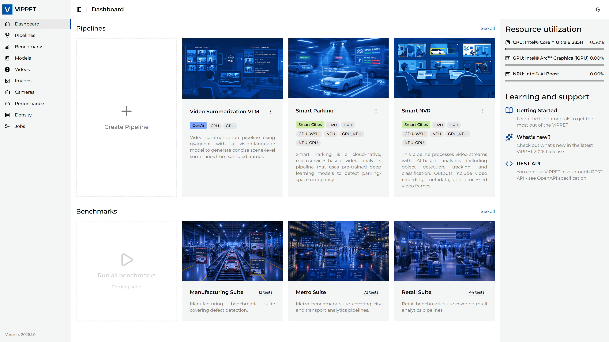
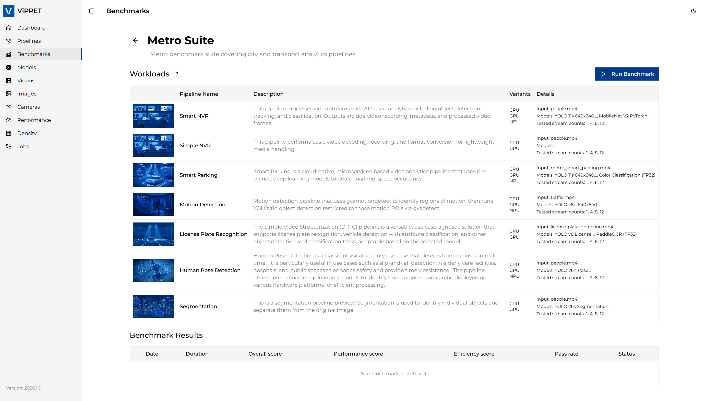
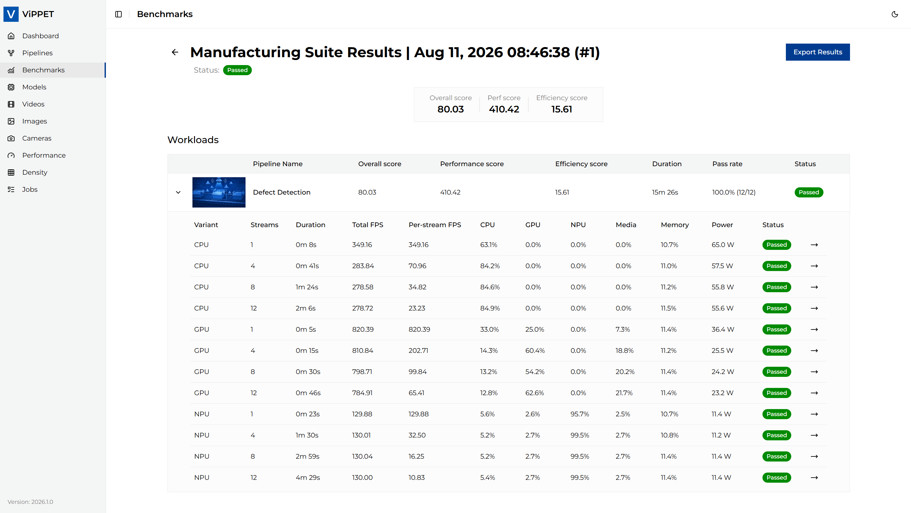
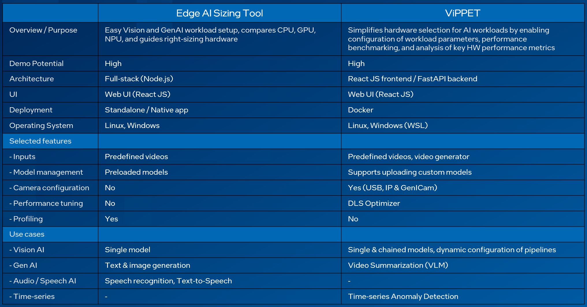

# ViPPET 2026.2

## Major features and improvements

- [New predefined pipelines](#new-predefined-pipelines) - New pipelines for
  showcasing DeepSORT tracking and (experimental) time-series anomaly detection
- [In-app perfomrance benchmarks](#in-app-performance-benchmarking)
  \- Streamlined benchmarking and reporting for predefined workloads sets
- [Performance testing](#performance-testing) - Added performance testing
  alongside functional tests
- [New supported models](#new-models) - Added support for InternVL2 & MiniCPM
  VLM and YOLO11/YOLO26 models
- [Support for machine vision cameras](#support-for-machine-vision-cameras)
  \- Added proof-of-concept support for GigE/GenICam-compliant machine
  vision cameras
- [Extended density benchmarking](#extended-density-benchmarking) - Added option
  to find maximum stream density by fixing pipeline #1 count and incrementally
  testing pipeline #2 capacity
- [Guidelines for sizing tool selection](#guidelines-for-sizing-tool-selection)
  \- Added documentation to make it easier to decide when to use ViPPET and Edge
  AI Sizing Tool

## Release Details

This section provides additional details about the new functionality in ViPPET.

### New predefined pipelines

In the 2026.2 release, two new predefined pipelines were added for showcasing
People Detection and Tracking using DeepSORT for tracking and Wind Turbine
time-series anomaly detection pipeline.

| Pipeline                                                           | Description                                                                                                                                                                                                                                                                                                             | Variants                  |
| ------------------------------------------------------------------ | ----------------------------------------------------------------------------------------------------------------------------------------------------------------------------------------------------------------------------------------------------------------------------------------------------------------------- | ------------------------- |
|   | **People Detection and Tracking**: People detection and tracking pipeline using YOLO object detection, person re-identification, and Deep SORT (Simple Online and Realtime Tracking with a Deep Association Metric) tracking, which combines motion prediction, appearance features & robust association.               | Available in GPU variant. |
|  | **Wind Turbine Anomaly Detection**: Experimental, time-series anomaly detection pipeline that ingests wind turbine sensor data (grid active power, wind speed), processes it through the Time Series Analytics Microservice (TSAM) using a trained anomaly detection model, and outputs anomaly classification results. | Available in CPU variant. |

New predefined pipelines include matching sample videos and model configurations.

### In-app Performance Benchmarking

ViPPET’s preconfigured benchmarks can be used for comparing how sets of AI
pipelines behave across device variants and stream counts. For starters, we
created benchmark suites such as Retail, Metro, and Manufacturing.

Each suite is a collection of workloads, and each workload maps to a specific
pipeline plus a set of test cases like CPU/GPU/NPU at 1, 4, 8, and 12 streams.
The goal is to let a user run a repeatable, opinionated benchmark pack instead
of assembling one-off performance tests by hand.

For example, Metro benchmark suite covers all *Smart City* and *Transportation*
pipelines such as Smart NVR, Smart Parking, Motion Detection,
License Plate Recognition, etc.

Starting a benchmark launches an asynchronous orchestration job that runs the
suite’s test cases sequentially, tracks live progress, and prevents multiple
suites from running at once. As results come in, ViPPET aggregates them into
workload-level and suite-level scores, with separate performance and efficiency
components plus an overall score.

You can go one step deeper into an individual test run to view time-series
charts for frame rate, memory, and CPU usage. Finished runs can also be
exported as CSV and PDF.

To learn more about how to measure performance, refer to the
[Performance Testing](#performance-testing) section.

### Performance Testing

In addition to functional tests that exercise the VIPPET API end-to-end, we
added pytest-based performance testing suite for easy automated benchmarking of
VIPPET pipelines, sampling hardware KPIs per job while running against a live
instance of ViPPET. It is driven by YAML presets (quick, default, full) plus
environment variables and invoked via make test-performance or pytest directly,
emitting JSON, CSV, and interactive HTML Chart.js reports with FPS, utilization,
and power charts.

To learn more about how to measure performance, refer to the
[Performance Benchmarks](../user-guide/benchmarking/performance-testing.md)
section.

### New Models

ViPPET now supports two new VLM models: InternVL2-2B INT4 & MiniCPM-v4.5-8B INT4.
When in comes to new Ultralytics models, ViPPET supports:

| Model family                         | Detection        | Pose                       | Segmentation             |
| ------------------------------------ | ---------------- | -------------------------- | ------------------------ |
| Ultralytics YOLO26 FP32/FP16 (s & n) | YOLO26s, YOLO26n | YOLO26s-pose, YOLO26n-pose | YOLO26s-seg, YOLO26n-seg |
| Ultralytics YOLO11 (s & n)           | YOLO11s, YOLO11n | YOLO11s-pose, YOLO11n-pose | YOLO11s-seg, YOLO11n-seg |

### Support for machine vision cameras

Added proof-of-concept support for GigE/GenICam-compliant machine vision cameras.
The POC uses `gencamsrc` (our generic GenICam implementation) and `pylonsrc`
(Basler gstreamer element) camera sources. The POC will be merged into the
upcoming Sensor Manager microservice in 2026.3 timeframe. In the meantime, the
POC is available in the
[staszczuk/edge-ai-libraries repository](https://github.com/staszczuk/edge-ai-libraries).

### Extended density benchmarking

Extended ViPPET density benchmarking so users can fix the count of input streams
for one pipeline and then automatically increase the count of input streams for
the second pipeline class until the platform limit is reached. This allows users
to answer questions such as how many secondary analytics streams can be added
once a baseline workload is already running.

To learn more about how to run such density benchmarking tests, refer to the
[Density Testing](../user-guide/benchmarking/density-testing.md) section.

### Guidelines for sizing tool selection

We have two sizing tools with distinctive features & use cases:

- Edge AI Sizing Tool: A native app, offers profiling, supports text/image
  generation, and speech recognition, TTS use-cases.
- ViPPET: Relies on Docker, supports custom models, multiple input options, and
  performance tuning, chained vision pipelines, VLM summarization, and
  time-series anomaly detection.

As there was no documentation that could  help users to decide when to use
which tool, for this release, the comparison table was created to simplify the
comparison and selection of the sizing tool. In addition, both tools were
aligned in terms of Look&Feel.

