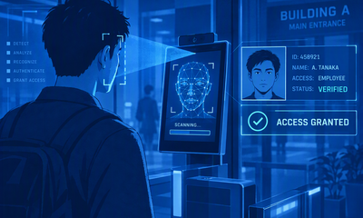
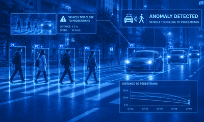
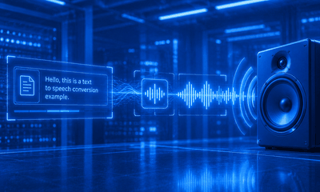
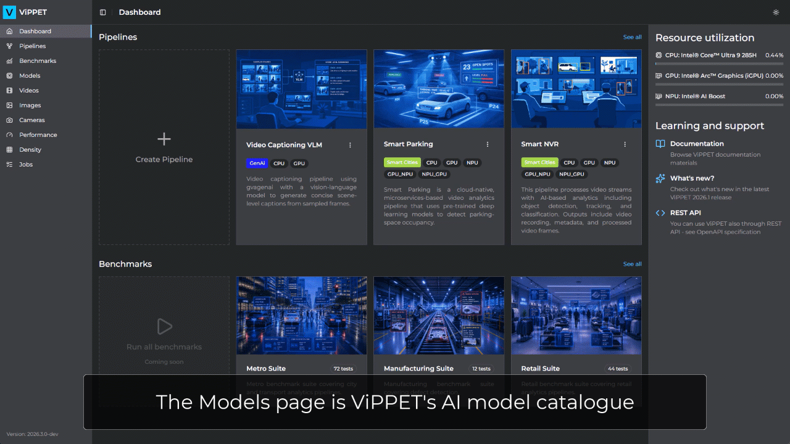
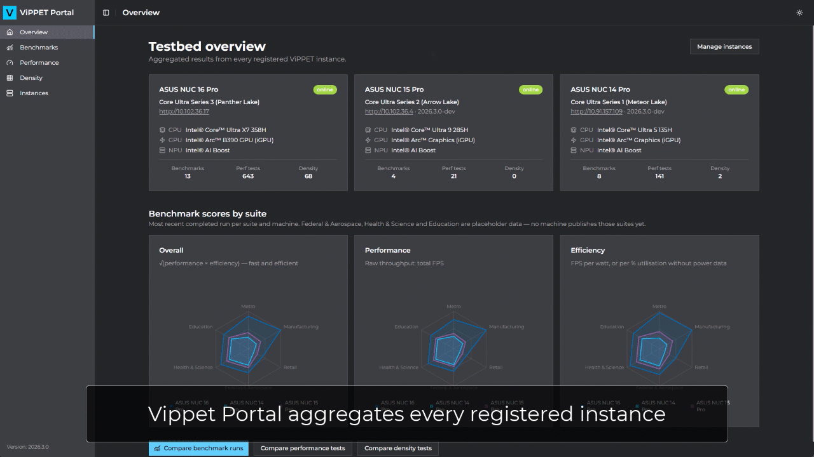

# ViPPET 2026.3

## Major features and improvements

- [DL Streamer Pipeline Server 2.0 execution engine](#dl-streamer-pipeline-server-20-execution-engine)
  \- Runs ViPPET workloads on the dedicated DLSPS 2.0 service
- [New vision and media pipelines](#new-vision-and-media-pipelines)
  \- Added face recognition, alerting, CV-triggered VLM, and Media Decode pipelines
- [New audio pipelines](#new-audio-pipelines) - Added speech recognition and speech synthesis workflows
- [Camera support with Sensor Manager](#camera-support-with-sensor-manager)
  \- Moved camera discovery and management to the new Sensor Manager microservice,
  including GigE Vision support
- [Improved Model Management](#improved-model-management) - Browse Hugging Face,
  Ultralytics, and configured Geti 3.0 models, and install pipeline requirements in one step
- [CPU core pinning](#cpu-core-pinning) - Restrict pipeline execution to selected
  logical CPU cores in advanced mode
- [Performance testing and reports](#performance-testing-and-reports)
  \- Added latency reporting for benchmarks, a command-line test entry point, and richer reports
- [ViPPET Portal (POC)](#vippet-portal) - Proof of concept for comparing results
  and running experiments across multiple ViPPET instances

## Release Details

This section provides additional details about the new functionality in ViPPET and ViPPET Portal.

### DL Streamer Pipeline Server 2.0 execution engine

ViPPET uses DL Streamer Pipeline Server 2.0 (DLSPS 2.0) as the execution engine for its
GStreamer and DL Streamer workloads. The ViPPET backend submits work to the dedicated
server over REST, keeping media processing separate from the API service. DLSPS 2.0 runs
pipeline validation, video conversion, benchmarks, performance tests, and density tests;
the pipeline optimizer also runs as a server job.

Each stream runs in its own server instance. ViPPET coordinates those instances,
reads the available CPU, GPU, and NPU devices from the server, and collects server
telemetry through OpenTelemetry and the Metrics Manager. This keeps pipeline execution
and reported device and performance data tied to the same runtime.

### New vision and media pipelines

Three new predefined vision and media pipelines extend the workloads that can be evaluated in ViPPET.

| Pipeline | Description | Variants |
| --- | --- | --- |
|  | **Face Recognition**: Detects and tracks faces, then extracts face embeddings for downstream matching against a gallery. | CPU, GPU, GPU (WSL), NPU, and GPU + NPU |
|  | **CV-Triggered VLM**: Object detection triggers a vision-language model to assess a nearby car and person; a parallel branch records annotated video. | CPU + GPU (detection on CPU, VLM on GPU) |
|  | **Alerting VLM**: Analyzes traffic video and briefly describes dangerous behavior by road users. | CPU and GPU |
|  | **Media Decode**: Measures video decode throughput and CPU utilization without inference, scaling, recording, or rendering. With CPU pinning on a supported Intel GPU, it can use VDBox; otherwise, it uses the default decoder. | Single **Decode** variant; VDBox requires CPU pinning and a supported GPU. |

See [Using Predefined Pipelines](../user-guide/pipeline-management/predefined-pipelines.md)
for pipeline information.

### New audio pipelines

ViPPET adds audio workflows for speech recognition and speech synthesis, using the
Audio Analyzer and Text to Speech services.

| Pipeline | Description | Variants |
| --- | --- | --- |
|  | **Speech to Text**: Transcribes a bundled sample recording with the Audio Analyzer service using Whisper Base. | CPU, GPU, and NPU |
|  | **Text to Speech**: Generates a WAV recording from text using the Text to Speech service and SpeechT5. | CPU |

### Camera support with Sensor Manager

Camera discovery and management moved to the new Sensor Manager microservice.
It discovers USB cameras, ONVIF network cameras and their media profiles, and GigE Vision
(GenICam) machine-vision cameras. ViPPET uses the discovered cameras as pipeline input sources.

This brings GigE Vision support, introduced as a proof of concept in 2026.2, into the
common Sensor Manager camera workflow.

### Improved Model Management

The model catalog is stored in the application database, and the redesigned **Models** page
 organizes models into separate tables by category. Browse and search Hugging Face and
 Ultralytics directly from the page to find and add models to the catalog. You can also
 connect to a configured Geti 3.0 instance to browse project models and download selected
 trained models directly, including their available variants. Each model includes a
 description and a link to its Hugging Face page when available.

ViPPET can install all models required by a pipeline selection in one step.
If a Hugging Face model requires license acceptance, a dialog prompts you to visit its
model page and accept the license before installation.

For details on working with models, see
[Model Management](../user-guide/model-management.md).

### CPU core pinning

In advanced mode, a pipeline variant can be pinned to selected logical CPU cores.
The selector groups cores by type when available, including performance, efficient,
and low-power efficient cores. With no cores selected, the pipeline can use all cores.
ViPPET validates the selected CPU IDs against the cores available to the execution service
and passes the selection to DL Streamer Pipeline Server 2.0.

### Performance testing and reports

Performance testing can be started from a command-line entry point as well as through
the application. Benchmark execution now includes latency metrics, and benchmark summaries
include charts. Performance reports can be generated as HTML from JSON results,
with host platform and ViPPET version included in the system information. Test runs can
also record their effective configuration for later replay.

For details on running performance tests from the command line, see the
[performance testing CLI guide](https://github.com/open-edge-platform/edge-ai-libraries/blob/main/tools/visual-pipeline-and-platform-evaluation-tool/vippet/tests/performance/README.md).
For performance tests and their metrics in the application, see
[Performance Testing](../user-guide/benchmarking/performance-testing.md) and
[Benchmarking](../user-guide/benchmarking.md).

### ViPPET Portal

The ViPPET Portal is introduced as a proof of concept (POC) for aggregating results
from multiple ViPPET instances. Register instances by URL; the portal discovers each
instance's version and hardware identity and reports its health.

The POC compares benchmark suites, performance tests, and density tests across machines.
Comparisons align workloads and test cases, use the first selected result as a baseline,
and highlight metric changes according to whether higher or lower values are better.
It can also launch a benchmark suite or performance or density test across several
instances as an experiment, then track progress side by side.

