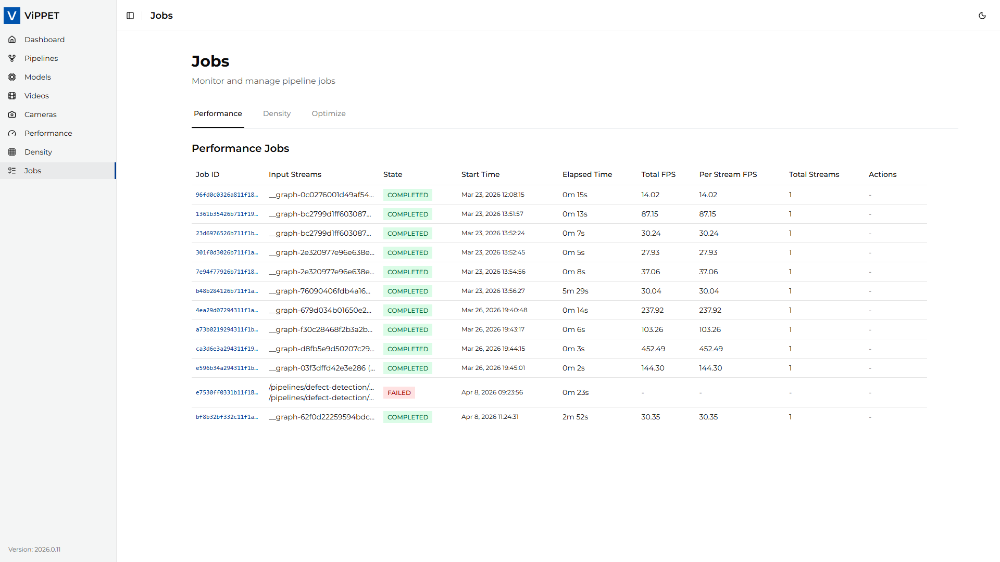

<!-- SPDX-FileCopyrightText: (C) 2026 Intel Corporation -->
<!-- SPDX-License-Identifier: Apache-2.0 -->

# Managing Jobs

Every performance test, density test, and managed Audio pipeline run creates a **job** — a tracked
unit of work with a unique ID, state, timing information, and results. The Jobs page lets you monitor
running work, review completed results, and stop supported test jobs that are no longer needed.

## Job states

Each job transitions through the following states:

| State         | Description                                                                  |
| ------------- | ---------------------------------------------------------------------------- |
| **QUEUED**    | The Audio job was accepted and is waiting to start.                          |
| **RUNNING**   | The job is currently executing.                                              |
| **COMPLETED** | The job finished successfully. Results are available in the job detail view. |
| **FAILED**    | The job terminated with an error.                                            |
| **CANCELLED** | The Audio job ended before completion.                                       |

## Job information

The Jobs page displays the following information for each job:

| Field            | Description                                                                    |
| ---------------- | ------------------------------------------------------------------------------ |
| **Job ID**       | Unique identifier assigned when the job is created                             |
| **Type**         | Performance, Density, Optimize, or Audio                                       |
| **State**        | Current lifecycle state                                                        |
| **Start time**   | When the job was created                                                       |
| **Elapsed time** | Duration from start to current time, or to the terminal state                  |
| **Details**      | Type-specific status, metrics, pipeline, variant, device, or artifact metadata |

## Viewing job results

Click on a completed job to view its detailed results:

- **Performance jobs** — Total FPS, Per Stream FPS, stream count, output video paths, and live stream URLs.
- **Density jobs** — Maximum sustainable stream count, per-stream FPS at that count, and stream distribution
  across pipelines. In mixed density mode the pinned pipeline always reports its fixed `streams` value
  while the other pipeline reports the highest count that still met `fps_floor`.
- **Audio jobs** — Pipeline, operation, variant, device, state, timestamps, and service latency. A
  completed Speech to Text detail shows its transcript. A completed Text to Speech detail links to
  its WAV artifact. Transcript content is not included in the Audio jobs list.
- **Latency metrics** — If latency metrics were enabled for the job, the results include avg/min/max latency
  values (in milliseconds) per reporting interval.

## Stopping a running test job

To stop a performance or density job that is currently running:

1. Locate the job in the list (state = RUNNING).
2. Click the **Stop** button.
3. The job will be terminated.

**Behavior after stopping:**

- **Performance tests** — If the pipeline had already started processing frames, partial results
  (FPS, output videos) may be preserved and the job state transitions to COMPLETED.
  If no frames were processed, the job transitions to FAILED.
- **Density tests** — Cancelled density tests always transition to FAILED because partial results
  from an incomplete search algorithm are not meaningful.

> [!NOTE]
> Stopping a job sends a cancellation signal to the underlying GStreamer subprocesses.
> The actual termination may take a few seconds while pipelines flush their buffers.

Audio jobs do not provide a Stop action.

## API endpoints

Jobs can also be managed programmatically via the REST API:

| Operation                  | Endpoint                                         | Method |
| -------------------------- | ------------------------------------------------ | ------ |
| List all performance jobs  | `/api/v1/jobs/tests/performance/status`          | GET    |
| Get performance job status | `/api/v1/jobs/tests/performance/{job_id}/status` | GET    |
| Stop performance job       | `/api/v1/jobs/tests/performance/{job_id}`        | DELETE |
| List all density jobs      | `/api/v1/jobs/tests/density/status`              | GET    |
| Get density job status     | `/api/v1/jobs/tests/density/{job_id}/status`     | GET    |
| Stop density job           | `/api/v1/jobs/tests/density/{job_id}`            | DELETE |
| List all Audio jobs        | `/api/v1/jobs/audio/status`                      | GET    |
| Get Audio job status       | `/api/v1/jobs/audio/{job_id}/status`             | GET    |

For full API documentation, see the auto-generated OpenAPI docs at `/docs` on the backend service.
