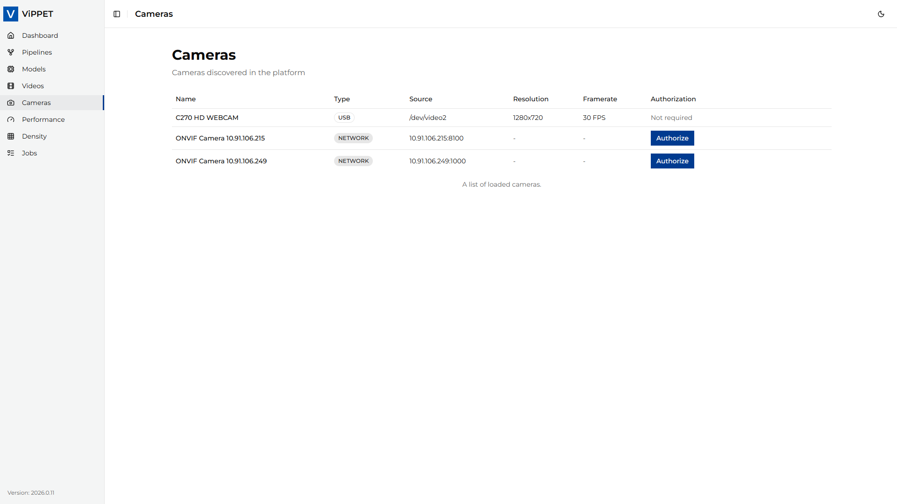
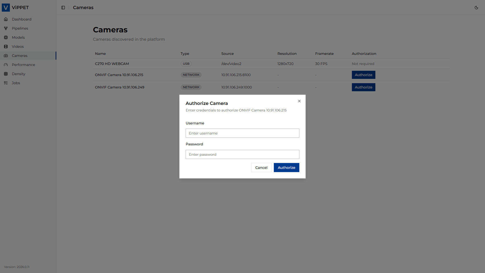
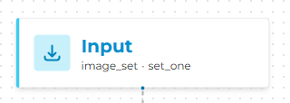
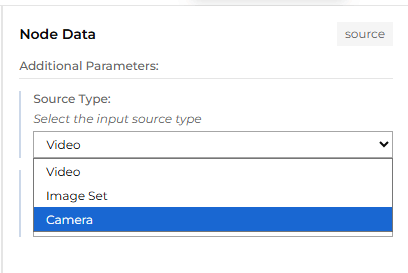
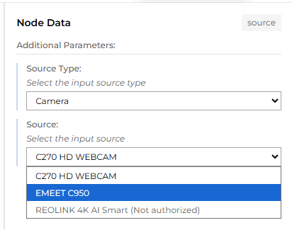

# Cameras

This article explains how to use the Camera module in ViPPET to detect and connect to cameras.
From the left-side menu, choose **Cameras** to open the camera management page.

ViPPET supports three types of cameras: USB cameras, network cameras, and GigE Vision cameras. USB
cameras are detected automatically via plug-and-play, network cameras are discovered using the ONVIF
standard, and GigE Vision cameras are discovered using [Aravis](https://github.com/AravisProject/aravis).



## USB Cameras

Connecting a USB camera requires no additional configuration. Simply plug the camera into the host
machine. ViPPET automatically detects the device and displays it in the *Cameras* tab.

## Network Cameras

### Network camera discovery

Network cameras are discovered using the ONVIF standard. Before ViPPET can detect a network camera,
you must configure it correctly:

1. **Enable the ONVIF service** on the camera. Refer to the camera manufacturer's documentation for
   instructions on how to do this.
1. **Create an ONVIF media profile** on the camera, defining the desired stream settings (resolution,
   encoding, frame rate, and so on).
1. **Connect the camera to the same subnet** as the host machine running ViPPET. The Sensor Manager
   service uses multicast to find cameras, so the camera must be reachable within the local network
   segment.

Once the camera is properly configured and connected to the network, ViPPET automatically discovers
and displays it in the *Cameras* tab.

> [!NOTE]
> If a network camera does not appear in the *Cameras* tab, verify that the ONVIF service is
> enabled, a valid media profile exists, and the camera is on the same subnet as the host machine.

### Network camera authorization

After a network camera is discovered, authorization is required before it can be used. An *Authorize*
button appears next to the camera entry in the *Cameras* tab.

To authorize a camera:

1. Click the *Authorize* button next to the camera.
1. Enter the camera's *Username* and *Password*.
1. Confirm. If the credentials are accepted, the camera status changes to *Authorized*.



> [!NOTE]
> If authorization fails, verify that the username and password are correct, and ensure that
> the clock on the camera is synchronized with the clock on the host machine. Time skew between the
> camera and the host is a common cause of ONVIF authentication failures.

## GigE Vision Cameras

### GigE Vision camera discovery

GigE Vision (GenICam) machine vision cameras are discovered automatically by the Sensor Manager
service. Connect the camera to a network interface of the host machine and make sure that the camera
has an IP address in the same subnet as that interface (for example, a persistent IP address or a
link-local address). No authorization is required.

The *Cameras* tab shows the camera IP address, serial number, and the resolution, pixel format,
and frame rate currently configured on the camera. ViPPET uses the camera's current
configuration; change it with the camera vendor's tools if needed.

> [!NOTE]
> The vendor, model, serial number, and capture settings are read once, when the camera is first
> found. If the camera is streaming to another application at that moment, only its IP address
> is shown.

### Streaming from GigE Vision cameras

GigE Vision cameras send video as UDP packets directly to the receiving host. The default ViPPET
deployment runs on a Docker bridge network, which cannot receive these packets, so streaming from
GigE Vision cameras requires running the ViPPET backend with host networking:

```bash
make build run GIGE=1
```

This applies the `compose.gige.yml` overlay. Use `make stop` to stop the services as usual.

> [!NOTE]
> The `GIGE=1` overlay is not supported together with `DLSPS2=1`.

Frames in uncompressed pixel formats such as `Mono8`, `RGB8`, `BGR8`, or `YUV422_8` are converted
with `videoconvert`, and frames in 8-bit Bayer formats (`BayerRG8`, `BayerBG8`, `BayerGR8`,
`BayerGB8`) are converted to color with `bayer2rgb`.

A GigE Vision camera can be used by only one pipeline stream at a time, and it is not supported in
density tests.

## Use cameras in pipelines as input sources

To use a camera as pipeline input, open the Pipeline Builder and click the **Input** block to see the properties.



From the *Source Type* dropdown, select **Cameras**.



Then, from the *Source* dropdown, select the desired camera.



The selected camera will now be used as the pipeline input.

> [!NOTE]
> A network camera that has not been authorized yet appears grayed out in the list and cannot
> be selected. To authorize the camera first, follow the steps in the
> [Network camera authorization](#network-camera-authorization) section.

GigE Vision cameras are identified in pipelines by their IP address (`gige://<IP address>`), so
assign a persistent IP address to the camera. In the advanced pipeline view, the camera is shown as
an `aravissrc` element with the `camera-name` property set to the IP address.
