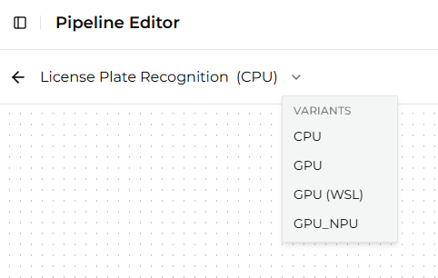

<!--
SPDX-FileCopyrightText: (C) 2026 Intel Corporation
SPDX-License-Identifier: Apache-2.0
-->

# Configuring and Running Pipelines

## Editing Pipeline Parameters

In the Pipeline Builder, you can view and configure the elements of the pipeline. For example, you can change
the *model* and *device* parameters in Object Detection and Object Classification elements.


## Running Pipelines on CPU

You can run the pipeline and save the output video using CPU-based encoding. Once the pipeline starts,
CPU utilization should visibly increase. The generated output video is then available for inspection.


## Running Pipelines on GPU

You can run the pipeline on a GPU to evaluate potential performance improvements. This requires updating the device
settings in the detection and classification components. After configuring the pipeline, run it and record
the output. During execution, GPU utilization should visibly increase.

With output saving enabled, the pipeline might not achieve maximum performance. You can then rerun the pipeline
with output saving disabled to measure the impact of I/O overhead.


## Switching Variants

If you have multiple variants of the same pipeline, you can easily switch between them to compare
performance across different configurations.
To switch variants, select the desired variant from the dropdown menu next to the pipeline name.
This allows you to quickly evaluate how different models or hardware settings affect the pipeline's
performance without needing to create separate pipelines for each configuration.



## Hybrid CPU and VDBox Media Decode

The **Media Decode** pipeline contains media-only variants, without inference,
scaling, recording, or rendering:

- **VDBox** uses `parsebin ! decodebin3 caps="video/x-raw(memory:VAMemory)"`.
	The caps require VA hardware decoding, rather than silently falling back to CPU.
	ViPPET preserves this `decodebin3` instead of replacing it with a CPU decoder.
- **CPU H264** uses `parsebin ! avdec_h264 max-threads=1`.
- **CPU H265** uses `parsebin ! avdec_h265 max-threads=1`.

Each stream runs as a separate DLSPS 2.0 instance. All variants use a queue,
`gvafpscounter starting-frame=2000`, and `fakesink sync=false async=false`.
The VDBox and CPU H264 variants default to `people.mp4`. CPU H265 requires an
uploaded HEVC recording: duplicate the predefined pipeline and select that
recording as its source before running it. Its initial `media-decode-h265.mp4`
path is a placeholder, not an automatically downloaded video.
For comparisons, use the same recording, codec, resolution, and FPS in both variants.
VDBox requires an Intel GPU with VA decode support and access to its render node
in the DLSPS container, including the render node's group permissions.

### Maximum Streams Search

Open **Density Tests > Hybrid Decode** and select a shared video. ViPPET uses
the built-in **Media Decode** pipeline automatically: VDBox with `decodebin3`,
paired with CPU H264 (`avdec_h264`) for AVC or CPU H265 (`avdec_h265`) for HEVC.
The detected video format and selected decoders appear as read-only information;
there are no pipeline or variant selectors in this test. If the required built-in
pipeline or codec-matched variant is missing, an error is shown and Run is disabled.
Other pipelines are never used as automatic fallbacks.

Select CPU core ids using the core-pinning icon; the initial selection comes
from the matched CPU variant's `cpu_pinning` definition. Changing the video restores
the matched variant's default pinning. Dialog changes apply to the CPU graph for
this run only, while VDBox remains unpinned. Configure persistent defaults in the
built-in variant's YAML definition and rebuild the backend image to apply them.

Set target FPS and iteration duration (default 30 seconds, minimum 10 seconds).
Decode-only density tests loop file inputs, require a common post-warmup measurement
window for every stream, and do not accept end-of-file average FPS as a substitute.
ViPPET searches in this order:

1. Find the maximum number of VDBox streams meeting the requested FPS floor,
	 using exponential growth followed by bisection, with no CPU decode streams.
2. Keep that VDBox count fixed and independently search the CPU stream count.
	 Every measured stream, including VDBox streams, must still meet the FPS floor.
3. Report the separate counts and their sum. If no CPU stream fits, report the
	 VDBox-only maximum with zero CPU streams. If no VDBox stream meets the floor,
	 the hybrid search fails rather than reporting an invalid maximum.

Providing an explicit fixed stream count still selects the existing mixed-density
mode. Other pipeline combinations retain the existing percentage-based search.
The two stages restart instances between measurements; the VDBox *count* is held
constant during CPU search, not the lifetime of the initial VDBox processes.

During the run, the measured-configurations table shows the VDBox/CPU stage and
stream allocation alongside the live hardware telemetry.
If the VA decoder becomes unavailable after a successful VDBox measurement,
the failed allocation narrows the search and is shown below rate without an FPS
measurement. A decoder error before any successful VDBox measurement fails the test.
The scrollable measured-configurations table shows each trial, including average
CPU utilization for its measurement window when available. Hardware telemetry
charts are shown live during the run, not stored for individual trials. After
successful completion, ViPPET highlights the best row and shows its result in
**Selected configuration** above the table.
The job status API exposes `trials` and `selected_trial`, including per-trial
stream counts, FPS, and measurement timestamps.

### CPU Pinning in the Pipeline Definition

Pinning belongs to the variant's graph, not its GStreamer launch string. Set
`cpu_pinning` alongside `nodes` and `edges` in `pipeline_graph` through the
pipeline API when creating or updating a writable variant:

```json
"cpu_pinning": [12, 13, 14, 15]
```

For predefined YAML variants, the same field is alongside `pipeline_description`:

```yaml
- name: CPU H264
	cpu_pinning: [12, 13, 14, 15]
	pipeline_description: >-
		filesrc location=/videos/input/people.mp4 ! parsebin !
		avdec_h264 max-threads=1 ! queue ! gvafpscounter starting-frame=2000 !
		fakesink name=default_output_sink sync=false async=false
```

The example core ids are hardware-specific. Use `GET /api/v1/devices` CPU topology
to select logical CPU ids available to DLSPS; do not assume ids 12-15 are LP E-cores
on another platform. Streams are assigned round-robin: eight streams on four ids
means two separate decode instances per core. Variant pinning overrides test-level
`pinned_cpu_cores` for that variant only. An empty list uses test-level pinning,
or no pinning when that is also empty. To leave VDBox unpinned while pinning CPU,
leave test-level pinning empty and set the CPU variant's `cpu_pinning` only.
Omitting the field when updating an existing variant preserves its pinning;
explicitly sending an empty list clears it.

### Demonstrating CPU Utilization Versus Stream Density

Use a performance test with the two variants to run any desired combination,
including zero streams of either variant. Disable output and metadata generation
to avoid measuring encoding, disk, or metadata overhead. Use a finite runtime
long enough for warmup and a stable measurement window.

When file output is enabled for VDBox, ViPPET selects a VA hardware encoder
compatible with the decoder's VAMemory output. This adds encoding and disk I/O
to the workload and must not be used for a decode-only density comparison.

First run VDBox alone, then keep its count fixed and increase the CPU stream
count. Observe CPU utilization in the live hardware telemetry alongside FPS and
the requested per-variant counts. Repeat with fewer VDBox streams to compare
total decode capacity against CPU headroom. Record each combination separately;
the last density-search iteration may be a deliberately overloaded configuration,
not the best configuration reported in its result. Rerun the reported counts as
a performance test to demonstrate the selected operating point.

To validate the +/-5% performance criterion against the PTL-358H reference,
use the reference hardware, input files, codecs, resolutions, frame rates, core
selection, software/driver versions, power settings, warmup, and measurement
duration. Compare both the VDBox-only and hybrid operating points and retain
CPU telemetry for each. The pipeline's frame-counter warmup and DLSPS runner's
time-based FPS warmup are distinct; match the reference measurement window.
Unit tests and a synthetic decode smoke test do not establish this performance
criterion; the referenced SharePoint presentation requires authenticated access.
