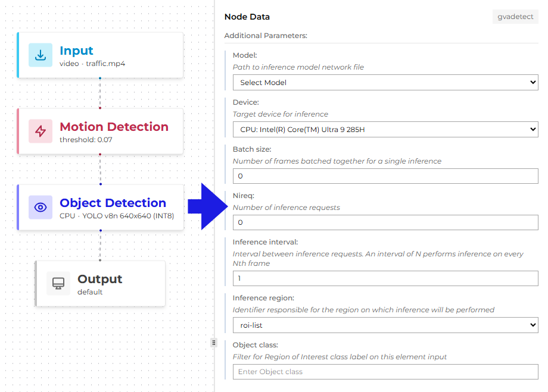
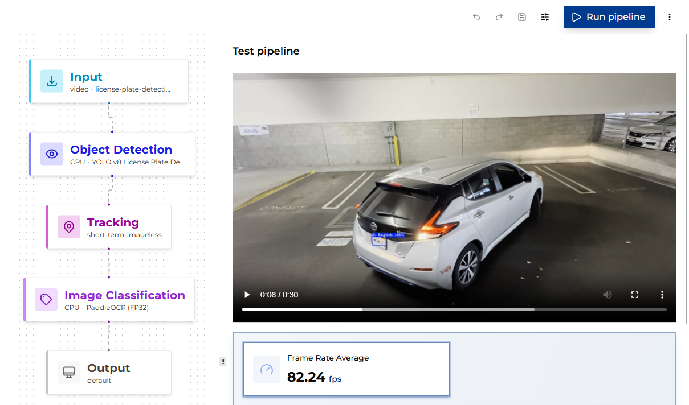
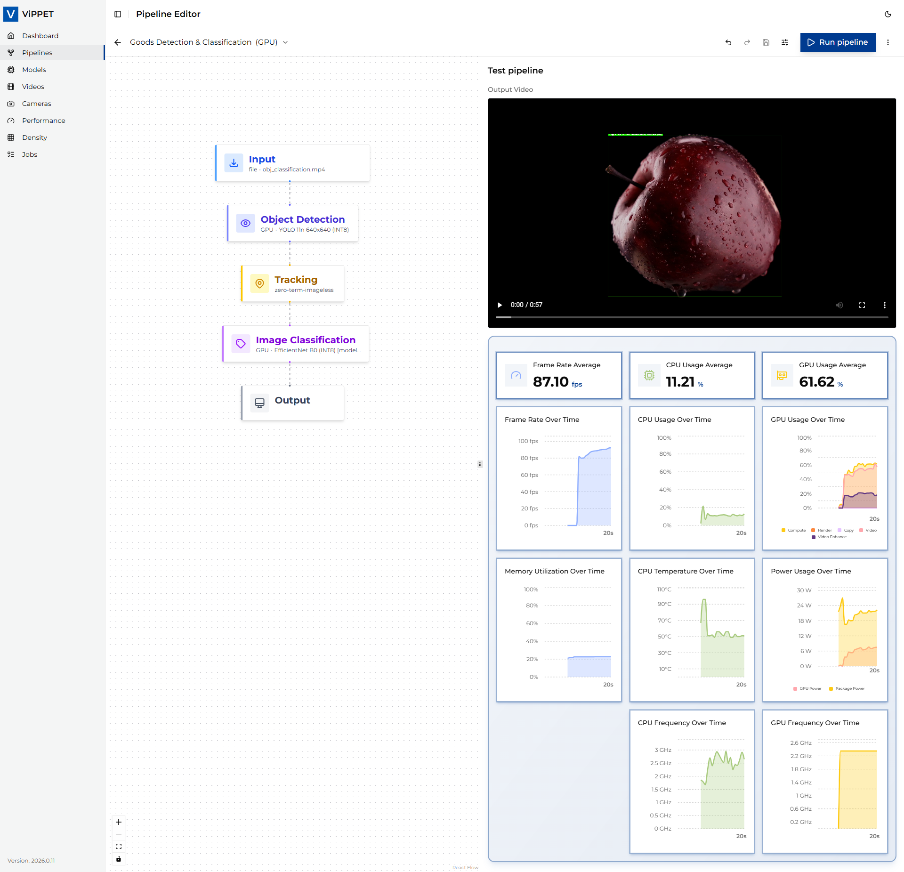

<!--
SPDX-FileCopyrightText: (C) 2026 Intel Corporation
SPDX-License-Identifier: Apache-2.0
-->

# Configuring and Running Pipelines

## Editing Pipeline Parameters

In the Pipeline Builder, you can view and configure the elements of the pipeline. For example, you can change
the *model* and *device* parameters in Object Detection and Object Classification elements.



## Running Pipelines on CPU

You can run the pipeline and save the output video using CPU-based encoding. Once the pipeline starts,
CPU utilization should visibly increase. The generated output video is then available for inspection.



## Running Pipelines on GPU

You can run the pipeline on a GPU to evaluate potential performance improvements. This requires updating the device
settings in the detection and classification components. After configuring the pipeline, run it and record
the output. During execution, GPU utilization should visibly increase.

With output saving enabled, the pipeline might not achieve maximum performance. You can then rerun the pipeline
with output saving disabled to measure the impact of I/O overhead.



## Switching Variants

If you have multiple variants of the same pipeline, you can easily switch between them to compare
performance across different configurations.
To switch variants, select the desired variant from the dropdown menu next to the pipeline name.
This allows you to quickly evaluate how different models or hardware settings affect the pipeline's
performance without needing to create separate pipelines for each configuration.


## Media Decode Pipeline

The **Media Decode** pipeline decodes video without inference, scaling, recording,
or rendering: `filesrc ! decodebin3 ! queue ! gvafpscounter starting-frame=2000 !
fakesink sync=false async=false`. Each stream runs as a separate DLSPS 2.0 instance.
**Keep pipeline output** is off by default for such pipelines, because encoding
the output would limit the measured decode throughput.

The decoder depends on the variant's CPU pinning:

- **With CPU pinning**, ViPPET keeps `decodebin3` and sets
  `caps="video/x-raw(memory:VAMemory)"`, so decoding runs on the GPU media engine
  (VDBox) and the DLSPS instance runs on the pinned cores. VDBox requires an Intel
  GPU with VA decode support and access to its render node in the DLSPS container.
  If DLSPS reports no GPU, ViPPET logs a warning and uses the default decoder,
  keeping the CPU pinning.
- **Without CPU pinning**, `decodebin3` is replaced with a decoder that matches the
  input codec, as in other pipelines.

This applies to any pipeline whose only `gva*` elements are `gvafpscounter`,
`gvametaconvert`, or `gvametapublish`. LP E-core-only pinning is allowed for such
pipelines.

### Hybrid CPU and VDBox Decode

The predefined **Decode** variant is read-only and unpinned, so it decodes on CPU.
To run CPU and VDBox decode streams side by side:

1. Open **Media Decode** and turn on **Enable advanced mode** in the pipeline options.
1. Click the CPU core pinning icon, select the cores for the VDBox streams, and
   click **Apply**.
1. In the actions menu, select **Save as new variant** and name it, for example,
   `VDBox`. The pinning is saved with the new variant.
1. On the Performance page, select **Media Decode** with the **Decode** variant and
   set its number of streams.
1. Click **+ Add Pipeline**, select **Media Decode** with the `VDBox` variant, and set
   its number of streams.
1. Click **Run performance test**.

Each stream of both variants runs as a separate DLSPS 2.0 instance. The results
report FPS for every stream, so CPU and VDBox decode throughput can be compared
in a single run. See [Performance Testing](../benchmarking/performance-testing.md)
for the remaining test options.

### CPU Pinning in the Pipeline Definition

CPU pinning set with the core-pinning icon in the pipeline editor is saved with
the variant. It is available in advanced mode only; runs started in simple mode
ignore it. Through the API, set `cpu_pinning` alongside `nodes` and `edges` in
`pipeline_graph`; for predefined YAML variants, set it alongside
`pipeline_description`:

```yaml
- name: Decode
  cpu_pinning: [12, 13, 14, 15]
  pipeline_description: >-
    filesrc location=/videos/input/people.mp4 ! decodebin3 ! queue !
    gvafpscounter starting-frame=2000 !
    fakesink name=default_output_sink sync=false async=false
```

Core ids are hardware-specific; use the CPU topology from `GET /api/v1/devices`.
Every stream runs on all listed cores.
Variant pinning overrides test-level `pinned_cpu_cores` for that variant only.
Omitting the field when updating a variant preserves its pinning; sending an
empty list clears it.
